<!--
  SPDX-License-Identifier: LicenseRef-CMSD-1.0
  Copyright (c) 2026 CyberMind — Gérald Kerma <devel@cybermind.fr>
  Source-Disclosed License — All rights reserved except as expressly granted.
  See LICENCE-CMSD-1.0.md for terms.
-->

# Se repérer dans l'administration SecuBox (bêta 1)

Ce tutoriel fait suite à [Premier Pas](PREMIER-PAS-TUTORIEL.md) : la box est installée et configurée,
il reste à prendre l'administration en main. Il se lit partie par partie ; chaque capture vient d'une
box de démonstration (`secubox-demo`, profil « modules actuels »).

SecuBox est **modulaire** : chaque fonction (pare-feu applicatif, filtrage DNS, TV Privacy, VPN,
applications…) est un module, avec sa propre page. L'administration rassemble ces modules dans un même
menu, et la page **Profils** décide lesquels tournent.

## Partie 1 — Se connecter

Ouvrez `https://<nom-de-la-box>.local/` (ou l'adresse IP de la box), saisissez `admin` et votre mot de passe.

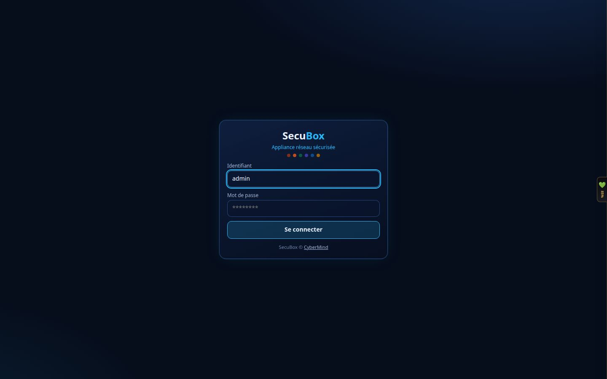

Le second facteur est obligatoire. À la toute première connexion, la box affiche un QR code à scanner avec une
application d'authentification (Aegis, FreeOTP, Google Authenticator…), puis des **codes de secours** à conserver
hors de la box : chacun ne sert qu'une fois, et ils ne sont montrés qu'à ce moment-là. Ensuite, chaque connexion
demande le code à 6 chiffres de l'application.

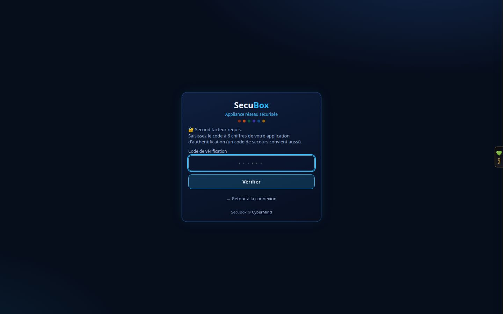

> Le code dépend de l'heure. Si la box refuse un code juste, vérifiez que son horloge est à l'heure
> (Partie 6, « Santé »).

## Partie 2 — Le tableau de bord

Premier écran après la connexion : l'état de la box d'un coup d'œil.

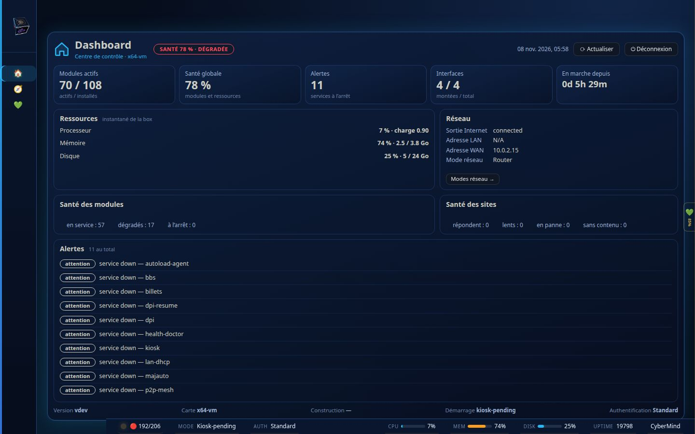

- **En haut**, l'état de santé global (pastille verte, orange ou rouge), puis cinq compteurs : modules actifs,
  santé globale, alertes, interfaces réseau, temps depuis le démarrage.
- **Ressources** : processeur, mémoire et disque à l'instant présent.
- **Réseau** : sortie Internet, adresses, mode réseau ; « Modes réseau » ouvre le réglage.
- **Alertes** : les services arrêtés ou en difficulté. Sur une box neuve, certains services optionnels sont
  à l'arrêt tant que vous ne les utilisez pas : c'est normal, la box n'allume que ce qui sert.
- **La barre du bas**, présente sur toutes les pages : santé, mode, authentification, CPU, mémoire, disque et
  temps de fonctionnement.

## Partie 3 — Le menu : rail, catégories, recherche

À gauche, un **rail** d'icônes reste toujours visible. Passez la souris dessus, ou touchez-le sur un écran
tactile, pour le déplier.

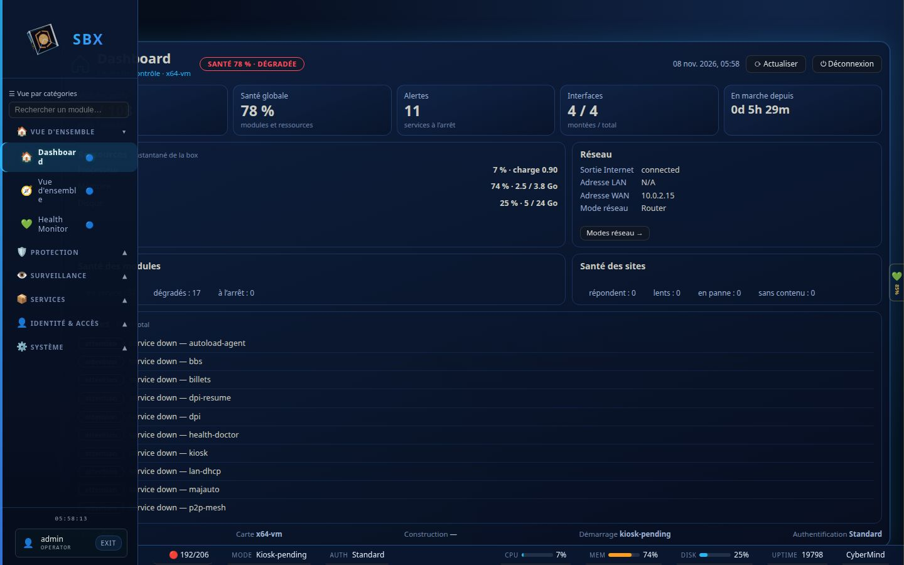

Le menu déplié contient :

1. **La recherche** (« Rechercher un module… ») ;
2. **Les catégories**, chacune repliable :

| Catégorie | Exemples |
|---|---|
| **Vue d'ensemble** | Tableau de bord, vue d'ensemble, Health Monitor |
| **Protection** | WAF, pare-feu, DNS Guard, Ad Guard, TV Privacy, filtrage de contenus, WireGuard, Tor |
| **Surveillance** | Analyse du trafic, menaces, courbes |
| **Services** | Les applications hébergées : médias, photos, vidéos, podcasts… |
| **Identité & accès** | Comptes, portail, accès |
| **Système** | Réglages de la box : DNS, métriques, mises à jour… |

Le contenu exact dépend des modules installés sur votre box.

3. **Votre compte** en bas, avec le bouton **EXIT** pour se déconnecter.

Cliquez une catégorie pour l'ouvrir ou la refermer :

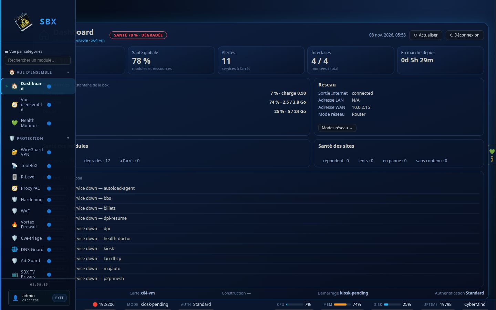

La pastille à droite de chaque module donne son état. Le plus rapide reste la **recherche** : tapez
quelques lettres (« dns », « waf », « tv »), le menu ne garde que les modules qui correspondent.

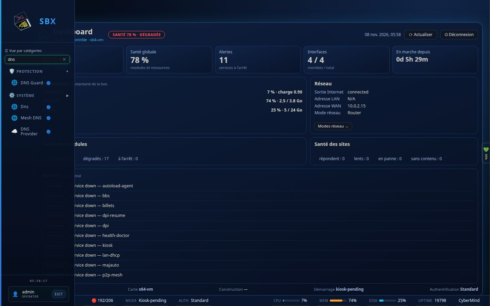

### Deux façons de ranger le menu

Le lien en haut du menu bascule entre deux vues :

- **Vue par catégories** (par défaut) : rangée par usage, comme ci-dessus ;
- **Vue par espaces** : rangée par couche technique de la box, `AUTH` (identités), `WALL` (protection),
  `BOOT` (démarrage et déploiement), `MIND` (analyse) et `ROOT` (système).

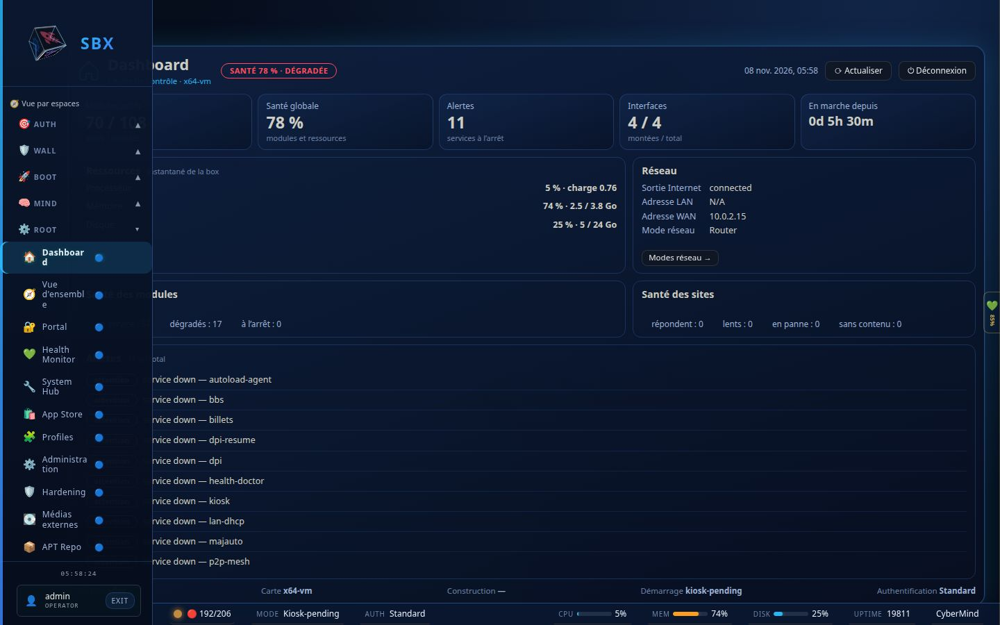

Les deux vues mènent aux mêmes pages : choisissez celle qui vous parle.

## Partie 4 — La page d'un module

Toutes les pages de module suivent le même plan :

- **l'en-tête** : nom du module, pastille d'état (« EN LIGNE », « ACTIF »…), boutons d'action à droite
  (Actualiser, Réglages…) ;
- **des compteurs** : les chiffres clés du module ;
- **des onglets** pour les différentes vues (vue d'ensemble, équipements, historique, configuration…).

Exemple : **SBX TV Privacy**, qui retire les publicités et le pistage des télévisions connectées. Le bouton
« Ça ne marche plus ? Je débloque » rétablit une application en un clic si un blocage la gêne.

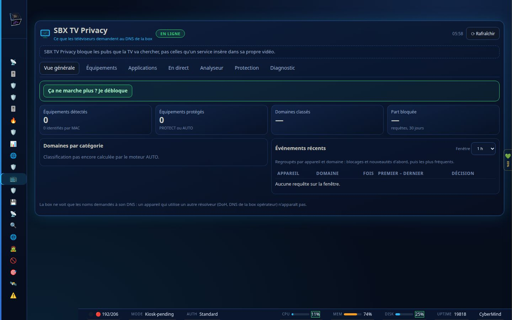

Exemple : le **pare-feu applicatif (WAF)**, qui inspecte tout le trafic web vers la box.

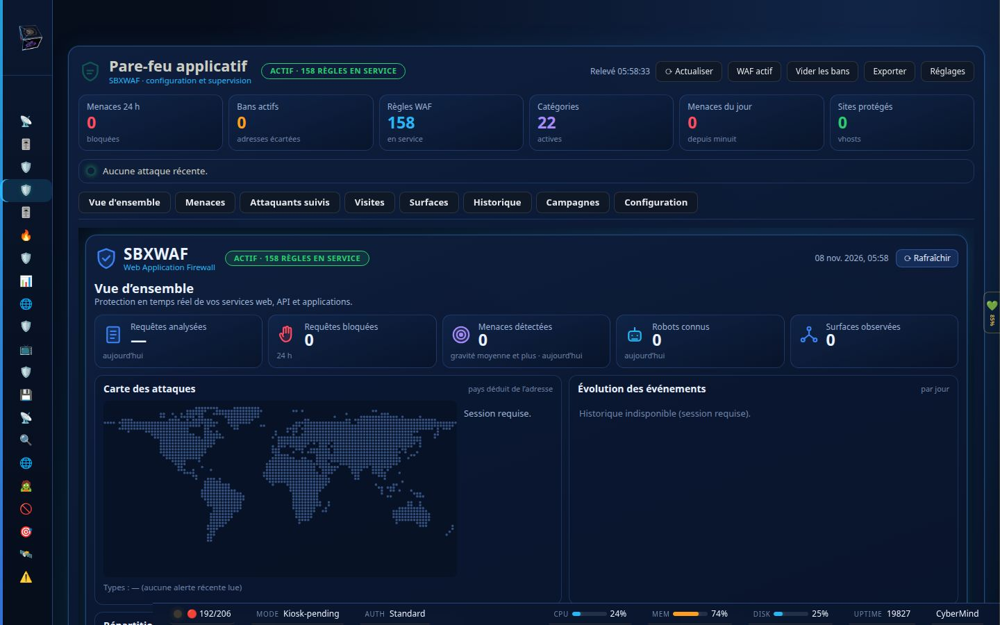

## Partie 5 — La modularité : Profils et App Store

### Profils : choisir ce qui tourne

La page **Profiles** (tapez « profil » dans la recherche du menu, ou espace `ROOT` dans la vue par espaces) dresse l'inventaire de tous les modules installés : actifs, arrêtés, mémoire utilisée,
exposition. Un **profil** est un ensemble de modules adapté à un usage (Lite, Media Lab, Mobile, Minimal…),
le même choix qu'à l'étape « Services » de Premier Pas.

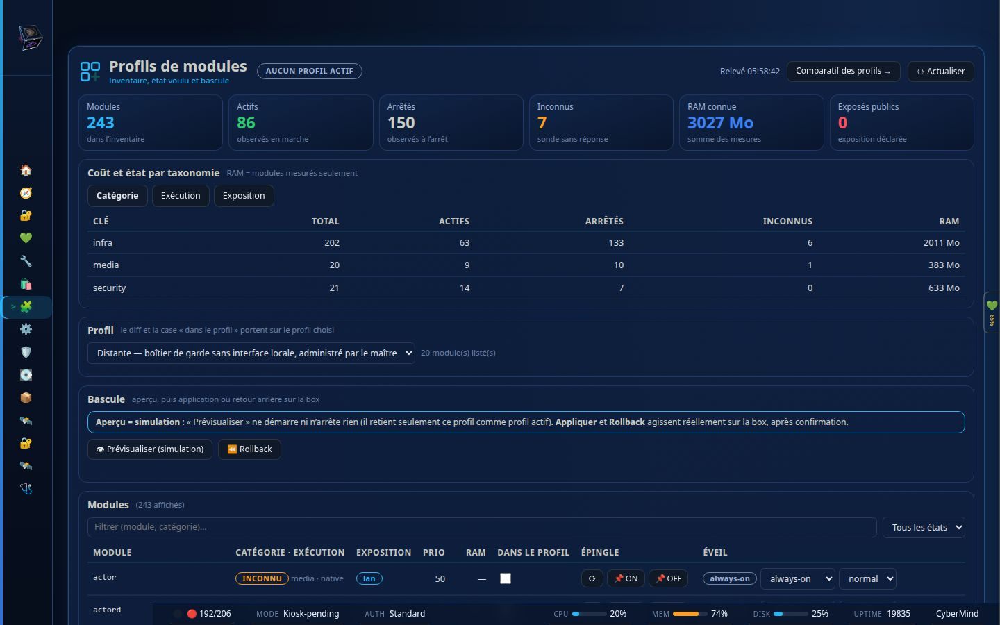

Pour changer de profil sans risque :

1. choisissez le profil dans la liste ;
2. **Prévisualiser (simulation)** montre ce qui démarrerait et s'arrêterait, sans rien toucher ;
3. **Appliquer** fait la bascule, après confirmation ;
4. **Rollback** revient à l'état précédent si quelque chose ne va pas.

En bas de la page, le tableau des modules permet de régler chacun : **épingler** un module (toujours allumé
ou toujours éteint, quel que soit le profil) et choisir son **éveil** (`always-on`, ou réveillé à la demande).
Un module réveillé à la demande ne consomme rien tant qu'on ne s'en sert pas : c'est ce qui garde la box légère.

### App Store : ajouter des fonctions

La page **App Store** (recherche « app store », espace `ROOT`) présente les modules par catégorie (sécurité, réseau, médias, publication…), avec
ceux déjà installés et ceux disponibles. Installer un module l'ajoute au menu ; il apparaît alors dans
la catégorie correspondante.

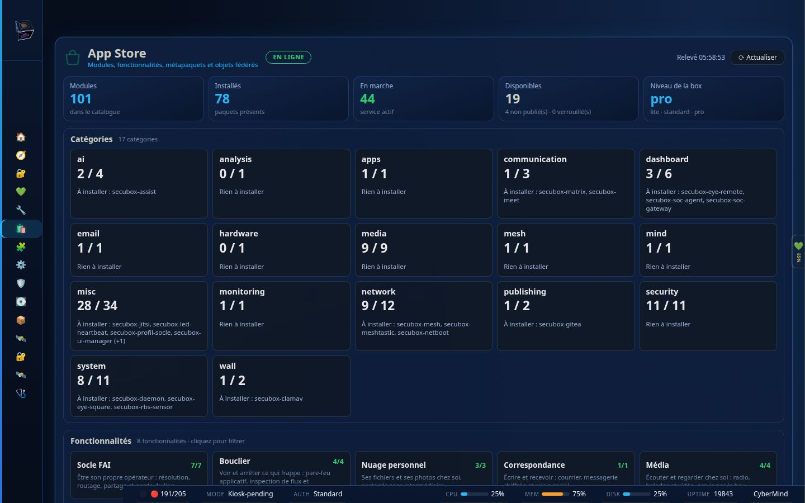

## Partie 6 — Surveiller : Santé et Vue d'ensemble

**Health Monitor** (catégorie Vue d'ensemble) liste chaque service : en bonne santé, en veille, dégradé ou en panne.
C'est ici qu'on cherche pourquoi une pastille n'est pas verte.

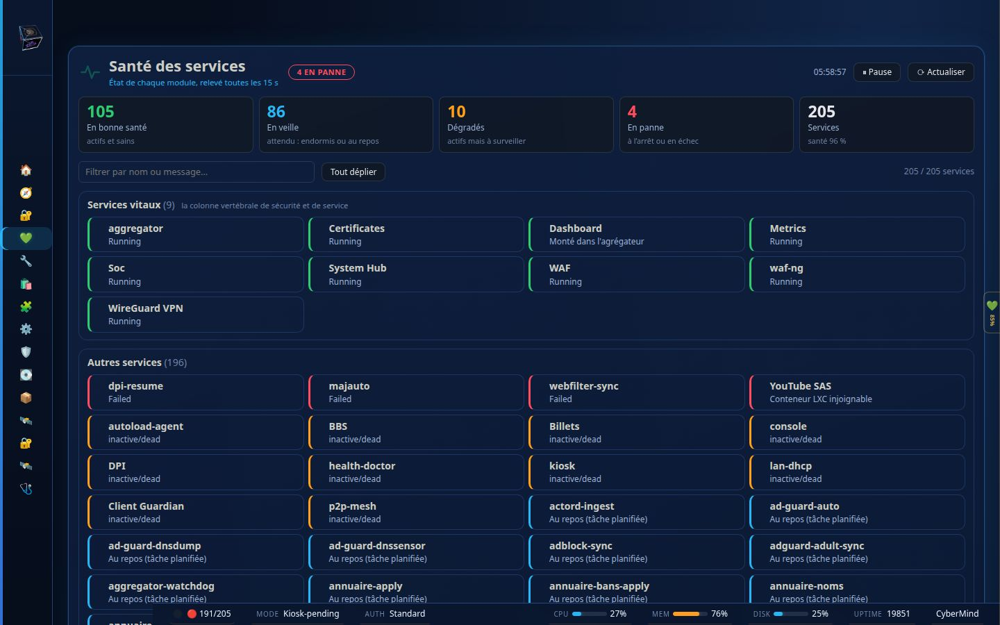

La page **Vue d'ensemble** (même catégorie) résume la box par espace (Protection, Surveillance, Services…), avec
le nombre de services actifs dans chacun, les ressources et les alertes récentes.

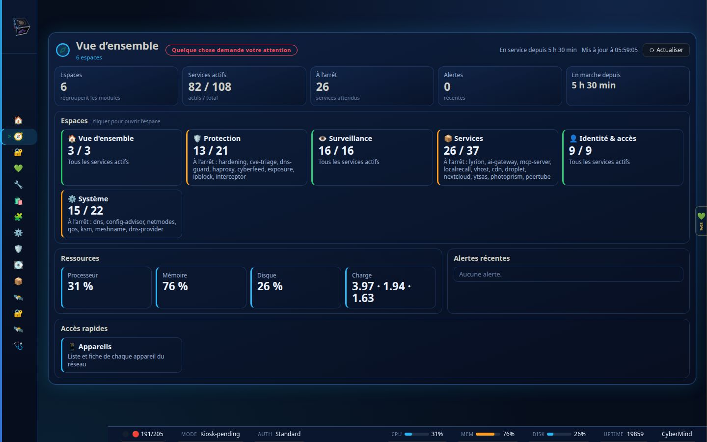

## Pour aller plus loin

- [Premier Pas, pas à pas](PREMIER-PAS-TUTORIEL.md)
- [Wiki SecuBox](https://github.com/CyberMind-FR/secubox-deb/wiki) : chaque module y a sa page
- [Signaler un problème](https://github.com/CyberMind-FR/secubox-deb/issues)
