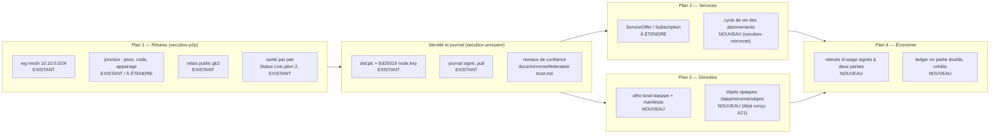
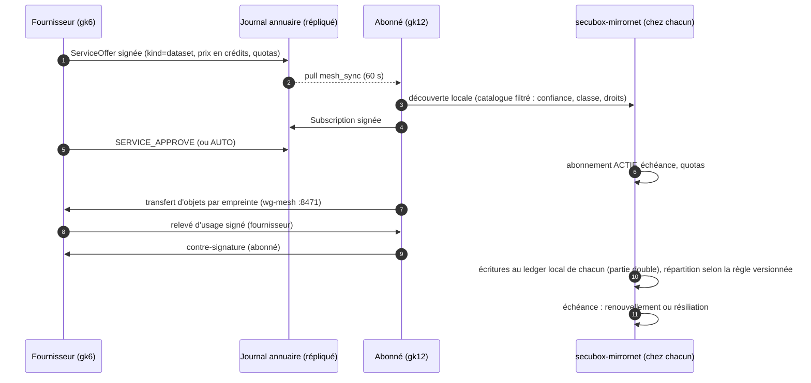

<!--
  SPDX-License-Identifier: LicenseRef-CMSD-1.0
  Copyright (c) 2026 CyberMind — Gérald Kerma <devel@cybermind.fr>
  Source-Disclosed License — All rights reserved except as expressly granted.
  See LICENCE-CMSD-1.0.md for terms.
-->

# MirrorNet v1 — Architecture d'ensemble

Issue #3643 (phase 1) · 2026-11-10 · **CONCEPTION** : rien de ce document n'est implémenté, sauf ce qui est marqué
EXISTANT. Fondé sur `docs/MIRRORNET_AUDIT.md` (#3641) et sur les arbitrages ci-dessous.

Marquage : **EXISTANT** (code de `master`, référencé) · **À ÉTENDRE** (existant modifié) · **NOUVEAU** (proposition).

Documents de la phase 1 :

| Document | Plan |
|---|---|
| `MIRRORNET_ARCHITECTURE.md` (ce document) | vue d'ensemble, découpage, invariants, jalons |
| `MIRRORNET_NETWORK.md` | plan 1 — réseau, identité, découverte, santé |
| `MIRRORNET_SERVICE_EXCHANGE.md` | plan 2 — catalogue de services, cycle de vie des abonnements |
| `MIRRORNET_DATA_EXCHANGE.md` | plan 3 — jeux de données, classes d'accès, synchronisation |
| `MIRRORNET_ECONOMY.md` | plan 4 — mesure d'usage, crédits, ledger, répartition |
| `MIRRORNET_SECURITY.md` | transversal — identités, confiance, menaces |

Ils **prolongent** la conception Alpha 21 de `docs/mirrornet/` (#3429 : hébergement distribué, réplication,
bascule, répartition de charge, confiance fédérée, défense collective), qui reste valable et n'est pas répétée.

## 1. Arbitrages

**2026-11-10 (audit #3641, validés par le propriétaire)**

1. API sous `/api/v1/mirrornet/` (`/api/v1/mirror/` est le miroir APT, `secubox-cdn/composants/mirror/api/main.py:29`).
2. Un seul paquet neuf, `secubox-mirrornet` ; le reste étend `secubox-annuaire` et `secubox-p2p`. Les 13 « modules »
   du prompt maître sont des **frontières logiques** (sous-modules Python), pas des paquets.
3. Économie v1 = **crédits internes sans valeur monétaire**. Aucun règlement en argent réel avant avis juridique et
   fiscal ; les enregistrements de règlement existent, aucun virement n'est jamais déclenché par le code.
4. Ordre : abonnements → jeux de données → mesure d'usage → ledger → tableau de bord ; multi-saut, traversée de NAT
   et élection seulement sur besoin constaté.
5. `secubox-daemon` (squelette Go, ZKP factice) : retiré ou marqué expérimental, jamais une dépendance.
6. Gardes manquantes de `secubox-mesh` (802.11s) : corrigées hors MirrorNet.

**2026-11-03 (#3429, rappel)** — chaque module reste maître de ses services ; `secubox-mirrornet` est le plan de
contrôle (manifestes `mirrornet.d`, objets opaques, routes sbxwaf) ; `ConfigBlob` par version ; pas d'élection ;
un seul écrivain par contenu ; secrets jamais répliqués ; gk2 seule entrée Internet (`docs/mirrornet/architecture.md` § 0).

## 2. Les quatre plans

| Plan | Porté par | Ce que v1 livre | Détail |
|---|---|---|---|
| 1 Réseau | `secubox-p2p` (EXISTANT, À ÉTENDRE) | étoile wg-mesh + liens directs, appairage, apparition/disparition au relais, santé par pair | `MIRRORNET_NETWORK.md` |
| Identité | `secubox-annuaire` (EXISTANT) | did, journal signé, niveaux de confiance calculés | `MIRRORNET_SECURITY.md` |
| 2 Services | annuaire (offres, À ÉTENDRE) + `secubox-mirrornet` (cycle de vie, NOUVEAU) | catalogue fédéré par le journal, abonnements avec échéance, grâce, révocation | `MIRRORNET_SERVICE_EXCHANGE.md` |
| 3 Données | annuaire (manifestes) + `secubox-mirrornet` (objets, cache) | jeux de données versionnés, classes d'accès, transfert vérifié | `MIRRORNET_DATA_EXCHANGE.md` |
| 4 Économie | `secubox-mirrornet` (NOUVEAU) | relevés d'usage, ledger local, répartition configurable, crédits | `MIRRORNET_ECONOMY.md` |

## 3. Découpage logiciel

| Frontière logique (prompt) | Où elle vit | Nature |
|---|---|---|
| mirror-network, mirror-peer-manager | `secubox-p2p` (`api/mesh.py`, `api/main.py` master-link, `sbin/secubox-relais-maillage`) | EXISTANT, À ÉTENDRE |
| mirror-discovery | annuaire (`mesh_sync.py`, `NodeRecord`), p2p (mDNS, appairage) | EXISTANT |
| mirror-mesh-router | aucun en v1 (étoile + liens directs) ; voir `MIRRORNET_NETWORK.md` § 6 | REPORTÉ |
| mirror-catalog, mirror-service-registry | annuaire (`ServiceOffer` étendu) + `secubox_mirrornet/catalogue.py` (index local) | À ÉTENDRE + NOUVEAU |
| mirror-data-exchange | `secubox_mirrornet/donnees.py` + objets (`docs/mirrornet/replication.md`) | NOUVEAU |
| mirror-subscriptions | `secubox_mirrornet/abonnements.py` | NOUVEAU |
| mirror-metering | `secubox_mirrornet/mesure.py` | NOUVEAU |
| mirror-ledger, mirror-economy | `secubox_mirrornet/ledger.py`, `repartition.py` | NOUVEAU |
| mirror-provider | adaptateurs des modules (`mirrornet.d/<module>.toml`, `docs/mirrornet/architecture.md` § 0) | NOUVEAU (déjà conçu) |
| mirror-dashboard | `secubox-mirrornet/www/mirrornet/` + onglet Flotte | NOUVEAU |

`secubox-mirrornet` (rappel `docs/mirrornet/architecture.md` § 7, complété) :

| Élément | Valeur |
|---|---|
| Service | FastAPI, `/run/secubox/mirrornet.sock` (0660, groupe `secubox`), `root_path=/api/v1/mirrornet` |
| Compte | `secubox-mirrornet` (jamais root), AppArmor enforce, socle § 10 |
| Base | SQLite WAL `/var/lib/secubox-mirrornet/mirrornet.db` (abonnements, relevés, ledger) — schéma en phase 2 |
| Objets | `/data/mirrornet/objets/<blake2b>` (opaques, jamais extraits) |
| Écoute maillée | nginx sur l'IP wg-mesh (`:8471`, conçu A21), réservé aux pairs enrôlés |
| ctl root | `mirrornetctl`, verbes exacts (routes sbxwaf, vhosts) ; rien de l'économie n'est root |
| Configuration | `/etc/secubox/mirrornet.toml` (0640) ; règles de répartition dans la base, versionnées |
| Minuteries | synchronisation 60 s, sondes 10 s (A21), clôture de période d'usage (horaire), échéances d'abonnement (horaire) |

## 4. Invariants

1. **Fédération de nœuds souverains** : aucun nœud ne décide pour un autre ; un geste distant est relayé et décidé par
   le ctl de la box cible (vision « remote controller »).
2. **Pas de place de marché centrale** : le catalogue est le journal répliqué ; chaque nœud filtre et décide localement.
3. **Rien n'est cru sur parole** : toute offre, tout manifeste, tout relevé d'usage est signé par son auteur (did),
   vérifié à réception, et rejeté s'il est rejoué (`MIRRORNET_SECURITY.md`).
4. **Le ledger d'un nœud est privé** : il n'est jamais exporté ; seuls les relevés d'usage signés circulent, entre les
   deux parties concernées.
5. **Aucune donnée personnelle redistribuée** sans base légale ; la classe PRIVATE ne quitte jamais son fournisseur.
6. **Aucune statistique inventée** : tableau de bord alimenté par des valeurs mesurées ou « — ».
7. **Rien ne casse l'existant** : chaque extension de l'annuaire est rétrocompatible (champs facultatifs, nouveaux
   `kind`, nouveaux `Op`), chaque migration a son retour arrière (`MIRRORNET_SECURITY.md` § 9).

## 5. Flux de bout en bout

## 6. Jalons

| Jalon | Contenu | Phase du prompt | Validation |
|---|---|---|---|
| J0 | audit | 0 | fait (#3641) |
| J1 | documents d'architecture (ce lot) | 1 | propriétaire |
| J2 | schéma de données, squelette `secubox-mirrornet` (santé, lecture seule) | 2 | tests + relecture sécurité |
| J3 | socle A21 déjà planifié (`docs/mirrornet/plan-alpha21.md`) et cycle de vie des abonnements | 3-4 | 3 nœuds |
| J4 | jeux de données (manifeste, objets, classes) | 4 | 3 nœuds |
| J5 | relevés d'usage signés à deux parties | 5 | tests de fraude |
| J6 | ledger, répartition, crédits | 5 | tests de propriétés (Σ = 0) |
| J7 | tableau de bord | 6 | données réelles seulement |
| J8 | validation MOCHAbin, x86_64, Raspberry Pi, 3 nœuds | 7 | banc gk4/gk5/gk6/gk12 + gk2 |

## 7. Ce que v1 ne fait pas

Pas d'argent réel, pas de cryptomonnaie ni de chaîne de blocs, pas de place de marché centrale, pas de routage
multi-saut ni de traversée de NAT, pas d'élection de maître, pas de second nœud exposé à Internet, pas de redistribution
de données personnelles, pas de partage du ledger, pas de réputation à effet (A22, `docs/mirrornet/node-reputation.md`).
