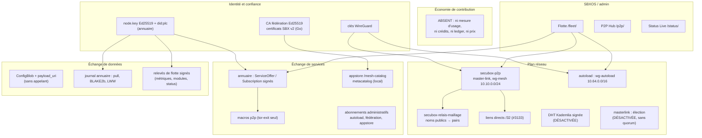
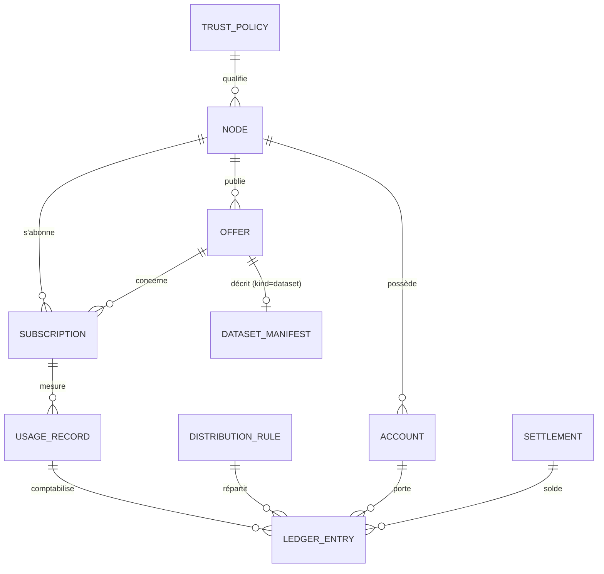

<!--
  SPDX-License-Identifier: LicenseRef-CMSD-1.0
  Copyright (c) 2026 CyberMind — Gérald Kerma <devel@cybermind.fr>
  Source-Disclosed License — All rights reserved except as expressly granted.
  See LICENCE-CMSD-1.0.md for terms.
-->

# MirrorNet v1 — Audit de l'existant (phase 0)

Issue #3641 · 2026-11-10 · base `master` du jour (après #3637), plus la PR #3640 (autojoin, relais automatique)
signalée là où elle change le constat. **Aucun code de production n'est modifié par cette phase.**

Statuts employés : **EXISTANT** (dans le code et en service) · **PARTIEL** (dans le code, avec une limite qui compte) ·
**DÉSACTIVÉ** (dans le code, éteint par défaut) · **DOCUMENTÉ** (seulement dans `docs/`) · **ABSENT** (cherché, non trouvé).
« Vu en production » = relevé sur gk2 le 2026-11-10 ; le reste vient du dépôt.

Cet audit **complète** sans le refaire `docs/audit/mirrornet-infrastructure-audit.md` (#3429, 2026-11-03 : confiance
fédérée, réputation, élection, répartition de charge) et ses deux audits sources (`ddos-defense-audit.md`,
`distributed-hosting-audit.md`). Il ajoute ce que le prompt maître demande en plus : **échange de services, échange de
données, économie de contribution**. Une correction à l'audit du 3 novembre : threatmesh n'a plus de partage non
signé sur TCP 8780 — retiré en 1.2.0 (#3450), pas encore déployé.

---

## 1. Carte de l'existant

## 2. Plan réseau (P2P, maillage, WireGuard)

### 2.1 Interfaces WireGuard

| Interface | Plage / port | Créée par | Rôle | Statut |
|---|---|---|---|---|
| `wg-mesh` | 10.10.0.0/24, UDP 51822 | `secubox-p2p/scripts/sbx-mesh-up` (`.path` root) | maillage MirrorNet | EXISTANT — 8 pairs sur gk2, 5 actifs (gk1, gk3, gk5, gk6, gk12) |
| `wg-autoload` | 10.64.0.0/16, UDP 51830 | `autoloadctl tunnel-sync` (hub) / agent | provisionnement en étoile | EXISTANT — 2 pairs, aucun actif |
| `wg-ephemeral` | 10.11.0.0/24, UDP 51825 | `secubox-p2pctl` | accès temporaires | EXISTANT — 0 pair |
| `wg-toolbox` | 10.99.0.0/24 | secubox-toolbox | clients de la toolbox | EXISTANT — 597 pairs déclarés, aucun actif |
| `wg-admin` | 10.98.0.1/24, UDP 51821 | `scripts/setup-admin-tunnel.sh` (hors paquet) | tunnel d'administration | PARTIEL (hors paquet) |
| `wg0` | clients 10.66.0.0/24, UDP 51820 | `secubox-wireguard/sbin/wgctl` | VPN utilisateur | EXISTANT |

### 2.2 Topologie et routage

- **Étoile autour du maître** : un pair ordinaire reçoit `AllowedIPs = 10.10.0.0/24` (`secubox-p2p/api/mesh.py:184`) ;
  le trafic pair-à-pair transite par gk2. Liens directs `/32` entre pairs après poignée de main (#3133,
  `api/pairs_directs.py`, `sbin/secubox-maillage-pairs`) : EXISTANT.
- **Multi-saut dynamique : ABSENT.** `babeld` et `batman-adv` n'existent que dans `annuaire/mirrornet/schema.py`
  (schéma, non branché). `secubox-daemon` (Go, `daemon/`) annonce mDNS/WireGuard/ZKP sur 10.42.0.0/16 mais c'est un
  **squelette** : `internal/topology/topology.go:234` « TODO: Implement actual routing », `internal/control/server.go:299`
  `"zkp_valid": true, // TODO: implement`.
- **Traversée de NAT : ABSENT** (ni STUN, ni hole punching, ni UPnP). Le modèle tient par `PersistentKeepalive = 25`,
  un maître joignable (redirection Freebox) et des satellites sans endpoint.
- **Relais public** : `secubox-relais-maillage` publie `<service>.<box>.secubox.in` vers l'IP maillée du pair
  (HAProxy → sbxwaf → pair:9080, joker DNS-01) — EXISTANT. Avec la PR #3640 : `admin.<box>` d'un pair sans webos,
  retrait des noms d'un pair muet depuis 72 h, synchronisation dès une jonction.

### 2.3 Découverte et identité

| Mécanisme | Où | Statut |
|---|---|---|
| Jonction par jeton (64 hex, usage unique, empreinte SHA-256 stockée) | `secubox-p2p/api/jetons.py`, `sbx-mesh-invite`, `sbx-mesh-join` | EXISTANT |
| Code `sbxmesh1.<b64>.<somme>` + `secubox-automesh` | `api/automesh.py` | EXISTANT |
| Ancre du maître (une box retient qui l'a flashée) | `sbx-mesh-ancre`, `/etc/secubox/p2p/ancre-maitre.json` | EXISTANT |
| Autojoin derrière un maître, pair « à valider » | PR #3640 | EN PR |
| mDNS `_secubox._tcp` (avahi) | `secubox-p2p/api/main.py:531`, `secubox-annuaire-noms` | EXISTANT (LAN) |
| DHT Kademlia signée, UDP 51823 | `secubox-p2p/api/dht.py` | DÉSACTIVÉ |
| Fiches signées `NodeRecord` + journal tiré depuis `:8799` | `secubox-annuaire` | EXISTANT |
| Gossip en poussée | — | ABSENT |
| Identité de nœud : Ed25519 `node.key` + `did:plc` | `/etc/secubox/secrets/annuaire/node.key` | EXISTANT, **c'est l'identité à réutiliser** |
| Certificats SBX v2 de la fédération (sujet = did) | `secubox-federation` (Go) | EXISTANT dans le code, déploiement non vérifié (`~bookworm1`) |
| Élection d'un maître (masterlink) | `secubox-p2p/api/masterlink.py` | DÉSACTIVÉ ; sans quorum, battement non signé accepté |

## 3. Échange de services

| Brique | Où | Ce qu'elle fait | Statut |
|---|---|---|---|
| `ServiceOffer` / `Subscription` signés | `secubox-annuaire/annuaire/model.py:453,485`, routes `/service/offer`, `/service/{id}/subscribe`, `/subscription/{id}/approve` | offre d'un nœud, abonnement auto-certifié, approbation AUTO ou PENDING | EXISTANT |
| Offres réelles publiées | `annuaire/offres.py`, `secubox-annuaire-offres.timer` | onions Tor, cartes du Hall, dépôt apt | EXISTANT |
| Activation par macro | `secubox-p2p/api/macro_grant.py`, `secubox-macroctl` (secubox-tor) | une seule macro installée : `tor-exit` (`MACRO_KINDS` en annonce 4) | PARTIEL |
| Catalogue maillé côté boutique | `secubox-appstore` `GET /mesh-catalog`, installation à distance (`api/remote.py`) | lit les offres de l'annuaire ; la box cible accepte | EXISTANT |
| Catalogue local des services | `secubox-appstore/composants/metacatalog` | services installés, **non fédéré** | EXISTANT (local) |
| Catalogue d'objets `.sbx` fédéré | `secubox-federation` `/api/appstore/catalog` | niveaux community / standard / pro / premium | EXISTANT dans le code |
| Droit d'installer selon l'abonnement | `secubox-appstore/api/abonnement.py` ← `/etc/secubox/abonnement.json` (écrit par `secubox-pilotagectl`) | fermé par défaut | EXISTANT |
| Abonnements par box, formules, droits du maillage | `secubox-autoload` (#3303, #3305) | statut, échéance, 5 jours de grâce — « Aucune facturation, aucun prix » (README:62) | EXISTANT |
| Surveillance de disponibilité d'un fournisseur | Status Live jalon 2 (relevés signés des pairs), sondes p2p | par box, pas par offre | PARTIEL |
| Renouvellement / révocation d'un abonnement de service | annuaire (`reject`), autoload (échéance) | pas de cycle de vie commun | PARTIEL |
| Déploiement d'un service chez l'abonné | appstore remote install, pilotage TR-369 | l'abonné reste décideur | EXISTANT |

## 4. Échange de données

| Besoin du prompt | Existant | Statut |
|---|---|---|
| Publication d'un jeu de données | `ConfigBlob` versionné de l'annuaire ; `payload_uri` **sans aucun appelant** | PARTIEL (enveloppe seule) |
| Catalogue de jeux de données, schéma, licence, provenance, qualité, fraîcheur | — | ABSENT |
| Synchronisation | journal de l'annuaire en tirage, chaîné BLAKE2b, dernier écrivain gagne (`annuaire/mesh_sync.py`) | EXISTANT pour les objets de l'annuaire |
| Transfert vérifié d'objets opaques, cache distribué | `docs/mirrornet/replication.md`, `architecture.md` (`/data/mirrornet/objets`) | DOCUMENTÉ |
| Données de flotte (métriques, modules, état) | `MetricSnapshot`, `ModulesSnapshot`, `StatusSnapshot` signés | EXISTANT — premier vrai « flux de données » maillé |
| Bans partagés signés | `BanRecord` de l'annuaire | EXISTANT ; partage threatmesh retiré (#3450) |
| Classes PUBLIC / COMMUNITY / SPECIALIZED / PROFESSIONAL / PRIVATE | droits du maillage (#3305) filtrent les offres par pair | ABSENT comme modèle de classification |
| Mesure d'usage des données | — | ABSENT |

## 5. Économie de contribution

**ABSENT, dans le code comme dans `docs/mirrornet/`.** Aucune mesure d'usage, aucun crédit, aucun ledger d'échange,
aucun prix, aucune répartition. Seules traces : la maquette `secubox-auth/composants/sbxid/acces/www/acces/maquette.html:481`
(Free 0 €, Premium 4 €/mois, Association — maquette, non branchée) et `docs/dossiers/provisionnement-auto-load.md:14`
(« La facturation est hors périmètre »). Le plan est donc **entièrement neuf** ; il peut s'appuyer sur :
l'identité signée des nœuds (annuaire), les abonnements existants (offres, autoload, fédération), les relevés signés
(Status Live jalon 2, anti-rejeu persistant) et l'audit append-only (`/var/log/secubox/audit.log`).

## 6. Interfaces SBXOS / administration

| Page | Paquet | Utile à MirrorNet |
|---|---|---|
| Flotte `/fleet/` | secubox-annuaire | pairs wg-mesh, Oublier, (PR #3640) Valider, autoload, pilotage — **point d'entrée naturel** |
| P2P Hub `/p2p/` | secubox-p2p | état du maillage, services |
| `/master-link/` | secubox-p2p | jonction (sans entrée de menu) |
| Annuaire `/annuaire/`, Centres `/centers/` | secubox-annuaire | journal, offres |
| Status Live `/status/` | secubox-status | santé par box, relevés signés des pairs |
| App Store, boutique, Service Catalog | secubox-appstore | catalogue maillé, catalogue local |
| `netmodes/maillage.html` | secubox-netmodes | liens du maillage |

Aucune page « MirrorNet » unique ; le jeu de jetons et cartes Aurora (`.claude/AURORA-REFERENCE.md`) et la coque
vue maître du Hall (#2996) fournissent l'identité visuelle demandée (fond marine, accents cyan, cartes).

## 7. Paquets à ne pas confondre

| Nom | Réalité | Conséquence |
|---|---|---|
| `secubox-mirror` | composant **miroir APT** de secubox-cdn, `root_path=/api/v1/mirror` | **le préfixe `/api/v1/mirror/` du prompt est déjà pris** → proposer `/api/v1/mirrornet/` |
| `secubox-mesh` | radio 802.11s / Passpoint (MOCHAbin), pas wg-mesh | hors périmètre ; ses routes n'ont **aucune garde** (`secubox_mesh/api.py:38-73`) — sans route nginx trouvée, à corriger quand même |
| `secubox-mesh-bt` | squelette (CLAUDE.md seul, trou matériel BLE) | hors périmètre |
| `secubox-meshname`, `secubox-metacatalog`, `secubox-master-link`, `secubox-identity`, `secubox-zkp` | absorbés ou retirés (voir l'inventaire) | ne pas les ressusciter |
| `secubox-daemon` | squelette Go, ZKP factice | ne pas s'appuyer dessus ; le retirer ou le marquer expérimental |

## 8. Composants manquants (par plan)

| Plan | Manque | Priorité |
|---|---|---|
| Réseau | traversée de NAT (au moins un relais de secours par le maître, ce qui existe de fait), routage multi-saut, élection avec quorum, signature du battement masterlink | moyenne — l'étoile suffit à 10 nœuds |
| Réseau | supervision par pair unifiée (Status Live jalon 2 la couvre en partie) | basse |
| Services | cycle de vie unique d'un abonnement (découverte → révocation), état hors ligne et période de grâce **par offre**, disponibilité par offre | **haute** |
| Données | catalogue de jeux de données (schéma, licence, provenance, fraîcheur, classe d'accès), transfert d'objets opaques vérifiés, cache | **haute** |
| Économie | relevés d'usage signés, ledger en partie double immuable, règles de répartition configurables, crédits, règlements séparés, litiges | haute, **après** la mesure d'usage |
| Interface | tableau de bord MirrorNet (réseau, offres, abonnements, contributions) | après les API |

## 9. Opportunités d'intégration (réutiliser plutôt que créer)

1. **Identité** : `node.key` Ed25519 + `did:plc` de l'annuaire comme identité unique de nœud pour tout objet MirrorNet
   (offres, jeux de données, relevés d'usage, écritures de ledger). Pas de nouvelle PKI.
2. **Offres et abonnements** : étendre `ServiceOffer` / `Subscription` (déjà signés, journalisés, approuvables) plutôt
   qu'un nouveau registre ; un jeu de données = une offre de `kind = "dataset"`.
3. **Relevés signés** : le patron de Status Live jalon 2 (signature, nom lié à la fiche, anti-rejeu par numéro de
   séquence persistant) est exactement celui qu'il faut pour les **relevés d'usage**.
4. **Transport** : wg-mesh + écouteur maillé de l'annuaire (`:8799`, gardes `lecture_ou_pair`) ; aucun nouveau port.
5. **Droits** : les droits du maillage d'autoload (#3305) et `appstore/api/abonnement.py` portent déjà la décision
   « ce pair a-t-il droit à cette offre » ; les étendre aux classes d'accès des données.
6. **Audit** : `/var/log/secubox/audit.log` append-only pour chaque décision ; le ledger reste une base à part.
7. **Interface** : la page Flotte comme socle (déjà multi-sources), en ajoutant des onglets MirrorNet.

## 10. Risques et compatibilité

| Risque | Détail | Mitigation |
|---|---|---|
| **Juridique / fiscal** | rémunérer des contributions en argent réel = activité commerciale (facturation, TVA, éventuellement services de paiement) ; redistribuer des données = RGPD (base légale, minimisation, droits des personnes) | crédits internes **sans valeur monétaire** en v1 ; règlement réel hors du code, après avis ; classe PRIVATE jamais redistribuée ; aucune donnée personnelle dans les jeux PUBLIC/COMMUNITY |
| Fraude à l'usage | un nœud peut gonfler sa consommation ou ses contributions | relevés signés par **les deux parties** (fournisseur et abonné), anti-rejeu, plafonds, rapprochement ; pas de récompense au volume brut |
| Point unique | gk2 maître, relais, exposition, apt | v1 l'assume (étoile) ; le ledger doit tolérer l'absence du maître (écritures locales, réconciliation) |
| Collision de nom d'API | `/api/v1/mirror/` = miroir APT | `/api/v1/mirrornet/` |
| Prolifération de paquets | 13 « modules » logiques demandés | 1 à 2 paquets neufs au plus (voir § 11) |
| Ressources ARM | MOCHAbin, RPi, ESPRESSObin 1 Go | SQLite, pas de nouveau démon permanent si une minuterie suffit |
| Squelettes trompeurs | `secubox-daemon` (ZKP factice), DHT/masterlink éteints | ne rien bâtir dessus sans les finir ou les retirer |
| Banc | gk1 (visio) et gk3 (voicestudio) intouchables sans accord ; gk2 = production | banc gk4/gk5/gk6/gk12 ; 3 nœuds indépendants disponibles |

## 11. Séquence recommandée

Découpage en paquets : **pas** de 13 microservices. Proposition :

- `secubox-p2p` garde le plan réseau (ajouts : supervision par pair, puis NAT/multi-saut si besoin réel).
- `secubox-annuaire` garde identités, offres, abonnements, jeux de données (nouveaux `kind`) et leur journal.
- **Un seul paquet neuf, `secubox-mirrornet`** : plan de contrôle des abonnements (cycle de vie), mesure d'usage,
  ledger et répartition, API `/api/v1/mirrornet/`, tableau de bord. Socket Unix, utilisateur dédié, AppArmor enforce.

| Étape | Contenu | Prérequis |
|---|---|---|
| 1 | Phase 1 : documents d'architecture (`MIRRORNET_ARCHITECTURE/NETWORK/SERVICE_EXCHANGE/DATA_EXCHANGE/ECONOMY/SECURITY.md`), arbitrages du § 13 | validation de cet audit |
| 2 | Phase 2 : modèle de données (§ 12) et squelette `secubox-mirrornet` (santé, lecture seule) | étape 1 |
| 3 | Cycle de vie d'un abonnement sur les offres existantes (aucune économie) : découverte, approbation, période de grâce, révocation, hors ligne | étape 2 |
| 4 | Jeux de données : offre `kind=dataset`, manifeste signé (schéma, licence, provenance, classe), transfert d'objets vérifiés | étape 3 |
| 5 | Relevés d'usage signés à deux parties + anti-rejeu (patron Status Live) | étape 3 |
| 6 | Ledger en partie double, crédits internes, règles de répartition configurables, aucun règlement réel | étape 5 |
| 7 | Tableau de bord MirrorNet (indicateurs réels uniquement) | étapes 3 à 6 |
| 8 | Validation sur 3 nœuds (gk2 + banc, ARM64 et x86_64) | chaque étape |

Réseau (NAT, multi-saut, élection) : **après** l'étape 4, seulement si la flotte réelle le demande.

## 12. Schéma de données initial (proposition)

SQLite (WAL), base `/var/lib/secubox-mirrornet/mirrornet.db`, propriété `secubox-mirrornet`. Identifiants UUID v4
stables ; nœuds identifiés par leur `did` (annuaire). Les **objets signés** (offre, manifeste, relevé d'usage)
gardent leur signature et leur empreinte ; le ledger est **en ajout seul** (jamais d'UPDATE ni de DELETE, une
correction = une écriture inverse).

| Table | Colonnes principales | Notes |
|---|---|---|
| `node` | `did` (PK), `nom`, `cle_pub`, `niveau_confiance`, `vu_le` | copie locale des fiches signées de l'annuaire, jamais source de vérité |
| `offer` | `id` UUID, `fournisseur_did`, `kind` (service / dataset), `ref_annuaire`, `version`, `modele_prix`, `quotas` JSON, `classe_acces`, `etat`, `signature` | miroir d'un `ServiceOffer` |
| `dataset_manifest` | `offer_id`, `schema` JSON, `licence`, `provenance`, `fraicheur_s`, `qualite`, `empreinte`, `taille`, `signature` | classe PRIVATE jamais distribuée hors du fournisseur |
| `subscription` | `id` UUID, `abonne_did`, `offer_id`, `version`, `type`, `modele_prix`, `quotas`, `permissions`, `renouvellement`, `expire_le`, `grace_s`, `etat` (DÉCOUVERT → … → RÉSILIÉ), `ref_compta` | une transition = une ligne d'historique |
| `subscription_event` | `id`, `subscription_id`, `de`, `vers`, `acteur_did`, `ts`, `motif` | ajout seul |
| `usage_record` | `id` UUID, `subscription_id`, `periode_debut/fin`, `unite`, `quantite`, `sequence`, `sig_fournisseur`, `sig_abonne`, `recu_le` | unique (`subscription_id`, `sequence`) : idempotence et anti-rejeu |
| `account` | `id` UUID, `proprietaire_did`, `type` (crédits / règlement), `devise` | crédits et règlements **séparés** |
| `ledger_entry` | `id` UUID, `transaction_id`, `account_id`, `montant` (entier, centièmes), `sens`, `usage_record_id`, `regle_id`, `ts`, `empreinte_prec` | partie double (Σ = 0 par transaction), chaîné, ajout seul |
| `distribution_rule` | `id`, `version`, `parts` JSON (producteur / relais / infra / réserve, Σ = 100), `valide_du/au` | configurable, versionné, jamais en dur |
| `settlement` | `id`, `account_id`, `periode`, `montant`, `etat`, `reference_externe` | enregistrement seulement en v1, aucun virement |
| `dispute` | `id`, `transaction_id`, `ouvert_par`, `motif`, `etat`, `resolution` | une résolution = écritures inverses |
| `trust_policy` | `did`, `niveau`, `source` (journal annuaire), `maj_le` | calculé, réversible (cf. `docs/mirrornet/federated-trust.md`) |

Synchronisation : chaque nœud tient **son** ledger (ses comptes) ; les relevés d'usage signés à deux parties sont
la seule pièce échangée ; réconciliation par `sequence`. Hors ligne : l'abonnement vit jusqu'à `expire_le + grace_s`,
sans invalider le reste du réseau.

## 13. Arbitrages à valider avant la phase 1

1. Préfixe d'API : `/api/v1/mirrornet/` (le `/api/v1/mirror/` du prompt est pris).
2. Un paquet neuf `secubox-mirrornet` + extensions d'`annuaire` et `p2p`, plutôt que 13 modules.
3. Économie v1 = **crédits internes sans valeur monétaire** ; tout règlement en argent réel reporté, après avis
   juridique et fiscal.
4. Ordre : abonnements (sur l'existant) → jeux de données → mesure d'usage → ledger → tableau de bord ; le réseau
   (NAT, multi-saut, élection) seulement sur besoin constaté.
5. Sort de `secubox-daemon` (squelette, ZKP factice) : retrait ou marquage expérimental.
6. Correction immédiate hors MirrorNet : gardes manquantes de `secubox-mesh` (802.11s).

## 14. Complexité estimée

| Étape | Taille | Remarque |
|---|---|---|
| Documents d'architecture (phase 1) | M | s'appuie sur `docs/mirrornet/` existant |
| Modèle de données + squelette `secubox-mirrornet` | M | paquet complet (AppArmor, socket, tests) |
| Cycle de vie des abonnements | L | états, grâce, hors ligne, révocation, sur 3 nœuds |
| Jeux de données (manifeste, transfert vérifié, cache) | XL | le plus gros morceau technique |
| Relevés d'usage signés à deux parties | L | anti-fraude, anti-rejeu |
| Ledger + répartition + crédits | L | partie double, immuabilité, tests de propriétés |
| Tableau de bord | M | données réelles seulement |
| NAT / multi-saut / élection avec quorum | XL | seulement si nécessaire |

S ≈ quelques jours · M ≈ une à deux semaines · L ≈ deux à quatre semaines · XL ≈ plus d'un mois (un développeur,
relectures de sécurité comprises).

---

Sources : inventaire du dépôt (paquets, `docs/mirrornet/`, `docs/audit/`), relevé de gk2 du 2026-11-10
(interfaces WireGuard, pairs wg-mesh, services actifs). Toute affirmation sur une autre box que gk2 est
**non vérifiée**.
