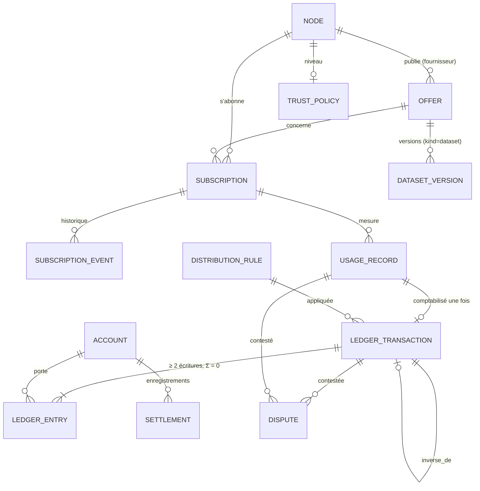

<!--
  SPDX-License-Identifier: LicenseRef-CMSD-1.0
  Copyright (c) 2026 CyberMind — Gérald Kerma <devel@cybermind.fr>
  Source-Disclosed License — All rights reserved except as expressly granted.
  See LICENCE-CMSD-1.0.md for terms.
-->

# MirrorNet v1 — Modèle de données (phase 2)

Issue #3645 · 2026-11-10 · **IMPLÉMENTÉ** dans `packages/secubox-mirrornet/secubox_mirrornet/schema.py` (schéma v1),
`ledger.py`, `repartition.py` ; testé (`packages/secubox-mirrornet/tests/`). Rien n'est encore alimenté : la
synchronisation avec l'annuaire arrive en phase 3.

## 1. Principes

| Principe | Mise en œuvre |
|---|---|
| Une base par nœud, privée | SQLite WAL `/var/lib/secubox-mirrornet/mirrornet.db`, compte `secubox-mirrornet`, dossier 0700 et fichiers 0600 (ledger privé, illisible par le groupe `secubox`) |
| Identifiants stables | UUID v4 (texte) pour les objets de ce nœud ; `did:plc:<32 hex>` pour les nœuds ; identifiants de l'annuaire (`service_id`, `subscription_id`) gardés dans `ref_annuaire` |
| La vérité partagée reste l'annuaire | offres, abonnements, manifestes : objets **signés** du journal ; la base n'en est qu'un index local, reconstructible |
| Ajout seul | ledger, transactions, relevés d'usage, historique des abonnements, règles : déclencheurs `RAISE(ABORT)` sur UPDATE/DELETE, `PRAGMA recursive_triggers=ON` (sans lui, `INSERT OR REPLACE` remplacerait en silence) |
| Montants entiers | centièmes de crédit, `CHECK (typeof(x) = 'integer')` et borne ±10^15, jamais de flottant |
| Crédits ≠ règlements | comptes de nature `credits` et `reglement` distincts ; aucun virement n'est jamais exécuté |
| Versionné | `PRAGMA user_version` ; migrations idempotentes, une transaction par version ; base plus récente que le code jamais touchée |

## 2. Entités

Correspondance avec les entités du prompt maître :

| Prompt | Table | Remarque |
|---|---|---|
| Node | `node` | copie locale des `NodeRecord` signés + niveau |
| Peer | — | vue de `node` + transport (`secubox-p2p`), pas de table propre |
| Provider | `node` (rôle) | un fournisseur est un nœud qui publie des offres |
| Service | `offer` (`kind` ≠ `dataset`) | miroir d'une `ServiceOffer` |
| Dataset | `offer` (`kind = dataset`) + `dataset_version` | versions immuables, empreinte unique par offre |
| Subscription | `subscription` + `subscription_event` | état courant = dernier événement ; vérité = journal |
| UsageRecord | `usage_record` | deux signatures ; `(subscription_id, sequence)` unique |
| Contribution | vue (agrégats d'`usage_record` × rôle) | pas de table : jamais une valeur déclarée seule |
| LedgerEntry | `ledger_entry` (+ `ledger_transaction`) | partie double, chaînée |
| RevenueShare | `distribution_rule` | parts versionnées, appliquées par `repartition.repartir` |
| Settlement | `settlement` | enregistrement seul (`propose → accepte → enregistre`) |
| TrustPolicy | `trust_policy` | niveau calculé et sa cause (cache de `federated-trust.md` § 3) |
| — | `account`, `dispute` | ajoutés : comptes par nature, litiges |

## 3. Tables (schéma v1)

| Table | Clé | Colonnes notables | Contraintes |
|---|---|---|---|
| `node` | `did` | `nom`, `cle_wg`, `mesh_ip`, `niveau`, `vu_le` | `did GLOB 'did:plc:*'` ; niveau ∈ 5 valeurs |
| `offer` | `id` (UUID) | `ref_annuaire` (unique), `fournisseur_did`, `kind`, `version`, `classe`, `tarif` (JSON), `quotas` (JSON), `duree_s`, `grace_s` (défaut 5 j), `etat`, `signature` | classe ∈ 5 classes ; FK node |
| `dataset_version` | `id` | `offer_id`, `numero`, `parent`, `empreinte`, `taille`, `format`, `licence`, `provenance`, `classe`, `fraicheur_s`, `donnees_personnelles`, `signature`, `retiree` | `(offer_id, numero)` et `(offer_id, empreinte)` uniques |
| `subscription` | `id` | `ref_annuaire`, `abonne_did`, `offer_id`, `tarif_accepte`, `renouvellement` (auto/manuel), `expire_le`, `grace_s`, `ref_compta` | FK node, offer |
| `subscription_event` | `id` | `de`, `vers`, `acteur_did`, `motif`, `ts` | `vers` ∈ Demande, Refuse, Actif, Grace, Suspendu, Expire, Resilie ; ajout seul |
| `usage_record` | `id` | `sequence`, `periode_debut/fin`, `unite`, `quantite`, `servi_par`, `fraicheur_ok`, `sig_fournisseur`, `sig_abonne` | `(subscription_id, sequence)` unique ; fin > début ; ajout seul |
| `account` | `id` | `nature`, `titulaire` | nature ∈ credits, reserve, infra, en_attente, reglement ; `(nature, titulaire)` unique |
| `distribution_rule` | `id` | `version` (unique), `parts` (JSON), `sans_relais`, `valide_du` | non modifiable (nouvelle version) |
| `ledger_transaction` | `id` | `usage_record_id`, `regle_id`, `inverse_de`, `libelle`, `detail` (JSON : calcul expliqué), `ts` | immuable |
| `ledger_entry` | `rang` (auto) | `id`, `transaction_id`, `account_id`, `montant`, `empreinte_prec`, `empreinte` | `montant ≠ 0` ; empreinte unique ; ajout seul |
| `settlement` | `id` | `account_id`, période, `montant`, `etat`, `reference_externe` | aucun virement déclenché |
| `dispute` | `id` | `transaction_id` / `usage_record_id`, `ouvert_par`, `motif`, `etat`, `resolution` | — |
| `trust_policy` | `did` | `niveau`, `cause`, `maj_le` | FK node |

## 4. Ledger : règles vérifiées par le code

`ledger.ecrire_transaction` (une transaction SQLite `BEGIN IMMEDIATE`) refuse, **sans rien écrire** :
moins de deux écritures, un montant non entier ou nul, une somme non nulle, un compte inconnu, un relevé d'usage déjà
comptabilisé (hors transaction inverse), un identifiant déjà utilisé avec un autre contenu. Réécrire une transaction
identique sous le même identifiant ne fait rien (**idempotence**).

Chaînage : `empreinte = BLAKE2b-256(empreinte_prec ‖ id ‖ transaction ‖ empreinte_contenu_transaction ‖ compte ‖ montant)`,
genèse `0…0` ; le contenu de la transaction (libellé, détail, relevé, règle, inverse, horodatage) est couvert.
`ledger.verifier_integrite` recalcule chaîne, contenus et sommes ; une modification faite en contournant les
déclencheurs est détectée (tests `test_alteration_detectee`, `test_alteration_du_contenu_detectee`). La chaîne n'est
**pas clé** : une troncature de queue ou une chaîne entièrement recalculée ne se voit qu'en comparant `ledger.tete`
à un ancrage externe (ligne d'audit ou signature du nœud), prévu en phase 5.

Index uniques : un relevé n'est comptabilisé qu'une fois hors inverse (`tx_releve_unique`) ; une transaction n'est
inversée qu'une fois (`tx_inverse_unique`).

Correction : `ledger.inverser(tx, motif)` (seule porte : `inverse_de` n'est pas un paramètre public) écrit, dans la
même transaction SQLite que ses contrôles, les écritures exactement opposées, sous l'identifiant `inv:<tx>` (rejouer
ne fait rien) ; une transaction ne s'inverse qu'une fois ; l'originale reste. Un relevé inversé n'est plus
recomptabilisable : la correction d'usage passe par un nouveau relevé.

## 5. Répartition

`repartition.repartir(montant, parts, avec_relais, sans_relais)` : parts entières de somme 100 parmi producteur,
relais, infrastructure, réserve ; découpage par **plus forts restes**, départage déterministe dans l'ordre des rôles :
la somme des parts vaut **exactement** le montant (test sur 2 000 tirages). Sans relais, sa part va au rôle
`sans_relais` (producteur par défaut).

## 6. Idempotence et synchronisation (phases 3+)

| Objet | Clé d'idempotence | Source de vérité | Conflit |
|---|---|---|---|
| Offre, version de jeu | `ref_annuaire`, `(offer_id, empreinte)` | journal de l'annuaire (signé) | une version est immuable ; une nouvelle offre remplace |
| Abonnement | `ref_annuaire` | journal | résiliation > renouvellement (`MIRRORNET_SERVICE_EXCHANGE.md` § 5) |
| Événement d'abonnement | `id` | dérivé localement | ajout seul, jamais réécrit |
| Relevé d'usage | `(subscription_id, sequence)` + `id` | les deux parties (deux signatures) | séquence inférieure refusée (rejeu) |
| Transaction | `id` (déterministe en phase 5 : dérivé de l'id du relevé et de la règle) | chaque nœud pour **ses** comptes | réconciliation par identifiant, jamais par solde |

La base d'un nœud peut être **reconstruite** depuis le journal (offres, abonnements, versions) ; le ledger, lui, ne se
reconstruit qu'à partir des relevés doublement signés : c'est pourquoi il est sauvegardé et jamais réécrit.

## 7. Migrations et retour arrière

- Migration `N` = liste d'instructions idempotentes (`IF NOT EXISTS`), appliquée au démarrage du service par le
  lanceur (`python3 -m secubox_mirrornet.lanceur`, processus principal de l'unité) dans une transaction, puis
  `user_version = N`.
- Base plus récente que le code (retour arrière du paquet) : refus explicite, aucune écriture, code 3 sans redémarrage
  en boucle (`RestartPreventExitStatus=3`, `StartLimitBurst=3`).
- Sauvegarde : le fichier de base (avec `-wal`) suit la sauvegarde de `/var/lib` ; une restauration ne doit jamais
  précéder une transaction déjà échangée avec un pair (réconciliation par identifiant en phase 5).

## 8. Ce que la phase 2 ne fait pas

Aucune écriture par l'API, aucune synchronisation avec l'annuaire, aucun relevé reçu, aucune règle de répartition
semée, aucune page. Ces éléments viennent avec les phases 3 (abonnements), 4 (données), 5 (mesure, ledger actif) et 6
(tableau de bord).
