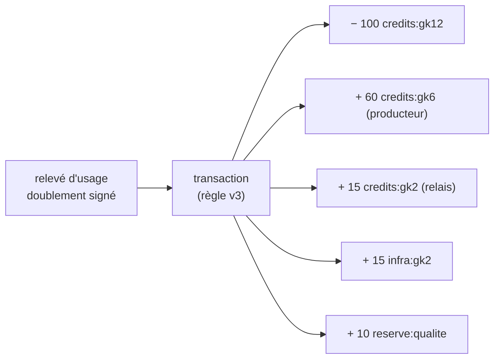

<!--
  SPDX-License-Identifier: LicenseRef-CMSD-1.0
  Copyright (c) 2026 CyberMind — Gérald Kerma <devel@cybermind.fr>
  Source-Disclosed License — All rights reserved except as expressly granted.
  See LICENCE-CMSD-1.0.md for terms.
-->

# MirrorNet v1 — Plan 4 : économie de contribution

Issue #3643 · **CONCEPTION** · tout ce document est **NOUVEAU** (audit #3641 § 5 : rien n'existe).

Principe : récompenser une **contribution utile et prouvée** (une donnée fraîche consommée, un service disponible
utilisé, un relais qui a vraiment servi), jamais un volume brut. v1 compte en **crédits internes sans valeur
monétaire** ; les règlements en argent réel sont seulement **enregistrés**, jamais exécutés, et restent hors périmètre
tant qu'un avis juridique et fiscal n'a pas été rendu (arbitrage 3, `MIRRORNET_ARCHITECTURE.md` § 1).

## 1. Rôles

| Rôle | Contribution prouvée par | Exemple |
|---|---|---|
| Producteur | relevé d'usage signé par l'abonné sur SA version / SON service | gk6 publie la météo |
| Fournisseur de service | relevé d'usage d'un abonnement actif + disponibilité mesurée | gk3 sert Visio |
| Relais | accusé signé de l'abonné nommant le nœud qui a servi l'objet | gk2 a servi le cache |
| Stockage | copie tenue et servie (accusés), pas l'espace réservé | gk4 garde une copie |
| Calcul | tâche rendue et acceptée (A22, hors v1) | — |
| Consommateur | débit de crédits | gk12 s'abonne |
| Infrastructure | part de règle, attribuée au maître qui exploite le relais public | gk2 |
| Réserve qualité | compte technique de la règle | réserve du maillage |

## 2. Relevé d'usage (la seule pièce échangée)

```json
{
  "id": "6f1e…-uuid",
  "abonnement": "sub-uuid",
  "periode": ["2026-11-10T00:00:00Z", "2026-11-11T00:00:00Z"],
  "unite": "version_recue | requete | octet | jour",
  "quantite": 144,
  "servi_par": "did:plc:… (fournisseur ou relais)",
  "sequence": 37,
  "fraicheur_ok": true,
  "sig_fournisseur": "…", "sig_abonne": "…"
}
```

- **Deux signatures** (fournisseur puis abonné) : un relevé à une seule signature n'est pas comptabilisé.
- **Anti-rejeu** : `(abonnement, sequence)` unique et strictement croissant, mémorisé de façon persistante (patron
  Status Live jalon 2 : séquence persistante, horodatage signé, fenêtre de dérive).
- **Idempotence** : un relevé déjà enregistré (même id) est ignoré, jamais compté deux fois.
- **Litige** : un abonné qui refuse de contre-signer ouvre un litige automatique (§ 7) ; rien n'est débité.
- Les relevés circulent **entre les deux parties seulement** (wg-mesh) ; jamais dans le journal public.

## 3. Ledger local en partie double

Chaque nœud tient **son** ledger (SQLite, `secubox-mirrornet`), privé, jamais exporté :

- toute transaction = ≥ 2 écritures dont la somme vaut **0** (contrainte vérifiée à l'écriture et par un test de propriété) ;
- **ajout seul** : ni UPDATE ni DELETE ; une correction = transaction inverse référencée ;
- écritures **chaînées** (empreinte de l'écriture précédente et du contenu de la transaction) : toute altération d'une
  écriture existante se voit au contrôle d'intégrité ; la tête de chaîne sera ancrée hors de la base (audit, signature
  du nœud, phase 5) pour détecter une troncature ou une chaîne recalculée ;
- montants en **entiers** (centièmes de crédit), jamais en flottants ;
- comptes : `credits:<did>` (solde), `reserve:qualite`, `infra:<did-maître>`, `en_attente:<abonnement>` (séquestre
  pendant un litige), `reglement:<did>` (séparé, enregistrements seulement).



Chez l'abonné, la transaction débite son compte ; chez le fournisseur et chez le relais, elle crédite le leur. Chacun
écrit **la même transaction** (même id, même règle, même relevé) : la réconciliation compare des identifiants, jamais
des soldes.

## 4. Modèles de tarification et règles de répartition

| Modèle (`tarif.modele`) | Débit |
|---|---|
| `gratuit` | aucun ; contribution comptée (statistique), pas de crédit |
| `forfait` | `credits` par `periode_s` tant que l'abonnement est Actif |
| `usage` | `credits` × `quantite` (unité déclarée) |
| `palier` | barème par tranches (`paliers: [[0,100,1],[100,1000,0.5]]`) |
| `reciproque` | échange compensé : contributions mutuelles soldées entre les deux parties, différence seule débitée |
| `parraine` | un tiers (did parrain) paie pour les abonnés (jeu public d'intérêt général) |

**Règle de répartition** : objet versionné, jamais en dur, stocké en base et publiable (signée) par le maître pour le
maillage :

```toml
id       = "regle-v3"
valide_du = "2026-12-01T00:00:00Z"
parts    = { producteur = 60, relais = 15, infrastructure = 15, reserve = 10 }   # Σ = 100, entiers
sans_relais = "producteur"      # part du relais reversée au producteur si l'objet vient de lui directement
```

Une transaction cite la règle en vigueur à la **fin de la période** de son relevé ; un changement de règle ne touche
jamais le passé.

## 5. Contribution utile, pas volume brut

Coefficient appliqué au crédit **producteur/fournisseur** (jamais au débit de l'abonné), borné à [0 ; 1] :

| Facteur | Mesure | Effet |
|---|---|---|
| Fraîcheur | version reçue dans `fraicheur_s` ×2 ? | non → période non créditée (unité `version_recue`) |
| Disponibilité | sondes de l'abonné sur la période | < seuil → crédit réduit au prorata |
| Validité | versions rejetées (empreinte, signature, schéma) | crédit nul pour ces versions |
| Consommation réelle | accusés signés | rien sans accusé |
| Provenance | donnée dérivée d'une source tierce | part reversée à la source citée (A22) |

Les paramètres sont dans `[economie]` de `mirrornet.toml` (documentés, défauts prudents) ; le détail du calcul est
enregistré avec la transaction (explicable).

## 6. Fraude visée

| Fraude | Parade |
|---|---|
| Usage gonflé par le fournisseur | contre-signature de l'abonné obligatoire |
| Consommation artificielle entre deux nœuds complices | plafond de crédits par paire et par période ; `reciproque` solde les échanges mutuels ; alerte sur paires anormales ; niveau de confiance requis (`MIRRORNET_SECURITY.md`) |
| Double déclaration d'un relevé | `(abonnement, sequence)` unique + id unique |
| Relais fictif | `servi_par` signé par l'abonné ; un relais non joignable par l'abonné n'est pas crédible (contrôle de chemin) |
| Nœuds Sybil | crédits seulement entre MEMBER de niveau ≥ LIMITED ; création d'un nœud = jonction auditée et validée |
| Rejeu d'un vieux relevé | fenêtre de dérive + séquence persistante |

## 7. Règlements et litiges

- **Règlement** (`settlement`) : agrégat périodique d'un compte `reglement:<did>`, état `propose → accepte → enregistre`
  ; **aucun virement** n'est déclenché ; référence externe saisie à la main si un règlement réel a lieu hors système.
- **Litige** : ouvert par l'une des parties (relevé contesté, débit refusé) ; les montants passent en `en_attente` ;
  résolution = transaction inverse ou libération, signée par les deux parties ou tranchée par l'administrateur du maître
  ancré pour les comptes d'infrastructure ; tout est audité.

## 8. Confidentialité

Le ledger d'un nœud n'est lisible que par **son** administrateur (`require_jwt`). Les pairs ne voient que les relevés
qui les concernent. Le tableau de bord du maître affiche des agrégats du maillage seulement si chaque nœud les publie
volontairement (relevé signé, comme Status Live) — jamais en lisant les ledgers.

## 9. API (NOUVEAU, `/api/v1/mirrornet/economy/`, `require_jwt` sauf mention)

| Route | Rôle |
|---|---|
| `GET /economy/account` | soldes de ce nœud (crédits, règlement séparé) |
| `GET /economy/contributions` | contributions prouvées par rôle et période |
| `GET /economy/ledger` | écritures paginées + contrôle d'intégrité de la chaîne |
| `GET /economy/earnings` | crédits gagnés par offre et par rôle |
| `GET /economy/transactions` | transactions (avec règle, relevé, détail du calcul) |
| `GET /economy/distribution-rules` | règles en vigueur et historiques (`require_lecture`) |
| `POST /economy/disputes` / `POST /economy/disputes/{id}/resolve` | litiges |

## 10. Tests attendus (phase 5)

Propriétés : Σ = 0 par transaction, chaîne intègre, aucun relevé compté deux fois, rejeu refusé, règle versionnée
appliquée au bon intervalle ; scénarios de fraude du § 6 ; réconciliation entre trois nœuds après coupure réseau.
