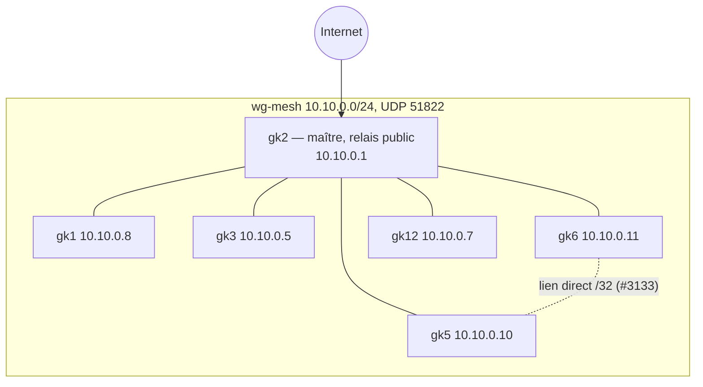
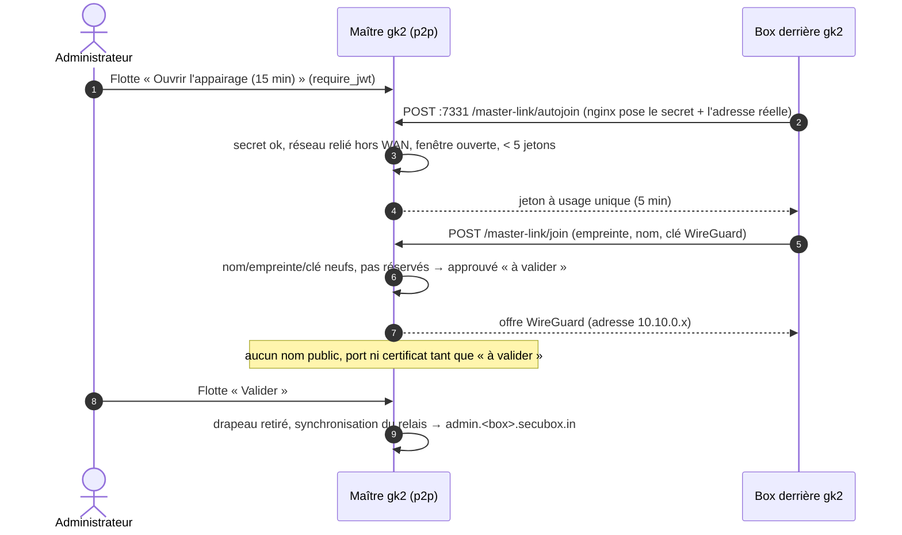
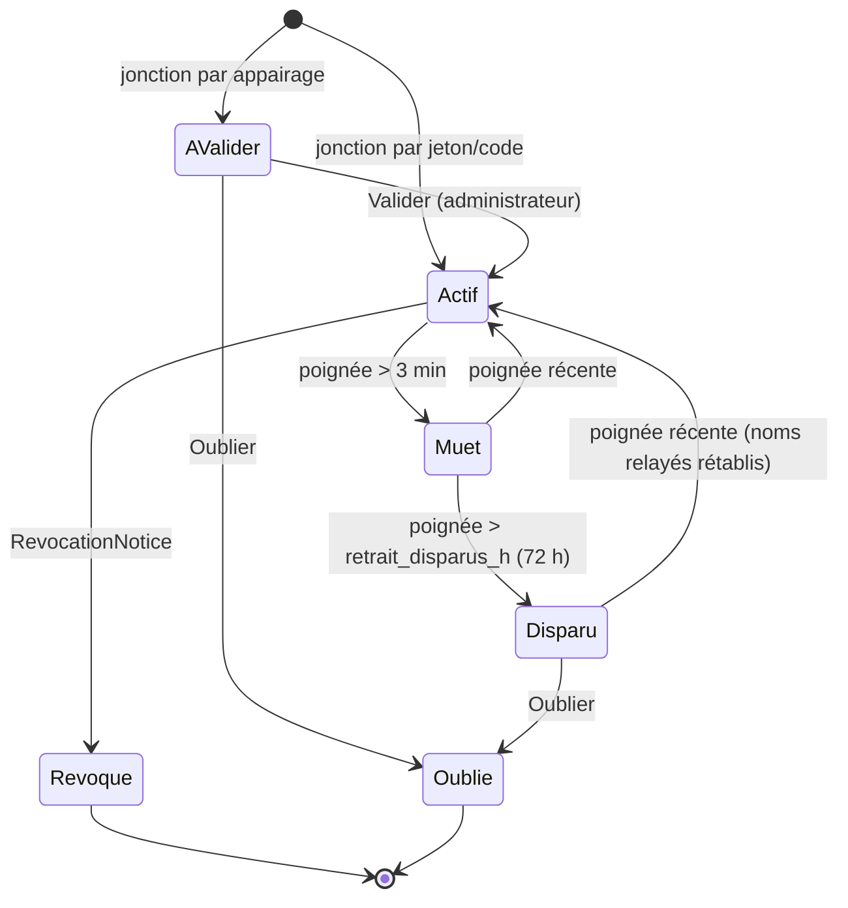

<!--
  SPDX-License-Identifier: LicenseRef-CMSD-1.0
  Copyright (c) 2026 CyberMind — Gérald Kerma <devel@cybermind.fr>
  Source-Disclosed License — All rights reserved except as expressly granted.
  See LICENCE-CMSD-1.0.md for terms.
-->

# MirrorNet v1 — Plan 1 : réseau

Issue #3643 · **CONCEPTION** · marquage EXISTANT / À ÉTENDRE / NOUVEAU (voir `MIRRORNET_ARCHITECTURE.md`).

P2P, maillage et WireGuard sont trois choses distinctes : **P2P** = échanges directs entre deux nœuds (objets,
relevés, offres) ; **maillage** = la topologie et l'accessibilité entre tous les nœuds ; **WireGuard** = le tunnel
chiffré. WireGuard seul ne fait pas un maillage : c'est `secubox-p2p` qui décide qui est pair, avec quelle adresse,
par quel chemin.

## 1. Topologie v1 (EXISTANT)

- **Étoile** : un pair ordinaire a `AllowedIPs = 10.10.0.0/24` vers le maître (`secubox-p2p/api/mesh.py:184`) ; le
  trafic pair-à-pair transite par gk2.
- **Liens directs** : après une poignée de main récente, un couple de pairs passe en `/32` direct
  (`api/pairs_directs.py`, `sbin/secubox-maillage-pairs`, minuterie 1 min).
- **Relais public** : gk2 seul exposé ; `<service>.<box>.secubox.in` → HAProxy → sbxwaf → `10.10.0.x:9080`
  (`sbin/secubox-relais-maillage`).
- Relevé gk2 du 2026-11-10 : 8 pairs wg-mesh, 5 actifs (gk1, gk3, gk5, gk6, gk12) ; gk4, gk7, gk8 muets.

## 2. Identité d'un nœud

| Identité | Rôle | Où | Statut |
|---|---|---|---|
| `did:plc:<32 hex>` + clé Ed25519 `node.key` | **identité MirrorNet** : signe offres, manifestes, relevés | `/etc/secubox/secrets/annuaire/node.key` | EXISTANT — référence unique |
| clé WireGuard wg-mesh | transport | `wg_mesh.json` (publique), `/etc/wireguard/wg-mesh.conf` | EXISTANT |
| `NodeRecord` signé (did, boxname, `pubkey_wg`, mesh_ip, endpoint) | lie le did à la clé WireGuard et à l'adresse | `annuaire/model.py:505` | EXISTANT |
| certificat SBX v2 (fédération) | appstore fédéré | `secubox-federation` | EXISTANT, non requis en v1 |

Règle v1 : **un objet MirrorNet n'est accepté que si son `signer_did` est lié, par un `NodeRecord` valide et non révoqué,
à la clé WireGuard du pair qui l'a transmis**. Détail et niveaux : `MIRRORNET_SECURITY.md` § 2-3.

## 3. Enregistrement et découverte

| Mécanisme | Usage | Statut |
|---|---|---|
| Jeton de jonction (`sbx-mesh-invite` → `sbx-mesh-join`) | enrôlement standard, à distance | EXISTANT |
| Code `sbxmesh1.…` + `secubox-automesh` | box préparée (Auto-Load, Premier Pas) | EXISTANT |
| **Appairage ouvert** (fenêtre 15 min sur le maître + `secubox-autojoin` sur la box) | box branchée derrière le maître, sans jeton | À ÉTENDRE — PR #3640 |
| Ancre du maître | une box retient le maître qui l'a flashée | EXISTANT |
| `NodeRecord` + pull du journal (`:8799`) | découverte de tout le parc par chaque nœud | EXISTANT |
| mDNS `_secubox._tcp` | voisinage LAN | EXISTANT |
| DHT Kademlia signée | découverte sans maître | DÉSACTIVÉE — hors v1 |

`GET /api/v1/mirrornet/nodes` (NOUVEAU, `require_lecture`) est une **vue** : fiches `NodeRecord` + niveau de confiance
+ santé ; elle n'enregistre rien. `POST /nodes/register` du prompt **n'existe pas** comme route : l'enregistrement est
la jonction (jeton, code ou appairage), seule porte d'entrée auditée.

### Appairage (séquence)

## 4. Santé et disponibilité

| Signal | Source | Statut |
|---|---|---|
| poignée de main par pair | `wg show wg-mesh latest-handshakes`, `secubox-p2p-mesh-liveness.timer` (20 s) | EXISTANT |
| relevé d'état signé par box | Status Live jalon 2 (`sbx-fleetctl publish-status/collect-status`) | EXISTANT |
| sondes de service | `mirrornet.d` (sonde déclarée par le module, 10 s) | NOUVEAU (A21) |
| disponibilité **par offre** | relevés signés + sondes, agrégés par `secubox-mirrornet` | NOUVEAU |

États d'un pair (NOUVEAU, vue `GET /api/v1/mirrornet/network/status`) :

Effets : **Muet** = rien ne change ; **Disparu** = noms et ports relayés retirés (PR #3640), abonnements en période de
grâce (`MIRRORNET_SERVICE_EXCHANGE.md` § 5) ; **Révoqué** = retiré du transport (`docs/mirrornet/federated-trust.md` § 4).
Une poignée à 0 après remontée de l'interface = **inconnu**, jamais « disparu ».

## 5. Sélection d'un relais

v1 : **un seul relais public, gk2** (le maître ancré). Pour un objet ou un service entre pairs : lien direct s'il est
actif, sinon via le maître (étoile). Le « relais » au sens économique (`MIRRORNET_ECONOMY.md`) est le nœud qui a
**effectivement servi** un objet (copie, cache) : il est connu par le relevé d'usage, pas deviné par la topologie.

## 6. Ce qui est reporté (critères d'entrée)

| Capacité | Entrée en scène quand… | Piste |
|---|---|---|
| Traversée de NAT | un nœud ne peut joindre ni le maître ni ses pairs (aujourd'hui : redirection Freebox du maître suffit) | relais par le maître (déjà le cas) ; STUN/hole punching seulement après mesure |
| Multi-saut | plus d'un maître, ou des pairs sans chemin vers le maître | babeld sur wg-mesh (`annuaire/mirrornet/schema.py`, schéma seul) |
| Élection | perte durable du maître | masterlink à reprendre avec quorum et battement signé (audit #3429 § 4) |
| DHT | parc > ~50 nœuds ou plusieurs maîtres | `api/dht.py` (signée, désactivée) |

## 7. Comportement hors ligne

- Maître injoignable : les pairs gardent leurs liens directs ; plus de relais public ; abonnements et ledger continuent
  localement ; les relevés d'usage attendent (file locale, horodatés, signés) et sont échangés au retour.
- Pair injoignable : ses abonnés passent en période de grâce ; ses noms publics restent 72 h puis sont retirés.
- Rien n'est supprimé sur une absence : seuls l'oubli (administrateur) et la révocation (journal) retirent un pair.

## 8. API réseau (NOUVEAU, lecture seule, `secubox-mirrornet`)

| Route | Garde | Contenu |
|---|---|---|
| `GET /api/v1/mirrornet/nodes` | `require_lecture` | nœuds connus : did, nom, mesh_ip, niveau, état (§ 4) |
| `GET /api/v1/mirrornet/nodes/{did}` | `require_lecture` | fiche + santé + offres publiées |
| `GET /api/v1/mirrornet/peers` | `require_lecture` | pairs du transport (vue de `/api/v1/p2p/peers`) |
| `GET /api/v1/mirrornet/mesh/topology` | `require_lecture` | étoile + liens directs (graphe) |
| `GET /api/v1/mirrornet/network/status` | `require_lecture` | synthèse : pairs actifs, muets, à valider, relais |

Toute écriture réseau reste dans `secubox-p2p` (appairage, valider, oublier), déjà gardée et auditée.
