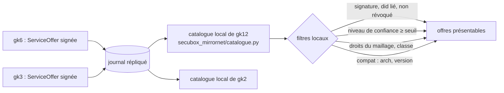
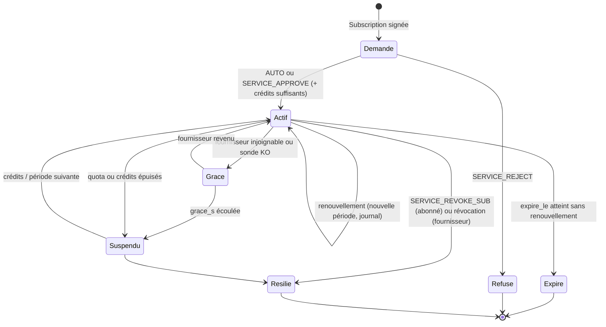
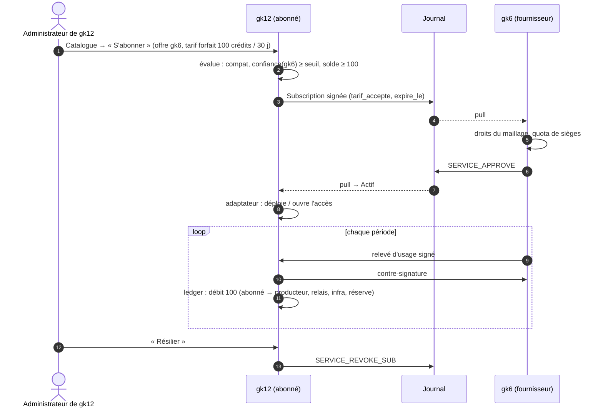

<!--
  SPDX-License-Identifier: LicenseRef-CMSD-1.0
  Copyright (c) 2026 CyberMind — Gérald Kerma <devel@cybermind.fr>
  Source-Disclosed License — All rights reserved except as expressly granted.
  See LICENCE-CMSD-1.0.md for terms.
-->

# MirrorNet v1 — Plan 2 : échange de services

Issue #3643 · **CONCEPTION** · marquage EXISTANT / À ÉTENDRE / NOUVEAU (voir `MIRRORNET_ARCHITECTURE.md`).

Un nœud découvre les services offerts par les autres **sans place de marché centrale** : le catalogue est le journal
signé de l'annuaire, répliqué par pull sur chaque nœud ; chacun filtre et décide localement.

## 1. Ce qui existe

| Brique | Référence | Statut |
|---|---|---|
| `ServiceOffer` signée (service_id, provider did, name, kind, endpoint, scope, approval_mode, macro, pac) | `secubox-annuaire/annuaire/model.py:453` | EXISTANT |
| `Subscription` signée (subscription_id, subscriber did, service_id) | `model.py:485` | EXISTANT |
| État dérivé du journal : PENDING / APPROVED / REJECTED / REVOKED | `annuaire/verbs.py:1319` (`subscription_state`) | EXISTANT |
| Routes `POST /service/offer`, `/service/{id}/subscribe`, `/subscription/{id}/approve|reject` | `secubox-annuaire/api/main.py:522-636` (`require_jwt`) | EXISTANT |
| Offres réelles publiées (onions, Hall, apt) | `annuaire/offres.py`, minuterie horaire | EXISTANT |
| Filtrage par droits du maillage | `GET /api/v1/annuaire/services` (#3305) | EXISTANT |
| Activation par macro (`tor-exit`) | `secubox-p2p/api/macro_grant.py` | EXISTANT (une macro) |
| Catalogue maillé + installation à distance consentie | `secubox-appstore` `/mesh-catalog`, `api/remote.py` | EXISTANT |
| Abonnements administratifs (statut, formule, échéance, grâce 5 j) | `secubox-autoload` (#3303) | EXISTANT, propre au provisionnement |

Manque : version et compatibilité d'une offre, prix et quotas, échéance et renouvellement d'un abonnement de service,
période de grâce, disponibilité par offre, cycle de vie unique.

## 2. Offre de service étendue (À ÉTENDRE, rétrocompatible)

Nouveaux champs **facultatifs** de `ServiceOffer` (une ancienne offre reste valide ; `extra="forbid"` impose de les
déclarer dans le modèle, avec un test de rétrocompatibilité) :

| Champ | Type | Sens |
|---|---|---|
| `version` | str | version servie (« 1.34.0 ») |
| `compat` | dict | contraintes (`arch`, `secubox_min`, profils) |
| `tarif` | dict | référence au modèle (`MIRRORNET_ECONOMY.md` § 4) : `{"modele": "gratuit" \| "forfait" \| "usage" \| "palier" \| "reciproque" \| "parraine", "credits": int, "periode_s": int, "unite": str}` |
| `quotas` | dict | plafonds par abonné (`requetes_jour`, `octets_mois`, `sieges`) |
| `classe` | str | classe d'accès (`MIRRORNET_DATA_EXCHANGE.md` § 2) — pour un service : `public`, `communaute`, `prive` |
| `duree_s` | int | durée d'un abonnement avant renouvellement (défaut : illimitée = comportement actuel) |
| `grace_s` | int | période de grâce si le fournisseur est injoignable (défaut 5 j, comme autoload) |
| `sonde` | str | chemin de santé sur l'endpoint maillé |

`kind` reste libre (`module`, `api`, `mirror`) ; v1 ajoute `dataset` (plan 3).

## 3. Catalogue fédéré

- Index local NOUVEAU (table `offer` de la phase 2), reconstruit depuis le journal ; aucune offre n'est crue sans sa
  signature et sans la liaison did ↔ nœud (`MIRRORNET_SECURITY.md` § 2).
- **Validation avant présentation** : une offre d'un nœud OBSERVER ou REVOKED n'est jamais présentée ; LIMITED : seulement
  `gratuit` et `public` ; seuil réglable (`[catalogue] confiance_min` dans `mirrornet.toml`).
- Disponibilité : sonde de l'offre (10 s, seulement pour les offres auxquelles ce nœud est abonné) + état du pair
  (`MIRRORNET_NETWORK.md` § 4).

## 4. Cycle de vie d'un abonnement

Les étapes du prompt maître, rattachées à l'existant :

| Étape | Qui | Mécanisme | Statut |
|---|---|---|---|
| DISCOVER | abonné | catalogue local (§ 3) | NOUVEAU (vue) sur EXISTANT (journal) |
| EVALUATE | abonné (administrateur) | compat, tarif, quotas, niveau du fournisseur, disponibilité | NOUVEAU |
| SUBSCRIBE | abonné | `Subscription` signée (+ `version`, `tarif_accepte`, `expire_le` demandés) | À ÉTENDRE |
| AUTHORIZE | fournisseur | AUTO ou `SERVICE_APPROVE` ; droits du maillage ; crédits disponibles | EXISTANT + NOUVEAU (crédits) |
| DEPLOY | abonné | adaptateur du module, installation consentie (appstore remote, macro) | EXISTANT / NOUVEAU par module |
| SYNCHRONIZE | les deux | objets par empreinte (plan 3), état par le journal | NOUVEAU |
| METER | les deux | relevé d'usage signé à deux parties | NOUVEAU (plan 4) |
| BILL | chacun chez soi | écritures au ledger local | NOUVEAU (plan 4) |
| DISTRIBUTE | chacun chez soi | règle de répartition versionnée | NOUVEAU (plan 4) |
| RENEW / CANCEL | abonné, fournisseur | renouvellement auto ou résiliation signée (`SERVICE_REVOKE_SUB`, EXISTANT) | À ÉTENDRE |

États locaux (NOUVEAU, `secubox_mirrornet/abonnements.py`) — **dérivés** du journal plus l'horloge, jamais stockés
comme vérité unique :

Nouvelles opérations du journal (À ÉTENDRE, `annuaire/model.py` `Op`) : `SERVICE_RENEW` (abonné, signée, nouvelle
période), `SERVICE_REVOKE_OFFER_SUB` (fournisseur révoque un abonné, motif). Le renouvellement automatique est une
**politique locale de l'abonné** (`renouvellement = "auto" | "manuel"`), jamais imposée par le fournisseur.

## 5. Hors ligne, grâce, conflits

| Situation | Comportement |
|---|---|
| Fournisseur injoignable | `Grace` pendant `grace_s` ; le service local déjà déployé continue ; aucune écriture de facturation ; au-delà : `Suspendu` (pas résilié) |
| Abonné injoignable | rien côté fournisseur ; à l'échéance sans renouvellement : `Expire` |
| Maître injoignable | les deux continuent par le maillage direct s'il existe ; le journal se resynchronise au retour |
| Deux écritures concurrentes sur un abonnement | le journal est ordonné par auteur ; règle : la résiliation l'emporte sur le renouvellement ; un renouvellement d'une période déjà close est ignoré (audit) |
| Offre modifiée (nouvelle version, nouveau tarif) | nouvelle `ServiceOffer` (nouveau `service_id` ou `version`) ; les abonnements en cours gardent leur tarif jusqu'à l'échéance |
| Fournisseur révoqué | abonnements `Resilie` à réception de la `RevocationNotice` ; service local arrêté par son adaptateur |

Un fournisseur déconnecté n'invalide **jamais** le reste du réseau : chaque abonnement est indépendant.

## 6. Séquence : abonnement à un service payant en crédits

## 7. API (NOUVEAU, `secubox-mirrornet`, `/api/v1/mirrornet/`)

| Route | Garde | Rôle |
|---|---|---|
| `GET /services` | `require_lecture` | catalogue local filtré (§ 3) |
| `GET /services/{id}` | `require_lecture` | offre, fournisseur, niveau, disponibilité, tarif |
| `POST /services/publish` | `require_jwt` | publie une offre de CE nœud (signée par `node.key` via l'annuaire) |
| `POST /services/{id}/subscribe` | `require_jwt` | abonnement signé (évaluation préalable, refus motivé) |
| `GET /subscriptions` | `require_lecture` | mes abonnements et ceux reçus, état dérivé |
| `POST /subscriptions/{id}/renew` | `require_jwt` | renouvellement manuel |
| `DELETE /subscriptions/{id}` | `require_jwt` | résiliation (abonné) ou révocation d'un abonné (fournisseur) |

Toute route d'écriture : audit (`/var/log/secubox/audit.log`), idempotence par identifiant fourni par le client.

## 8. Tests attendus (phase 3-4)

Rétrocompatibilité des offres anciennes ; état dérivé pour chaque transition ; grâce et suspension à l'horloge
simulée ; offre d'un nœud révoqué jamais présentée ; trois nœuds réels (fournisseur, abonné, maître absent).
