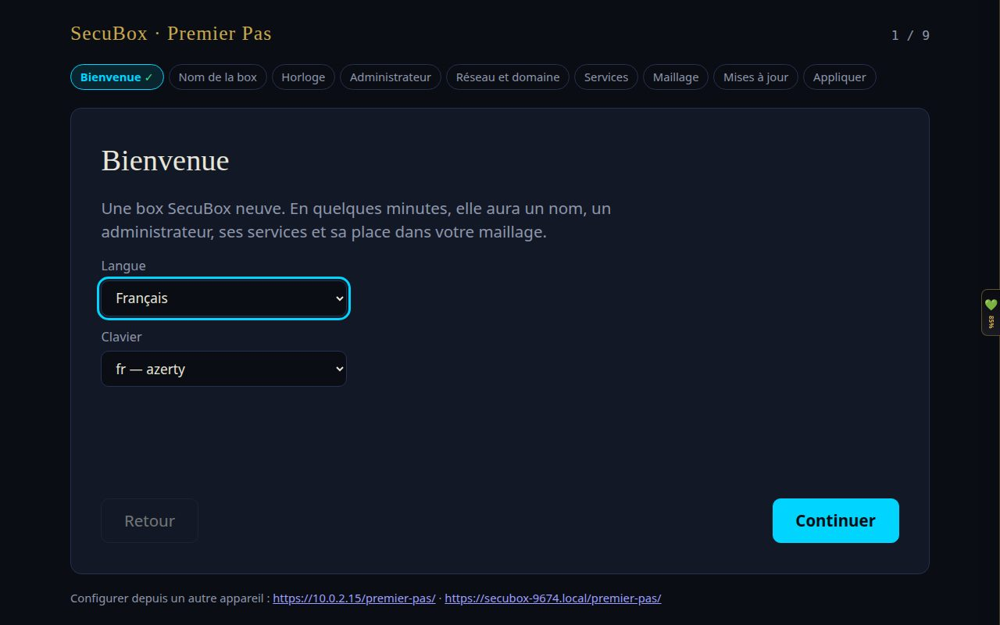
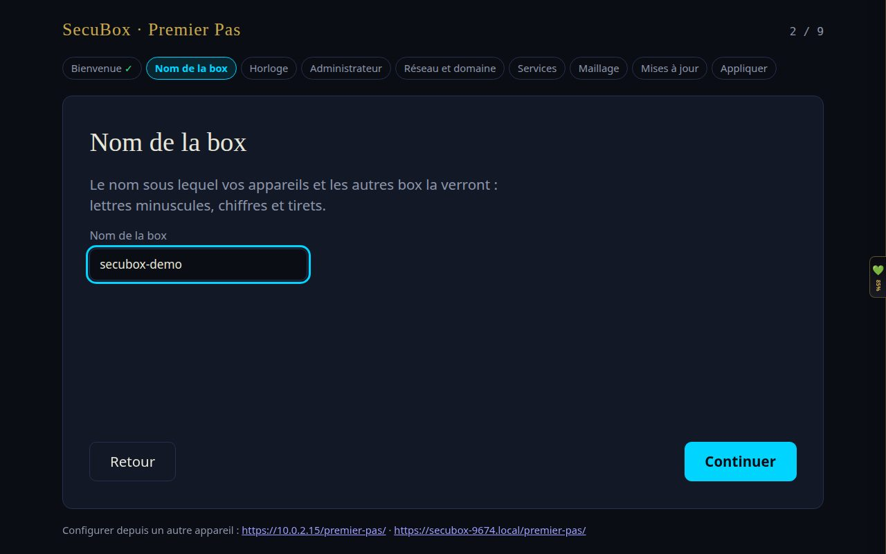
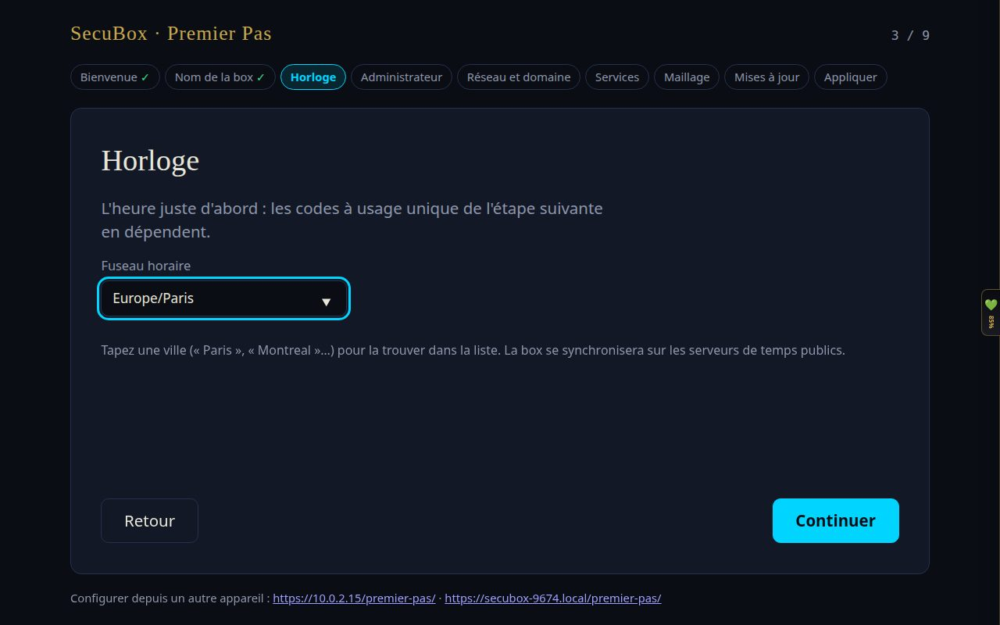
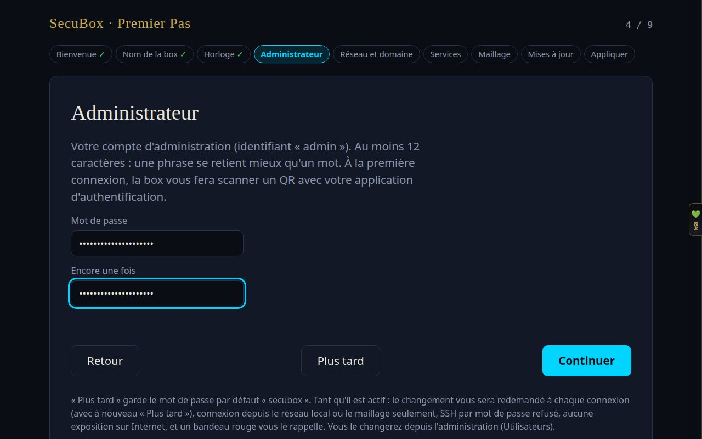
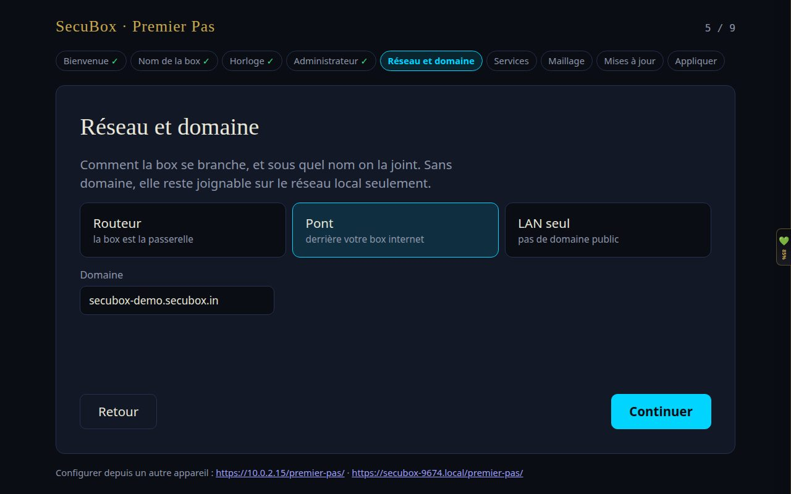
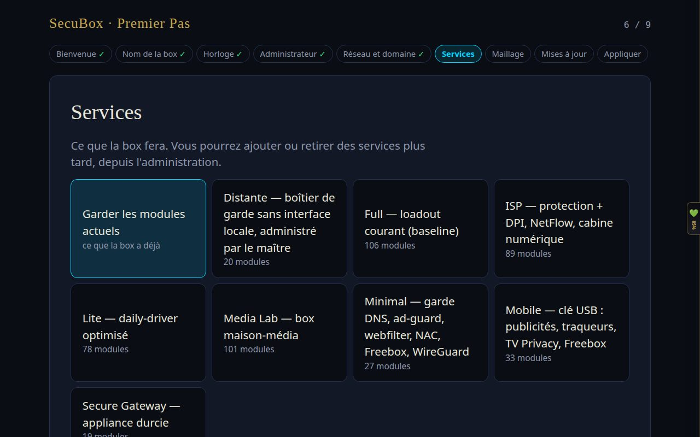
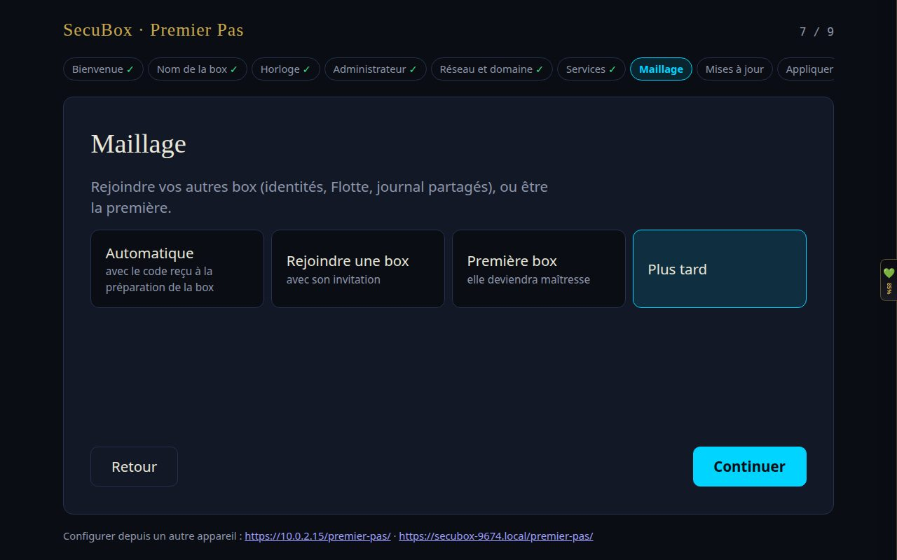
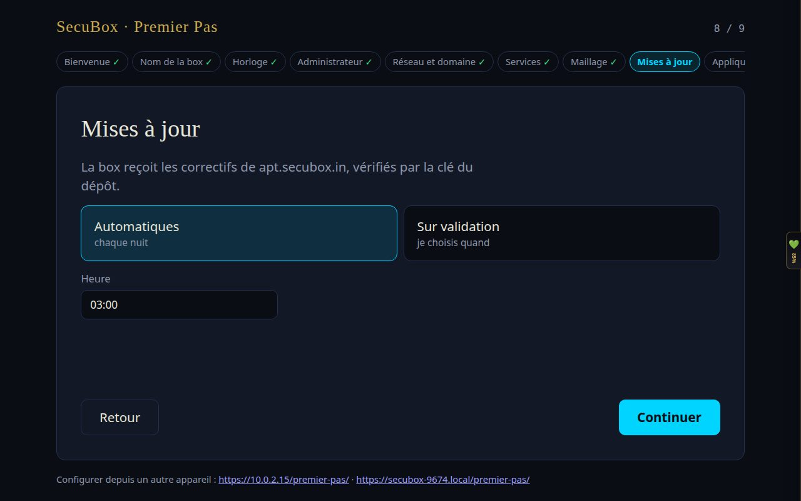
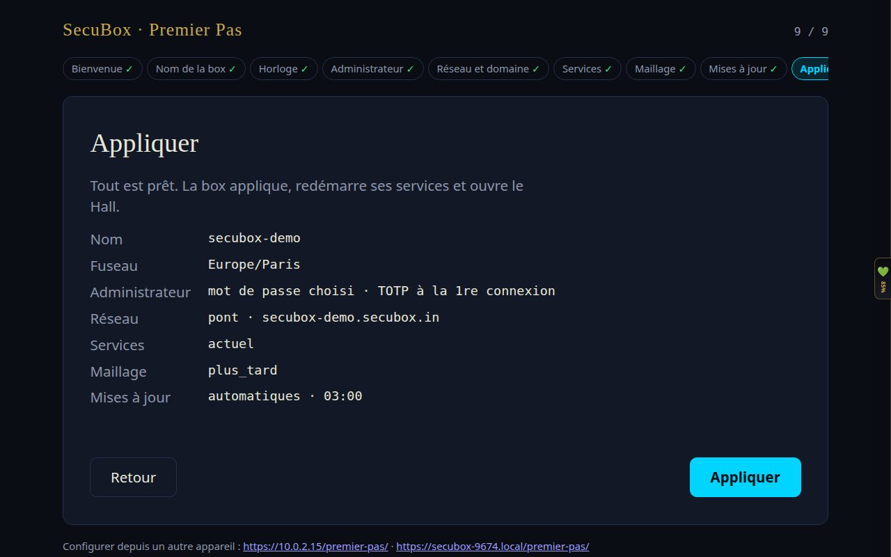
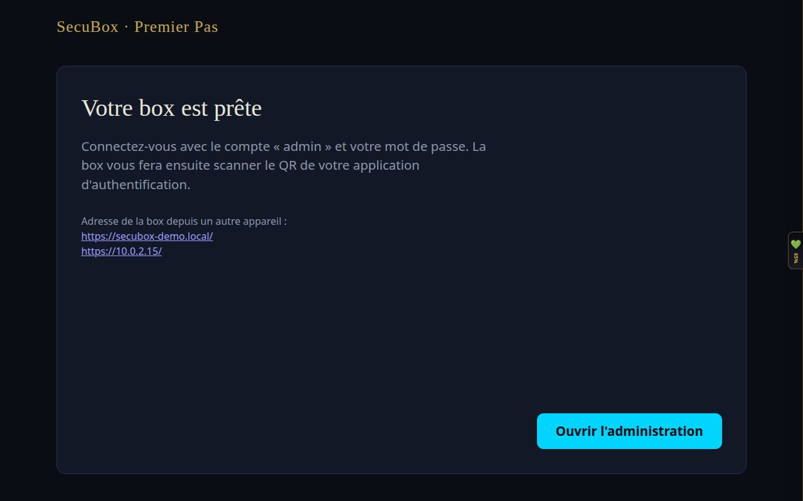

<!--
  SPDX-License-Identifier: LicenseRef-CMSD-1.0
  Copyright (c) 2026 CyberMind — Gérald Kerma <devel@cybermind.fr>
  Source-Disclosed License — All rights reserved except as expressly granted.
  See LICENCE-CMSD-1.0.md for terms.
-->

# Premier Pas — installer et configurer sa SecuBox (bêta 1)

Ce tutoriel suit une installation réelle de la bêta 1 sur un PC x86 : de la clé USB jusqu'à l'écran
« Votre box est prête ». Comptez une demi-heure, dont l'essentiel pour l'installation sur le disque.
Les captures viennent d'une box de démonstration nommée `secubox-demo`.

> **Bêta.** Installez SecuBox sur un PC de test, pas sur la connexion dont dépend votre foyer.
> Le disque n'est pas chiffré dans cette bêta.

## Avant de commencer

- Un PC x86_64 (amd64), 4 Go de mémoire au moins, un disque que l'installation **effacera entièrement**.
- Une clé USB de 4 Go au moins.
- Un écran et un clavier pour le premier démarrage. Sans écran, voir [Configurer depuis un autre appareil](#configurer-depuis-un-autre-appareil).
- Le PC branché en Ethernet sur votre réseau.

## 1. Préparer la clé USB

Téléchargez `secubox-installer-amd64-trixie.img.gz` et `SHA256SUMS` depuis la
[page de la release](https://github.com/CyberMind-FR/secubox-deb/releases), vérifiez, puis écrivez la clé :

```bash
sha256sum -c SHA256SUMS --ignore-missing
zcat secubox-installer-amd64-trixie.img.gz | sudo dd of=/dev/sdX bs=4M status=progress conv=fsync   # /dev/sdX = votre clé
```

Sous Windows ou macOS, un outil comme balenaEtcher accepte directement le fichier `.img.gz`.

## 2. Démarrer sur la clé et installer

1. Branchez la clé, démarrez le PC et choisissez la clé dans le menu de démarrage du BIOS (souvent F12, F11 ou Échap).
2. Le système démarre depuis la clé : le dé SecuBox tourne pendant le chargement.
3. L'installateur copie le système sur le premier disque, puis le PC redémarre.
4. **Retirez la clé** au redémarrage, pour que le PC démarre sur son disque.

Au démarrage depuis le disque, le dé tourne à nouveau, puis l'écran ouvre l'assistant **Premier Pas**.

## 3. L'assistant Premier Pas, étape par étape

La barre du haut montre les neuf étapes ; une coche ✓ marque chaque étape enregistrée. « Continuer »
enregistre l'étape sans rien changer à la box : **rien n'est appliqué avant la dernière étape**, et
« Retour » permet de corriger à tout moment.

### Étape 1 — Bienvenue

Choisissez la langue et la disposition du clavier.



### Étape 2 — Nom de la box

Le nom sous lequel vos appareils et vos autres box la verront : lettres minuscules, chiffres et tirets
(`secubox-demo`, `salon`, `gk3`…). Il sert aussi à proposer un domaine à l'étape 5.



### Étape 3 — Horloge

Tapez une ville (« Paris », « Montreal »…) pour trouver le fuseau horaire. L'heure doit être juste
avant l'étape suivante : les codes à usage unique de l'authentification en dépendent.



### Étape 4 — Administrateur

Le mot de passe du compte `admin`, **12 caractères au moins** : une phrase se retient mieux qu'un mot.
À la première connexion, la box vous fera scanner un QR code avec une application d'authentification
(double authentification).



« Plus tard » garde le mot de passe par défaut `secubox`. Tant qu'il est actif, la box le signale à chaque
connexion, n'accepte les connexions que depuis le réseau local ou le maillage, refuse l'exposition sur
Internet et affiche un bandeau rouge. Changez-le dès que possible.

### Étape 5 — Réseau et domaine

Comment la box se branche :

| Mode | Quand le choisir |
|---|---|
| **Routeur** | La box est la passerelle de votre réseau : elle distribue les adresses et protège tout ce qui est derrière elle. |
| **Pont** | La box est derrière votre box Internet (le cas le plus simple pour commencer). |
| **LAN seul** | Pas de domaine public : la box reste joignable sur le réseau local seulement. |

Le domaine est proposé à partir du nom (`secubox-demo.secubox.in`). Vous pouvez le changer.



### Étape 6 — Services

Ce que la box fera, sous forme de profils. Vous pourrez ajouter ou retirer des services plus tard,
depuis l'administration.



Quelques repères : **Lite** pour une box du quotidien, **Media Lab** pour une box maison-média,
**Mobile** pour une clé USB qu'on emporte (publicités, traqueurs, TV Privacy), **Minimal** pour les petites
cartes. « Garder les modules actuels » ne change rien à ce que la box a déjà.

### Étape 7 — Maillage

Relier cette box à vos autres SecuBox (identités, flotte et journal partagés) :

- **Automatique** : avec le code reçu à la préparation de la box ;
- **Rejoindre une box** : avec l'adresse de la box maîtresse et son jeton d'invitation ;
- **Première box** : elle deviendra la box maîtresse ;
- **Plus tard** : vous pourrez la relier depuis l'administration.



### Étape 8 — Mises à jour

La box reçoit les correctifs de `apt.secubox.in`, vérifiés par la clé du dépôt. **Automatiques** les
installe chaque nuit à l'heure choisie ; **Sur validation** vous laisse décider quand.



### Étape 9 — Appliquer

Le récapitulatif de vos choix. Relisez, revenez en arrière si besoin, puis cliquez **Appliquer** : la box
applique la configuration et redémarre les services concernés.



## 4. La box est prête

L'écran donne les adresses de la box depuis un autre appareil (`https://<nom>.local/` et son adresse IP).
Cliquez **Ouvrir l'administration**, connectez-vous avec `admin` et votre mot de passe, puis scannez le QR
code avec votre application d'authentification.



## Configurer depuis un autre appareil

Une box sans écran se configure depuis un ordinateur ou un téléphone **du même réseau local** :
ouvrez `https://<adresse-de-la-box>/premier-pas/`, l'adresse s'affiche aussi en bas de l'écran de la box quand
il y en a un. Pour des raisons de sécurité, cette possibilité est limitée :

- elle ne s'ouvre que depuis le réseau local de la box ;
- elle reste ouverte 15 minutes après le démarrage : passé ce délai, éteignez puis rallumez la box ;
- un seul appareil configure la box à la fois.

## En cas de souci

| Symptôme | Que faire |
|---|---|
| Le PC redémarre sur la clé au lieu du disque | Retirez la clé, ou placez le disque en premier dans l'ordre de démarrage du BIOS. |
| « L'assistant distant s'ouvre depuis le réseau local de la box » | Votre appareil n'est pas sur le même réseau local que la box. |
| « Un autre poste configure cette box » | Terminez sur l'autre appareil, ou attendez puis cliquez « Réessayer ». |
| Une étape affiche un message en rouge | Corrigez le champ indiqué ; l'étape n'est enregistrée qu'une fois valide. |

Pour aller plus loin : [wiki SecuBox](https://github.com/CyberMind-FR/secubox-deb/wiki) ·
[signaler un problème](https://github.com/CyberMind-FR/secubox-deb/issues).
