<!--
  SPDX-License-Identifier: LicenseRef-CMSD-1.0
  Copyright (c) 2026 CyberMind — Gérald Kerma <devel@cybermind.fr>
  Source-Disclosed License — All rights reserved except as expressly granted.
  See LICENCE-CMSD-1.0.md for terms.
-->

# Hall — vue maître responsive : maquette définitive, prompt et avancement

> Dossier vivant du chantier **#2996** (`packages/secubox-webos`, vhost `hall.<domaine>`). Il tient
> ensemble le prompt de référence, l'état des lieux, ce qui est livré phase par phase et les captures.
> Les décisions d'arbitrage sont en §4 ; la liste des modules à migrer, en §6.

## 1. Maquette définitive

La référence visuelle est la maquette Claude Design « SbX Hall — redesign responsive » (trois planches :
Bureau 1440, Tablette 834, Mobile 390). On en reproduit la **structure**, pas le pixel près. Les captures
ci-dessous sont celles du Hall réel (rendu Chromium, test `tests/test_hall_v2_2996.py`), coque v2 activée.

### Bureau — 1440 px

Sidebar 220 px (rubriques, favoris, carte d'usager), topbar (menu, recherche, disposition, notifications,
thème, pastille d'état), grille à quatre colonnes.


### Tablette — 834 px

La sidebar devient un rail horizontal collant sous la topbar, les favoris sont masqués, la grille passe à
deux colonnes.


### Mobile — 390 px

Une colonne, sidebar en tiroir (bouton menu, fermeture par Échap ou voile), barre d'onglets fixe en bas
(Accueil / Modules / Sécurité / Réseau / Système), cibles tactiles de 44 px minimum, marge basse de 88 px.


### Le dé SecuBox

Les six faces du dé de `3d.<domaine>`, extraites en fichiers (`www/hall/dice/face-0..5.jpg`, 320 × 320).
Le même jeu sert au thème Plymouth `secubox-cube` (PNG 128 px).

| face-0 | face-1 | face-2 | face-3 | face-4 | face-5 |
|---|---|---|---|---|---|
|  |  |  |  |  |  |

## 2. Prompt de référence

Le texte ci-dessous est le prompt tel qu'il a été donné à l'agent (Claude Code), phases et contraintes
comprises. Il fait foi pour la suite du chantier.

```markdown
# Prompt Claude Code — SecuBox Hall → « Master View » responsive

Contexte : tu travailles dans le dépôt du Hall SecuBox (hall.gk2.secubox.in, SBX OS v3.0.0-alpha.18). Le Hall
actuel est une mosaïque dense de ~118 modules empilés (MetaNews, L'écoute, Radio, Lyrion, Freebox TV, PeerTube,
Flux YouTube, Billets, YTSaS, Mur de discussion, Sécurité, DNS, Actor Intelligence, Radar des acteurs, Zigbee,
DewWatch, ZIA, Éphéméride, Mes comptes, launcher SBX OS…). Objectif : le faire évoluer vers une **vue maître**
structurée, réactive et responsive, sans perdre un seul module ni une seule donnée.

Référence visuelle : maquette Claude Design « SbX Hall — redesign responsive » (3 artboards : Desktop 1440 /
Tablette 834 / Mobile 390). Reproduis sa structure, pas son pixel-perfect.

## Phase 0 — Reconnaissance (obligatoire avant tout code)
1. Cartographie le code du Hall : framework, système de templates, CSS (fichiers, préprocesseur, variables
   existantes), mécanisme de chargement des modules (registre, API, websockets/SSE, polling), i18n, thème clair/sombre.
2. Liste chaque module avec : identifiant, source de données, fréquence de rafraîchissement, états possibles
   (actif / en veille / hors ligne / données périmées / aucune source).
3. Rends-moi un résumé en 20 lignes max + le plan de fichiers à toucher. Attends mon GO avant la phase 1.

## Phase 1 — Design tokens + layout shell
Crée (ou étends) un fichier de tokens CSS unique (`--sbx-*`) :
- Fond `#070C1C`, surface `#0F1830`, surface-2 `#0A1226`, bordure `#243457`, bordure-2 `#1B2745`
- Texte `#E8EEFB`, texte-atténué `#8A9BC3`, accent `#2563EB` / `#60A5FA`
- États : ok `#4ADE80`, warn `#FBBF24`, off `#FCA5A5`, info `#93C5FD` (fond ok `#0F2E24`, warn `#3A2A0C`,
  off `#3B1A1A`, info `#172554`)
- Rayons 10/12/16 px, espacement 4/8/12/16 px, Inter (UI) + JetBrains Mono (chiffres, IP, horodatages)
- Thème clair = redéfinition des tokens uniquement, pas de CSS dupliqué.

Shell de page :
- Sidebar 220 px (Accueil, Tableau de bord, Réseau, Sécurité, Modules, Stockage, Média, Communication, IA,
  Outils, Système + Favoris + carte utilisateur GK2).
- Topbar : menu, recherche globale (modules, fichiers, apps, adresse), disposition, notifications avec badge,
  thème, pastille « SecuBox-DEB vX · En ligne ».
- Zone principale `flex: 999 1 560px; min-width: 0`.

Points de rupture (max-width) :
- **1180 px** : grilles 4 → 2 colonnes, hero pleine largeur.
- **980 px** : sidebar → rail horizontal (favoris masqués).
- **720 px** : 1 colonne, sidebar masquée, barre d'onglets fixe en bas (Accueil / Modules / Sécurité / Réseau /
  Système), padding bas 88 px, cibles tactiles ≥ 44 px.

## Phase 1bis — Logo 3D rotatif dans la topbar (SBXOS)
Source : https://3d.gk2.secubox.in/ (« SecuBox Dice 3D »). Page autonome : un `<canvas>` 2D pur, sans
bibliothèque — matrices 3×3, projection perspective, quads texturés par `ctx.transform` + `clip`, éclairage
Lambert, 6 faces texturées par 6 JPEG embarqués en base64.
1. Extraire, ne pas iframer : Web Component `<sbx-dice size="36" speed="4" fov="40">`, canvas propre, taille par
   attribut (× devicePixelRatio).
2. Textures exportées en fichiers (pas de base64 dans le JS) ; cube uni `#2563EB` tant qu'elles chargent.
3. Placement : remplace l'icône statique du bloc de marque ; `aria-hidden` sur le canvas, le texte reste le
   label accessible.
4. Rotation lente (speed 4), survol → 12, clic → Accueil ; `prefers-reduced-motion` → figé sur la face SecuBox,
   aucune boucle ; pause onglet caché / hors écran ; ≤ 1 ms/frame à 36 px, 30 fps si la moyenne dépasse 8 ms ;
   thème clair : seule l'ombre change.
5. Variante hero `<sbx-dice size="96" fov="55" speed="6">` (option désactivée par défaut).
6. Aucune dépendance ; JS ≤ 8 Ko minifié ; pas de `eval`, pas de fetch distant.

## Phase 2 — Composants
Un composant `Card` générique (header : icône, titre, pastille d'état, action ›) utilisé par **tous** les
modules. Interdit : CSS spécifique par module hors de son body.
- `Hero` : salutation, date/heure live, CPU/RAM/stockage/réseau, titre radio en cours.
- `StatRing` (jauge conic-gradient), `Sparkline` (barres réseau), `Tabs`, `Pill`, `Tile` (accès rapide,
  auto-fill 104 px), `ModuleTile` (nom + sous-titre + pastille).
- `NewsItem` (vignette 16/10 + titre + méta), `DeviceRow` (icône SVG, nom, IP mono, lien, ancienneté).
- Icônes : SVG stroke inline uniquement, pas d'emoji, pas de logos tiers.

## Phase 3 — Réactivité (données)
- Chaque module expose `status` ∈ {active, idle, offline, stale, nosource} ; la pastille et l'opacité
  découlent du status, jamais codées en dur.
- Rafraîchissement par module (SSE ou websocket si disponible, sinon polling avec backoff). Affiche
  « Relevé HH:MM:SS » dans le pied de carte, « données périmées » au-delà de 2× l'intervalle.
- Hero + État système : mise à jour ≤ 5 s. Appareils connectés : ≤ 30 s. Flux d'actualités / YouTube : ≤ 15 min.
- Module en veille (ex. PeerTube) : bouton réveil, chargement différé (IntersectionObserver), aucune requête
  tant que non visible.
- Radio : le lecteur ne doit jamais se recharger lors d'une navigation interne (dock persistant, état global).

## Phase 4 — Migration des modules
Migre module par module vers `Card` **sans retirer l'ancien** tant que le nouveau n'est pas validé (feature
flag `hall.v2`). Ordre : Sécurité, DNS, Réseau, État système, Appareils, Notifications, Accès rapide, Mes
modules (launcher 18 apps + filtres Récents/Favoris/Système/Réseau/Média/IA), Flux d'actualités (fusion
MetaNews + Flux YouTube + Billets), Radio dock, Mur de discussion, Actor Intelligence + Radar, Éphéméride,
Zigbee, DewWatch, ZIA, Mes comptes, Lyrion, Freebox TV, L'écoute, YTSaS. Les modules non listés passent dans
« Tous les modules » avec la carte générique.

## Contraintes
- Zéro dépendance front nouvelle sans mon accord ; pas de framework ajouté.
- Accessibilité : contraste 4.5:1, `<button>`/`<a>` réels, `aria-label` sur icônes seules, navigation clavier complète.
- Perf : premier rendu < 1 s sur RPi4, CSS total < 60 Ko, pas de layout shift au chargement des modules.
- Pas de régression : tout module affiché aujourd'hui doit être atteignable en ≤ 2 clics.
- Commits atomiques par phase, messages en français.

## Livrables par phase
Diff + capture Playwright aux 3 largeurs (1440 / 834 / 390) + liste des modules migrés / restants. Stop et
attends mon GO entre chaque phase.
```

## 3. Phase 0 — état des lieux (2026-10-21)

- Le Hall est le paquet **`secubox-webos`** : FastAPI pur JSON (`/api/v1/webos/*`), front **HTML statique
  monolithique** (`www/hall/index.html`, 5 670 lignes, `<style>` inline de ~81 Ko) + cinq petits scripts.
  Aucun framework, aucun bundler, aucun mécanisme i18n (tout en français).
- Variables CSS existantes non préfixées (`--carte`, `--trait`, `--ink`, `--dim`…) ; thème `data-theme`
  déjà en place (sombre par défaut, bascule `#theme`, propagation aux cadres par `?theme=` et `postMessage`).
- Chargement des modules : **polling `fetch` + `setInterval`** (8 s, 3 s, 15 s, 20 s selon les sondes), pas de
  SSE ni WebSocket ; registre recalculé côté serveur toutes les 15 s (`GET /public/services`).
- 40 cartes déclarées (`api/aide_cartes.json`), 21 cardlets HTML ; états `online|degraded|offline|unknown`,
  les notions « en veille », « données périmées », « aucune source » sont affichées mais non typées.
- Un jeu `--sbx-*` existe déjà dans `secubox-sbxos/sbx-sdk/tokens/tokens.css` ; les noms sont repris.

## 4. Arbitrages

| Sujet | Décision | Pourquoi |
|---|---|---|
| Fichier de jetons | `www/hall/tokens.css`, propre au Hall, noms alignés sur `sbxos` | pas de dépendance inter-paquets pour servir un CSS |
| Activation | flag `hall_v2` dans `/etc/secubox/webos.toml`, lu par `GET /public/etat` ; `?hall=v2` / `?hall=v1` fixent le choix d'un navigateur, `?hall=` l'efface | l'ancien Hall reste le défaut, prévisualisation sans toucher la box |
| CSS historique | laissé inline, non extrait en phase 1 | diff minimal et réversible ; l'extraction suivra la migration |
| Budget CSS | `tokens.css` + `hall-v2.css` < 60 Ko (mesuré par test) ; l'inline historique sort du budget jusqu'à la bascule | la contrainte vise la coque v2 |
| Rubriques → parc | filtre textuel heuristique sur la vue Système | « Mes modules » (phase 4) apportera les vrais filtres |
| Dé SecuBox | extrait en composant, pas d'iframe ; servi par le Hall ; chargé seulement en v2 | CSP sans tiers, aucun coût pour le Hall v1 |
| Libellés des faces | non repris (le composant ne nomme pas les faces) | un libellé de la source nomme un produit tiers que le projet n'utilise pas |
| Variante hero du dé | composant prêt (`size`, `fov`, `speed`), option `hall.v2.hero-dice` reportée en phase 2 | le Hero n'existe pas encore |
| Une seule navigation | la **sidebar** fait foi (décision du 2026-10-21) : topbar = outils + menu contextuel dynamique du seul service embarqué (`#mnav-ctx`, rétabli en 1.19.6) ; menus Services ▾ / Système ▾ masqués en v2, remplacés par les rubriques Favoris (dynamique, bande ★), Services (curation) et Récents ; ⚙/⧉ et sous-navigation dans la sidebar et sur les tuiles ; pas d'onglets au-dessus de la mosaïque | « en haut ou à gauche, pas les deux » ; « il manque le favoris dynamique » |

## 5. Livré

### Phase 1 + 1bis — `secubox-webos` 1.15.0 (2026-10-21)

- `www/hall/tokens.css` : palette du brief, thème clair par redéfinition seule, pont vers les anciens noms
  **en v2 seulement**.
- `www/hall/hall-v2.css` (coque, ruptures 1180 / 980 / 720) et `www/hall/hall-v2.js` (sidebar, compléments
  de topbar, barre d'onglets, suivi des vues, favoris, usager, notifications, pastille).
- `www/hall/sbx-dice.js` (`<sbx-dice>`, 8 Ko) + `www/hall/dice/face-0..5.jpg` ; thème Plymouth
  `secubox-cube` sur les mêmes faces.
- API : `GET /api/v1/webos/public/etat` → `{hall_v2, version, en_ligne}` ; flag `hall_v2` dans `webos.toml`.
- Tests : `tests/test_hall_v2_2996.py` (jetons, budget, trois largeurs, tiroir, contraste clair/sombre),
  `tests/test_dice_2996.py` (budget, interdits, textures, Plymouth, rotation, survol, reduced-motion, mobile).
  Mesure : dessin moyen **0,29 ms/image** à 36 px dans Chromium (poste de développement).

### Phase 2 — composants (2026-10-21)

- `www/hall/composants.js` (`window.SbxUI`) et `composants.css` : `Card` (en-tête icône, titre, pastille de
  statut, action ›, pied « Relevé HH:MM:SS »), `Pill`, `StatRing` (conic-gradient), `Sparkline` (barres),
  `Tabs` (rôles ARIA, flèches), `Tile` (auto-fill 104 px), `ModuleTile`, `NewsItem` (vignette 16/10),
  `DeviceRow` (icône, nom, IP mono, lien, ancienneté), `Hero`. Tout lit les jetons ; aucune règle par module.
- Statuts `{active, idle, offline, stale, nosource}` → libellé, ton et opacité par CSS.
- `Hero` en tête de l'accueil v2 : salutation, date, horloge, titre radio en cours, et cinq statistiques
  vivantes (processeur, mémoire, stockage, réseau, **E/S disque**) lues toutes les 5 s sur
  `GET /api/v1/webos/public/systeme` (`/proc` hors boucle, cache 5 s, compteurs cumulés → différences côté client).


### Phase 3 — réactivité (2026-10-21, `secubox-webos` 1.16.0)

- **Statut typé côté API** : `Service.status ∈ {active, idle, offline, stale, nosource}` (`api/registry.py::statut`) ;
  « en veille » vient des cycles de vie des profils (`/run/secubox/profiles.sock`, lus hors boucle toutes les 15 s),
  `online → active`, `offline → offline`, `degraded → stale`, `unknown → nosource`. `GET /public/services` ajoute
  `status`, `releve` et `intervalle_s`.
- **Cartes v2** : `data-status` sur chaque carte, pastille et opacité par CSS seul ; pied « Relevé HH:MM:SS »,
  « données périmées » au-delà de 2× l'intervalle (`data-perime`) ; un module en veille perd le `src` de son aperçu
  (aucune requête) et porte une note de veille ; le bouton « réveiller » existant reste celui des profils.
- **Sondages** : Hero 5 s, registre 15 s, recul exponentiel jusqu'à 60 s sur échec, reprise au retour de l'onglet.
- **Dock média** : nœud unique, inchangé par la navigation interne (test).
- **Hero** : réseau et E/S disque en deux séries (entrant / lu en accent, sortant / écrit en vert).

### Phase 4, premier pas — mosaïque cliquable (2026-10-21, `secubox-webos` 1.17.0)

Demande du propriétaire : « plutôt mosaïque, par exemple avec la visu de la mosaïque metablogizer, vhosts cliquables ».
« Modules » et toutes les rubriques (Réseau, Sécurité, Stockage, Média, Communication, IA, Outils, Système) ouvrent
`#view-mosaique` : onglets Tous / Récents / Favoris / Sécurité / Réseau / Média / IA / Système / Sites, grille
auto-fill de tuiles. Une tuile de module (icône SVG de catégorie, nom, hôte, pastille de statut) est un vrai bouton
`data-open` : la délégation du Hall ouvre le service embarqué, comme depuis le mégamenu. L'onglet **Sites** reprend le
mur metablogizer (`GET /api/v1/metablogizer/public/mosaique`, vignettes `/site/{nom}/screenshot` servies par nginx,
lien direct vers le vhost). Les récents sont mémorisés par navigateur. L'ancienne vue liste « Système » reste
accessible par la recherche et le mégamenu.

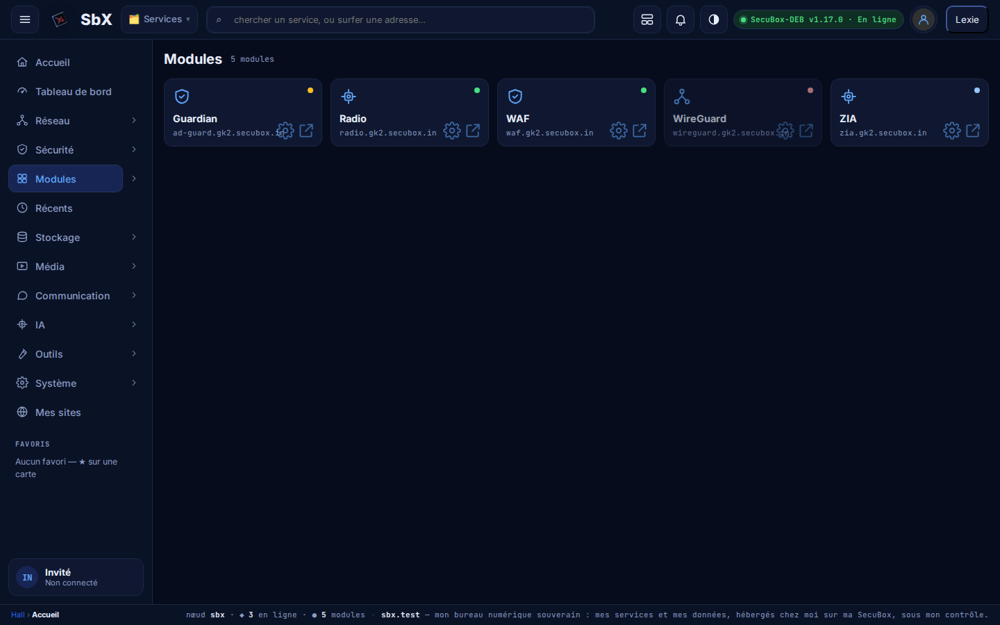

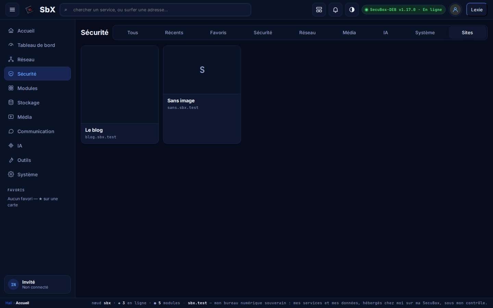

### Menus liés hall ↔ admin, cadre à pleine largeur (2026-10-21, `secubox-webos` 1.18.0)

Demande : « admin.gk2 et hall.gk2 : embedding, make menu linked, relatives, grouping smartly ». La page admin
embarquée masque déjà sa propre coquille (`sbx-embed`, `sidebar.js` du hub) ; c'est donc la sidebar du Hall qui
porte la navigation :

- chaque rubrique (Réseau, Sécurité, Modules, Stockage, Média, Communication, IA, Outils, Système) se déplie sur ses
  modules — le registre regroupé par catégorie et motif —, chacun ouvert embarqué d'un clic (`data-open`) ;
- le module embarqué est marqué dans sa rubrique et sa **sous-navigation** (`GET /api/v1/webos/public/menu/{id}` :
  rubriques BBS, pages d'un service) apparaît sous lui ; un clic passe par la délégation `[data-ctx]` du Hall ;
- pendant l'embarquement, la sidebar devient un **rail d'icônes de 64 px** (complète au survol ou au clavier) et le
  cadre reprend la largeur : le « décalage » observé sur DNS Guard était la mise en page centrée de la page admin,
  plus visible avec 220 px de sidebar.

### `/sbxos/` régénérée (2026-10-21, `secubox-sbxos` 0.6.0~aurora17-3)

La coquille PWA « SBX OS » reprend le profil de la vue maître sans changer d'architecture (mine / hall / ui, composants
du damier, service worker) : jetons `--sbx-*` identiques au Hall (thème clair par redéfinition seule, anciens noms
rebranchés pour le DOM fantôme du damier), topbar (dé SecuBox en SVG, salutation, heure locale, pastille de profil),
barre basse en icônes SVG (cibles 44 px) qui devient la sidebar de 220 px au large, tuiles et réglages aux jetons,
cache `sbxos-v8`. Le dé animé n'y est pas : la PWA hors ligne ne charge rien hors de `/sbxos/`.

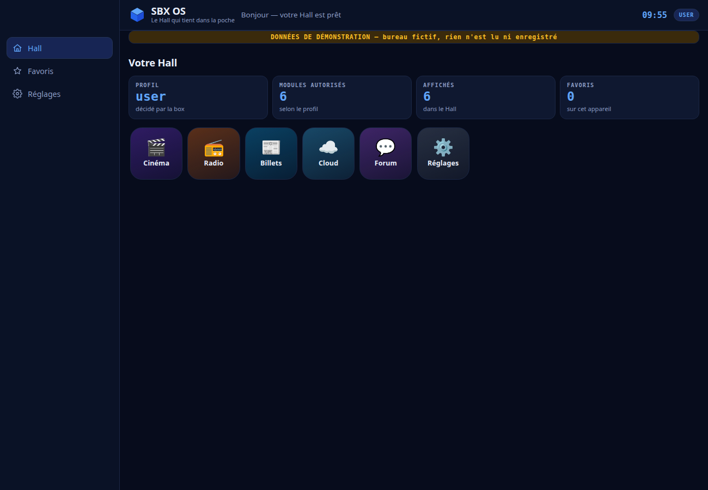

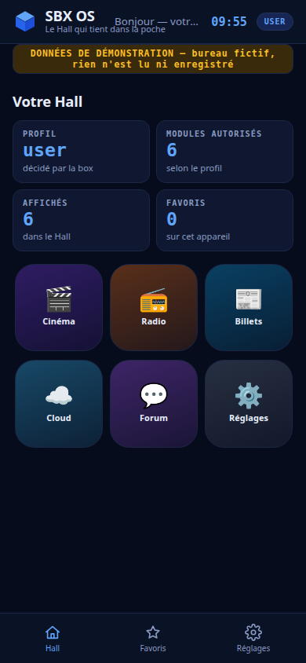

### Identité, avatar et comptes SSO (2026-10-21)

- La carte d'usager de la sidebar lit `GET /api/v1/sbxid/moi` ; avec une identité, l'image vient de
  `GET /api/v1/avatar/par-nom/{pseudo}` (`secubox-avatar` 1.4.0 : identité dont le `username` est le pseudo,
  sans révéler l'identifiant interne ; relais de lecture dédié sur le vhost du Hall, conforme au gabarit).
  Sans image : initiales ; sans identité : rien n'est demandé de plus.
- Deux liens apparaissent avec l'identité : **Mes comptes** (la carte `cardlets/comptes.html`, comptes SSO
  ouverts avec la session du Hall) et **Mon identité** (`/identite/`). L'Identity Manager de l'administration
  (`admin.<domaine>/avatar/`) reste le lieu où l'on crée l'identité et dépose l'image.

### Déployé sur gk2 (2026-10-21)

`secubox-webos` 1.15.1 et `secubox-avatar` 1.4.0 installés sur gk2 (trixie) et publiés dans la suite `trixie`
d'`apt.secubox.in`. Flag `hall_v2` laissé à faux : le Hall classique reste le défaut, la coque se prévisualise par
`https://hall.gk2.secubox.in/?hall=v2`. Rendu réel dans Chromium (aucune erreur de page, dé à 0,13 ms/image) :

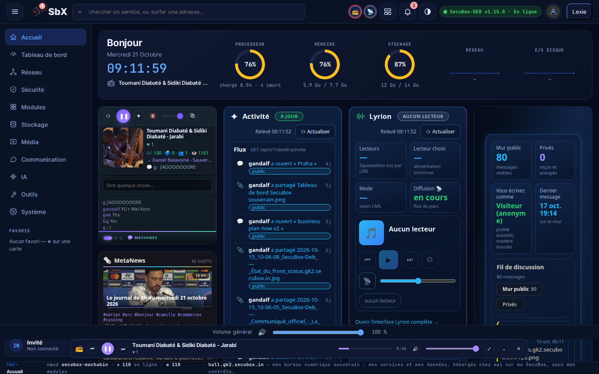

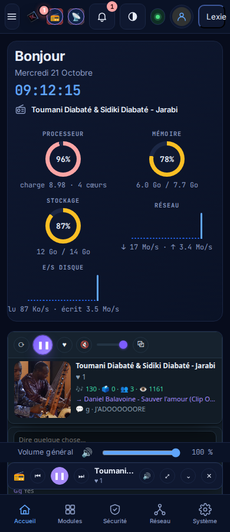

### Phase 4, suite — cartes de l'accueil habillées en `Card`, premier lot (2026-10-22, `secubox-webos` 1.19.11)

Dans l'ordre du prompt (Sécurité, DNS, Réseau, État système, Appareils, Notifications…), rapporté aux cartes réelles du
Hall : **Sécurité** = `securite`, `acteurs`, `radar` ; **DNS** et **Appareils** = `guardian` ; **Réseau** = `dpi`,
`ipv6guard` ; **État système** = le Hero (phase 2) ; **Notifications** = `activite`. La liste `MIGREES` de `hall-v2.js`
porte ce lot. Une carte du lot est **habillée sur place** (`SbxUI.Card({hote: article})`) : en-tête (icône SVG, titre,
pastille de statut typé, action › qui ouvre le service embarqué par la délégation `data-open` du Hall), son cardlet intact
dans le corps (padding 0), pied « hôte · Relevé HH:MM:SS ». L'ancien rendu n'est pas retiré : l'article garde `.fcard`,
`data-embed`, sa poignée ⠿, son étoile ★ et son aide ? (descendues dans la bande du pied pour ne pas tronquer le titre),
donc le glisser, les favoris et l'auto-guide continuent de fonctionner. Le registre pilote pastille, opacité et veille
(`sbxStatut`, `sbxReleve`) ; une carte de curation sans module à son nom (securite, acteurs, radar, guardian, activite) prend
le statut du module qui la sert (`SOURCE_STATUT` : waf, actor, ad-guard, sbxid ; 1.19.12) ; les cartes hors lot gardent le
pied v2 de la phase 3 ; le Hall v1 ne change pas. À alléger plus tard : les cardlets qui portent leur propre en-tête (Activité,
cumul Sécurité) le perdront quand leur corps sera natif.
Tests : `tests/test_cartes_card_2996.py` (lot et ordre, habillage, statut et veille, 390 px sans débordement, v1 intact).

**Second lot (1.19.13)** : Flux d'actualités (`metanews`, `ytflux`, `billets`), Radio dock (`radio`), Mur de discussion (`bbs`),
`ephemeride`, `zigbee`, `devwatch`, `zia`, `comptes`, `lyrion`, `freeboxtv`, L'écoute (`mood`), `ytsas` — icônes SVG ajoutées à
`composants.js`, statut emprunté (ytflux→ytsas, comptes→sbxid, mood→sbxos-audio-mood, freeboxtv→freebox). Restent avec la
carte générique (pied v2) : les cartes hors liste du prompt (Contenu, Cloud, Forums, PeerTube, Podcaster, Coffre, SBX OS, Mes
sites, Messagerie, Accès, Surf & Viewer, VoiceStudio, Voix, Mail, Dépôt, Torrent, SocialRelay).

**Accès rapide (1.19.14)** : la `Card` native de la maquette, sous le Hero — huit `Tile` au plus (auto-fill 104 px) vers le
service embarqué (`data-open`, délégation du Hall) : favoris de la bande ★, puis récents du navigateur, puis la curation ;
pastille du statut typé (emprunté comme pour les cartes) ; l'action › ouvre la mosaïque « Modules ». Redessinée quand les
favoris, les récents ou le registre changent. Tests : `tests/test_acces_rapide_2996.py`.

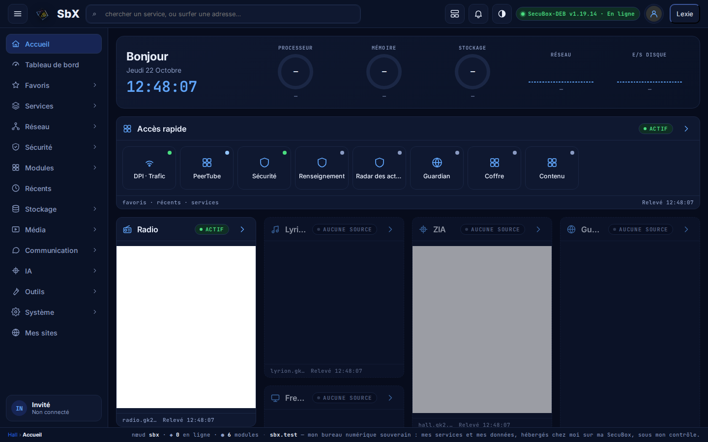

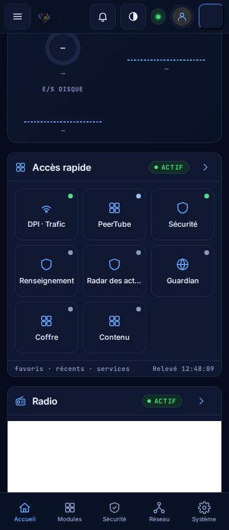

**Flux d'actualités (1.19.16)** : la fusion du prompt — une `Card` native sous Accès rapide, `NewsItem` en tourniquet entre
MetaNews (sujets, `/api/v1/metanews/topics`), YouTube (listes du compte, `/api/v1/ytsas/flux`, session : absent sinon) et
Billets (`/api/v1/billets/feed.json`), neuf entrées au plus, relue toutes les 15 min et au retour de l'onglet ; deux relais
nginx en lecture seule ajoutés au vhost du Hall (sujets + relais d'image de MetaNews pour les vignettes, feed.json des
billets), avec le verdict LAN comme tout relais. Les trois anciennes cartes restent tant que la fusion n'est pas validée (GO
du propriétaire : les retirer de la curation ou les masquer en v2). Tests : `tests/test_flux_actualites_2996.py`.

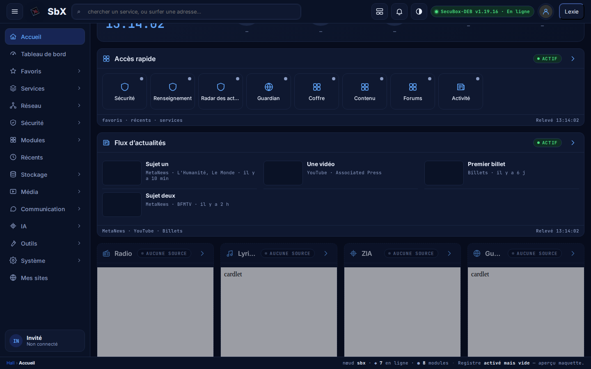

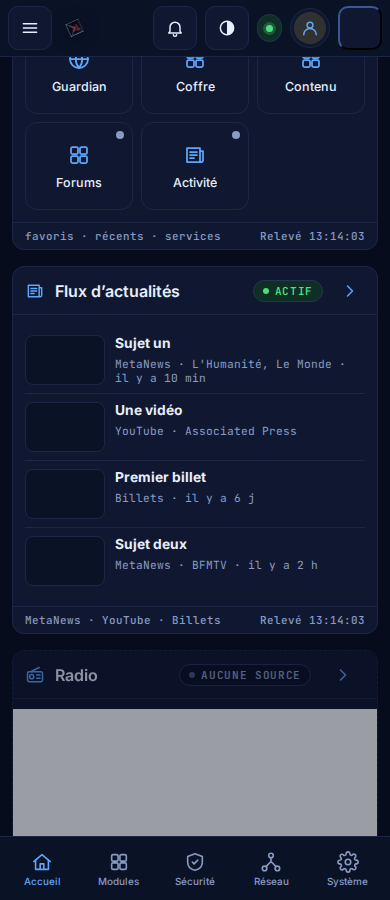

**Plus de double en-tête (1.19.18)** : un cardlet servi par le Hall et habillé en `Card` reçoit `{sbx:'carte'}` (postMessage,
même origine, `/cardlets/` seulement) ; `sonde.js`, qu'ils chargent tous, pose `html.sbx-carte` et une règle : la marque
(icône, titre, sous-titre) disparaît, les commandes de l'en-tête (rafraîchir, réglages) restent, un en-tête sans commande
disparaît en entier. Seul, ou dans le Hall v1, l'en-tête reste. Les micros d'autres origines (MetaNews, BBS, radio…) ne
reçoivent rien : leur en-tête reste tant qu'ils n'exposent pas une variante encartée. Tests : `tests/test_cardlet_encarte_2996.py`.

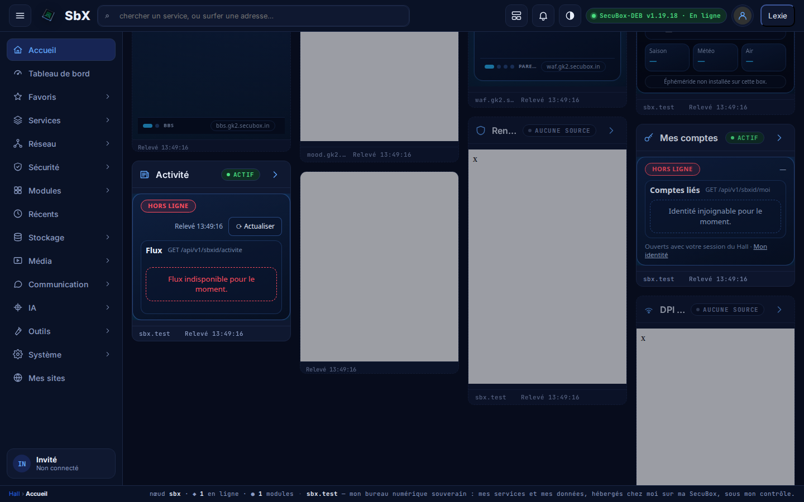

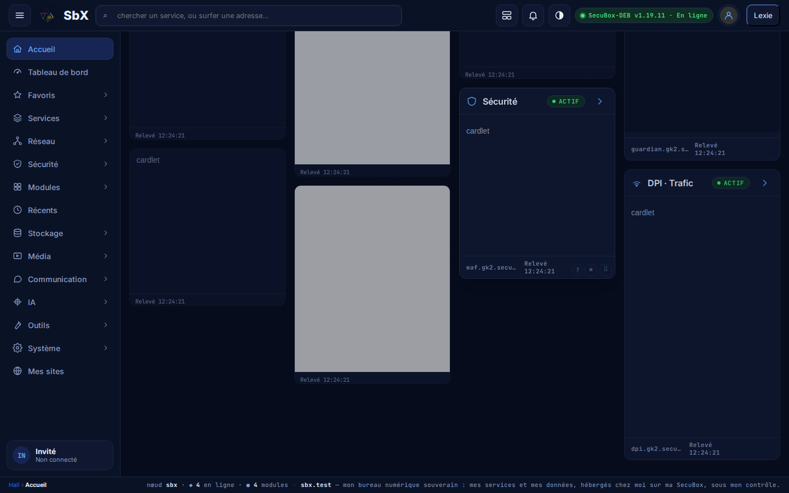

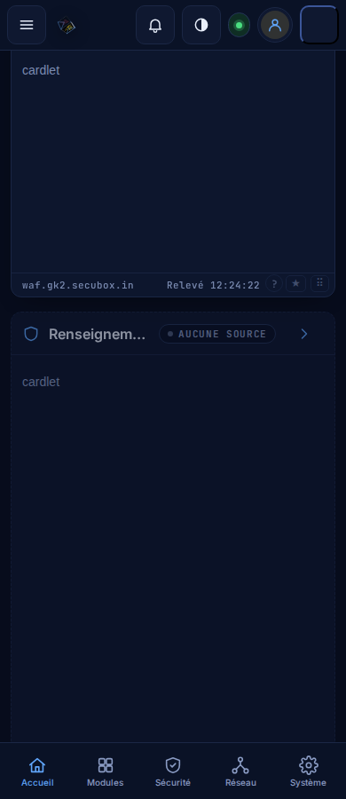

## 6. Reste à faire

- Phase 2, reste : option `hall.v2.hero-dice` (dé de 96 px derrière l'heure), reportée avec la carte « Bonjour ».
- Hors périmètre du Hall, à confirmer : reprendre le relevé `/public/systeme` (dont les E/S) dans les courbes de
  `secubox-metrics` (« Système en direct »).
- Fait le 2026-10-21 (webos 1.19.x) : vignettes des modules (`webos-vignettes` + minuterie, charge ≤ 8, `shotter` sur la
  page publique, nginx statique `/api/v1/webos/public/vignette/{id}`, `vignette` dans le registre) ; **`hall_v2 = true`
  sur gk2** (sauvegarde `/var/backups/webos.toml.avant-hall-v2-*` ; `?hall=v1` rend l'ancien à un navigateur) ;
  rubrique « Mes sites » dans la sidebar. Webos 1.19.3 → 1.19.8 : onglets de la mosaïque retirés, rubriques Récents,
  Services (curation FEATURED) et **Favoris dynamique** (suit la bande ★ de l'accueil, dépliable avec ⚙/⧉, mosaïque au
  clic ; remplace la section statique), menu contextuel `#mnav-ctx` du service embarqué rétabli, colonne vide des
  pages admin embarquées supprimée (hub 1.12.20), sonde HTTP avant capture des vignettes (pages 421/connexion
  exclues). Pages admin embarquées : les marges restantes sont leur conteneur centré
  (`:root.sbx-embed main{max-width:none}` côté `sidebar.css` du hub les étirerait).
- Phase 4, suite : les 20 captures Streamlit demanderaient un relais `/api/v1/streamlit/apps/{nom}/screenshot` sur le Hall.
  Migration vers `Card` : les deux lots de la liste du prompt sont habillés (1.19.11 → 1.19.13) et « Accès rapide » est une
  Card native (1.19.14), « Flux d'actualités » fusionne les trois flux (1.19.16). Les cardlets encartés n'ont plus de double en-tête (1.19.18). Reste : GO sur la fusion
  (retirer ou masquer les cartes MetaNews / Flux YouTube / Billets) ; variante encartée des micros d'autres origines (MetaNews,
  BBS, radio, billets, podcaster) ; lien profond vers un sujet MetaNews (son interface n'en expose pas : la carte ouvre l'accueil). Hors Hall : #3042 (hub, modules
  autonomes metanews / socialrelay absents du menu et du registre → « aucune source »).
- Mesure du dé sur RPi4 (le budget ≤ 1 ms/image est à confirmer sur la cible).
