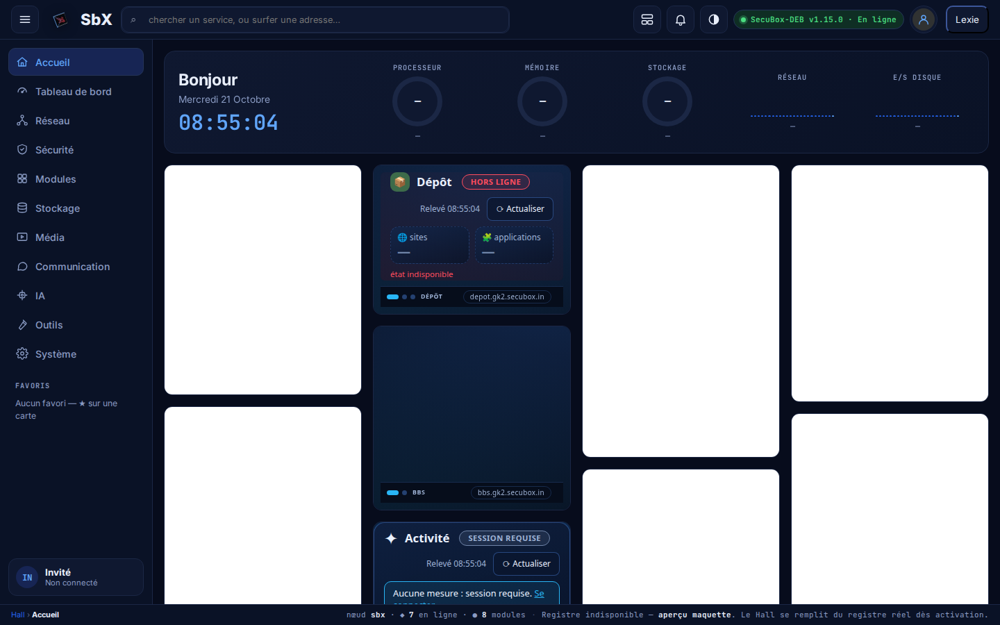
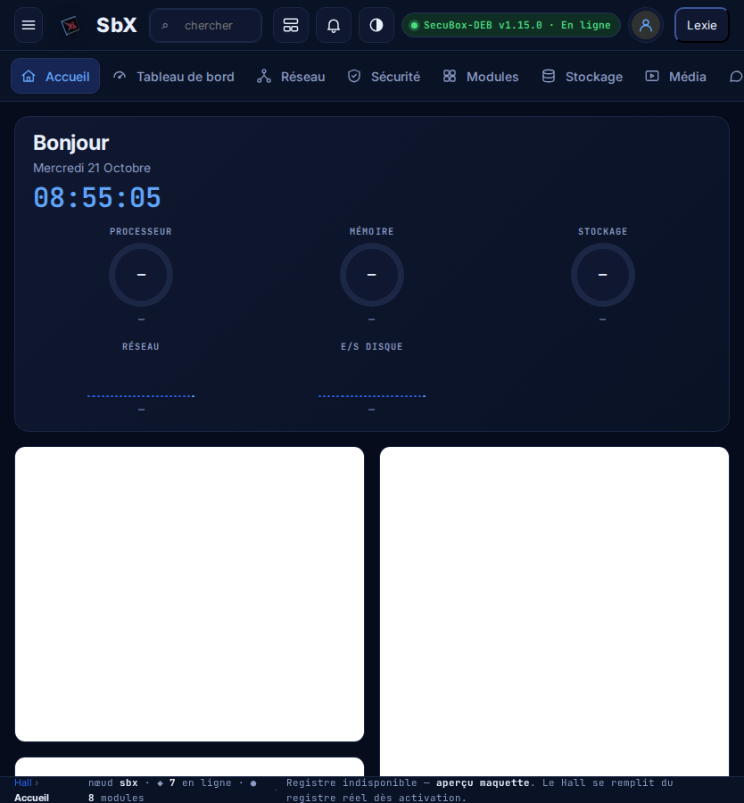
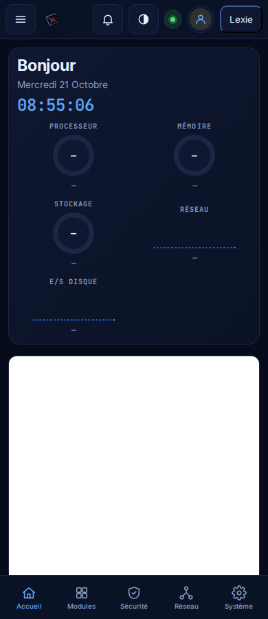
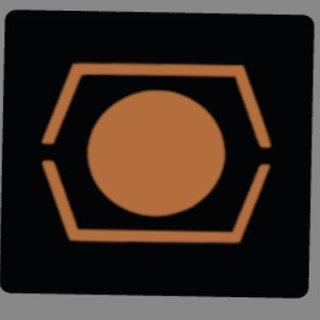
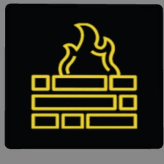
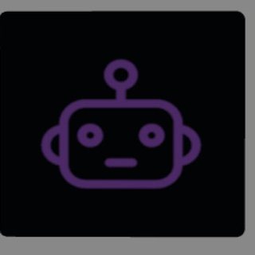
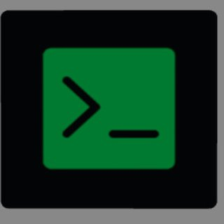
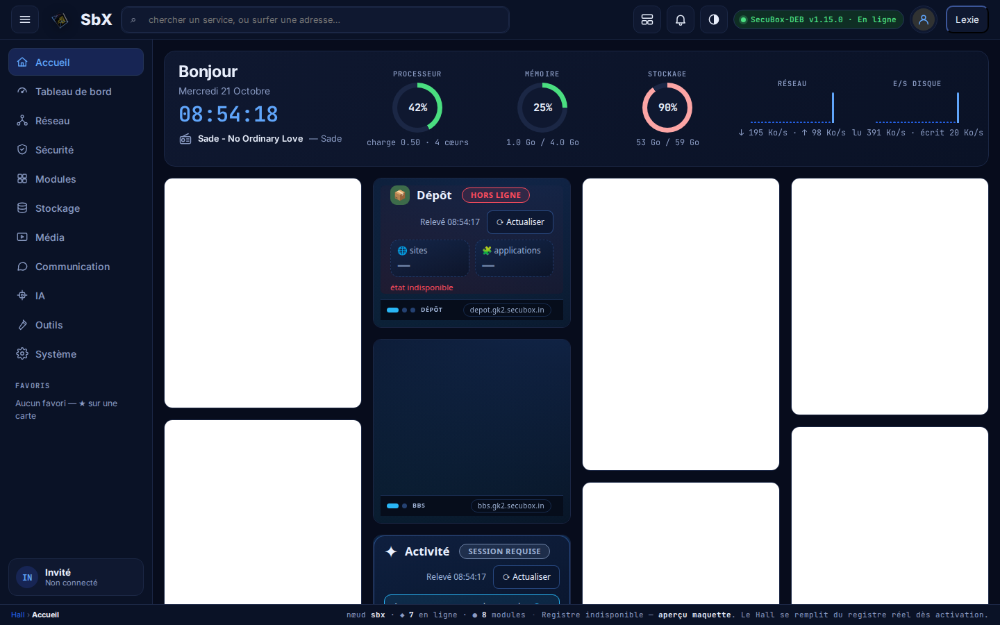
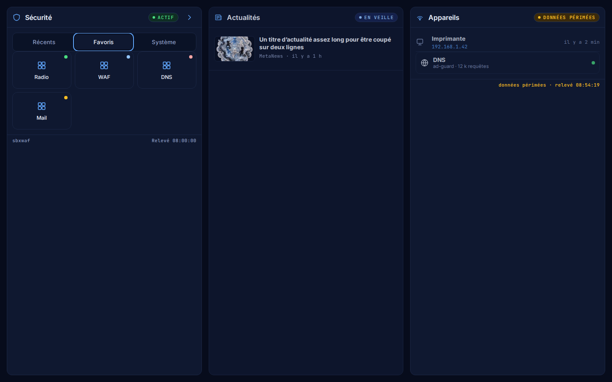

<!--
  SPDX-License-Identifier: LicenseRef-CMSD-1.0
  Copyright (c) 2026 CyberMind — Gérald Kerma <devel@cybermind.fr>
  Source-Disclosed License — All rights reserved except as expressly granted.
  See LICENCE-CMSD-1.0.md for terms.
-->

# Hall — vue maître responsive : maquette définitive, prompt et avancement

> Dossier vivant du chantier **#2996** (`packages/secubox-webos`, vhost `hall.<domaine>`). Il tient
> ensemble le prompt de référence, l'état des lieux, ce qui est livré phase par phase et les captures.
> Les décisions d'arbitrage sont en §4 ; la liste des modules à migrer, en §6.

## 1. Maquette définitive

La référence visuelle est la maquette Claude Design « SbX Hall — redesign responsive » (trois planches :
Bureau 1440, Tablette 834, Mobile 390). On en reproduit la **structure**, pas le pixel près. Les captures
ci-dessous sont celles du Hall réel (rendu Chromium, test `tests/test_hall_v2_2996.py`), coque v2 activée.

### Bureau — 1440 px

Sidebar 220 px (rubriques, favoris, carte d'usager), topbar (menu, recherche, disposition, notifications,
thème, pastille d'état), grille à quatre colonnes.



### Tablette — 834 px

La sidebar devient un rail horizontal collant sous la topbar, les favoris sont masqués, la grille passe à
deux colonnes.



### Mobile — 390 px

Une colonne, sidebar en tiroir (bouton menu, fermeture par Échap ou voile), barre d'onglets fixe en bas
(Accueil / Modules / Sécurité / Réseau / Système), cibles tactiles de 44 px minimum, marge basse de 88 px.



### Le dé SecuBox

Les six faces du dé de `3d.<domaine>`, extraites en fichiers (`www/hall/dice/face-0..5.jpg`, 320 × 320).
Le même jeu sert au thème Plymouth `secubox-cube` (PNG 128 px).

| face-0 | face-1 | face-2 | face-3 | face-4 | face-5 |
|---|---|---|---|---|---|
|  |  |  |  |  |  |

## 2. Prompt de référence

Le texte ci-dessous est le prompt tel qu'il a été donné à l'agent (Claude Code), phases et contraintes
comprises. Il fait foi pour la suite du chantier.

```markdown
# Prompt Claude Code — SecuBox Hall → « Master View » responsive

Contexte : tu travailles dans le dépôt du Hall SecuBox (hall.gk2.secubox.in, SBX OS v3.0.0-alpha.18). Le Hall
actuel est une mosaïque dense de ~118 modules empilés (MetaNews, L'écoute, Radio, Lyrion, Freebox TV, PeerTube,
Flux YouTube, Billets, YTSaS, Mur de discussion, Sécurité, DNS, Actor Intelligence, Radar des acteurs, Zigbee,
DewWatch, ZIA, Éphéméride, Mes comptes, launcher SBX OS…). Objectif : le faire évoluer vers une **vue maître**
structurée, réactive et responsive, sans perdre un seul module ni une seule donnée.

Référence visuelle : maquette Claude Design « SbX Hall — redesign responsive » (3 artboards : Desktop 1440 /
Tablette 834 / Mobile 390). Reproduis sa structure, pas son pixel-perfect.

## Phase 0 — Reconnaissance (obligatoire avant tout code)
1. Cartographie le code du Hall : framework, système de templates, CSS (fichiers, préprocesseur, variables
   existantes), mécanisme de chargement des modules (registre, API, websockets/SSE, polling), i18n, thème clair/sombre.
2. Liste chaque module avec : identifiant, source de données, fréquence de rafraîchissement, états possibles
   (actif / en veille / hors ligne / données périmées / aucune source).
3. Rends-moi un résumé en 20 lignes max + le plan de fichiers à toucher. Attends mon GO avant la phase 1.

## Phase 1 — Design tokens + layout shell
Crée (ou étends) un fichier de tokens CSS unique (`--sbx-*`) :
- Fond `#070C1C`, surface `#0F1830`, surface-2 `#0A1226`, bordure `#243457`, bordure-2 `#1B2745`
- Texte `#E8EEFB`, texte-atténué `#8A9BC3`, accent `#2563EB` / `#60A5FA`
- États : ok `#4ADE80`, warn `#FBBF24`, off `#FCA5A5`, info `#93C5FD` (fond ok `#0F2E24`, warn `#3A2A0C`,
  off `#3B1A1A`, info `#172554`)
- Rayons 10/12/16 px, espacement 4/8/12/16 px, Inter (UI) + JetBrains Mono (chiffres, IP, horodatages)
- Thème clair = redéfinition des tokens uniquement, pas de CSS dupliqué.

Shell de page :
- Sidebar 220 px (Accueil, Tableau de bord, Réseau, Sécurité, Modules, Stockage, Média, Communication, IA,
  Outils, Système + Favoris + carte utilisateur GK2).
- Topbar : menu, recherche globale (modules, fichiers, apps, adresse), disposition, notifications avec badge,
  thème, pastille « SecuBox-DEB vX · En ligne ».
- Zone principale `flex: 999 1 560px; min-width: 0`.

Points de rupture (max-width) :
- **1180 px** : grilles 4 → 2 colonnes, hero pleine largeur.
- **980 px** : sidebar → rail horizontal (favoris masqués).
- **720 px** : 1 colonne, sidebar masquée, barre d'onglets fixe en bas (Accueil / Modules / Sécurité / Réseau /
  Système), padding bas 88 px, cibles tactiles ≥ 44 px.

## Phase 1bis — Logo 3D rotatif dans la topbar (SBXOS)
Source : https://3d.gk2.secubox.in/ (« SecuBox Dice 3D »). Page autonome : un `<canvas>` 2D pur, sans
bibliothèque — matrices 3×3, projection perspective, quads texturés par `ctx.transform` + `clip`, éclairage
Lambert, 6 faces texturées par 6 JPEG embarqués en base64.
1. Extraire, ne pas iframer : Web Component `<sbx-dice size="36" speed="4" fov="40">`, canvas propre, taille par
   attribut (× devicePixelRatio).
2. Textures exportées en fichiers (pas de base64 dans le JS) ; cube uni `#2563EB` tant qu'elles chargent.
3. Placement : remplace l'icône statique du bloc de marque ; `aria-hidden` sur le canvas, le texte reste le
   label accessible.
4. Rotation lente (speed 4), survol → 12, clic → Accueil ; `prefers-reduced-motion` → figé sur la face SecuBox,
   aucune boucle ; pause onglet caché / hors écran ; ≤ 1 ms/frame à 36 px, 30 fps si la moyenne dépasse 8 ms ;
   thème clair : seule l'ombre change.
5. Variante hero `<sbx-dice size="96" fov="55" speed="6">` (option désactivée par défaut).
6. Aucune dépendance ; JS ≤ 8 Ko minifié ; pas de `eval`, pas de fetch distant.

## Phase 2 — Composants
Un composant `Card` générique (header : icône, titre, pastille d'état, action ›) utilisé par **tous** les
modules. Interdit : CSS spécifique par module hors de son body.
- `Hero` : salutation, date/heure live, CPU/RAM/stockage/réseau, titre radio en cours.
- `StatRing` (jauge conic-gradient), `Sparkline` (barres réseau), `Tabs`, `Pill`, `Tile` (accès rapide,
  auto-fill 104 px), `ModuleTile` (nom + sous-titre + pastille).
- `NewsItem` (vignette 16/10 + titre + méta), `DeviceRow` (icône SVG, nom, IP mono, lien, ancienneté).
- Icônes : SVG stroke inline uniquement, pas d'emoji, pas de logos tiers.

## Phase 3 — Réactivité (données)
- Chaque module expose `status` ∈ {active, idle, offline, stale, nosource} ; la pastille et l'opacité
  découlent du status, jamais codées en dur.
- Rafraîchissement par module (SSE ou websocket si disponible, sinon polling avec backoff). Affiche
  « Relevé HH:MM:SS » dans le pied de carte, « données périmées » au-delà de 2× l'intervalle.
- Hero + État système : mise à jour ≤ 5 s. Appareils connectés : ≤ 30 s. Flux d'actualités / YouTube : ≤ 15 min.
- Module en veille (ex. PeerTube) : bouton réveil, chargement différé (IntersectionObserver), aucune requête
  tant que non visible.
- Radio : le lecteur ne doit jamais se recharger lors d'une navigation interne (dock persistant, état global).

## Phase 4 — Migration des modules
Migre module par module vers `Card` **sans retirer l'ancien** tant que le nouveau n'est pas validé (feature
flag `hall.v2`). Ordre : Sécurité, DNS, Réseau, État système, Appareils, Notifications, Accès rapide, Mes
modules (launcher 18 apps + filtres Récents/Favoris/Système/Réseau/Média/IA), Flux d'actualités (fusion
MetaNews + Flux YouTube + Billets), Radio dock, Mur de discussion, Actor Intelligence + Radar, Éphéméride,
Zigbee, DewWatch, ZIA, Mes comptes, Lyrion, Freebox TV, L'écoute, YTSaS. Les modules non listés passent dans
« Tous les modules » avec la carte générique.

## Contraintes
- Zéro dépendance front nouvelle sans mon accord ; pas de framework ajouté.
- Accessibilité : contraste 4.5:1, `<button>`/`<a>` réels, `aria-label` sur icônes seules, navigation clavier complète.
- Perf : premier rendu < 1 s sur RPi4, CSS total < 60 Ko, pas de layout shift au chargement des modules.
- Pas de régression : tout module affiché aujourd'hui doit être atteignable en ≤ 2 clics.
- Commits atomiques par phase, messages en français.

## Livrables par phase
Diff + capture Playwright aux 3 largeurs (1440 / 834 / 390) + liste des modules migrés / restants. Stop et
attends mon GO entre chaque phase.
```

## 3. Phase 0 — état des lieux (2026-10-21)

- Le Hall est le paquet **`secubox-webos`** : FastAPI pur JSON (`/api/v1/webos/*`), front **HTML statique
  monolithique** (`www/hall/index.html`, 5 670 lignes, `<style>` inline de ~81 Ko) + cinq petits scripts.
  Aucun framework, aucun bundler, aucun mécanisme i18n (tout en français).
- Variables CSS existantes non préfixées (`--carte`, `--trait`, `--ink`, `--dim`…) ; thème `data-theme`
  déjà en place (sombre par défaut, bascule `#theme`, propagation aux cadres par `?theme=` et `postMessage`).
- Chargement des modules : **polling `fetch` + `setInterval`** (8 s, 3 s, 15 s, 20 s selon les sondes), pas de
  SSE ni WebSocket ; registre recalculé côté serveur toutes les 15 s (`GET /public/services`).
- 40 cartes déclarées (`api/aide_cartes.json`), 21 cardlets HTML ; états `online|degraded|offline|unknown`,
  les notions « en veille », « données périmées », « aucune source » sont affichées mais non typées.
- Un jeu `--sbx-*` existe déjà dans `secubox-sbxos/sbx-sdk/tokens/tokens.css` ; les noms sont repris.

## 4. Arbitrages

| Sujet | Décision | Pourquoi |
|---|---|---|
| Fichier de jetons | `www/hall/tokens.css`, propre au Hall, noms alignés sur `sbxos` | pas de dépendance inter-paquets pour servir un CSS |
| Activation | flag `hall_v2` dans `/etc/secubox/webos.toml`, lu par `GET /public/etat` ; `?hall=v2` / `?hall=v1` fixent le choix d'un navigateur, `?hall=` l'efface | l'ancien Hall reste le défaut, prévisualisation sans toucher la box |
| CSS historique | laissé inline, non extrait en phase 1 | diff minimal et réversible ; l'extraction suivra la migration |
| Budget CSS | `tokens.css` + `hall-v2.css` < 60 Ko (mesuré par test) ; l'inline historique sort du budget jusqu'à la bascule | la contrainte vise la coque v2 |
| Rubriques → parc | filtre textuel heuristique sur la vue Système | « Mes modules » (phase 4) apportera les vrais filtres |
| Dé SecuBox | extrait en composant, pas d'iframe ; servi par le Hall ; chargé seulement en v2 | CSP sans tiers, aucun coût pour le Hall v1 |
| Libellés des faces | non repris (le composant ne nomme pas les faces) | un libellé de la source nomme un produit tiers que le projet n'utilise pas |
| Variante hero du dé | composant prêt (`size`, `fov`, `speed`), option `hall.v2.hero-dice` reportée en phase 2 | le Hero n'existe pas encore |

## 5. Livré

### Phase 1 + 1bis — `secubox-webos` 1.15.0 (2026-10-21)

- `www/hall/tokens.css` : palette du brief, thème clair par redéfinition seule, pont vers les anciens noms
  **en v2 seulement**.
- `www/hall/hall-v2.css` (coque, ruptures 1180 / 980 / 720) et `www/hall/hall-v2.js` (sidebar, compléments
  de topbar, barre d'onglets, suivi des vues, favoris, usager, notifications, pastille).
- `www/hall/sbx-dice.js` (`<sbx-dice>`, 8 Ko) + `www/hall/dice/face-0..5.jpg` ; thème Plymouth
  `secubox-cube` sur les mêmes faces.
- API : `GET /api/v1/webos/public/etat` → `{hall_v2, version, en_ligne}` ; flag `hall_v2` dans `webos.toml`.
- Tests : `tests/test_hall_v2_2996.py` (jetons, budget, trois largeurs, tiroir, contraste clair/sombre),
  `tests/test_dice_2996.py` (budget, interdits, textures, Plymouth, rotation, survol, reduced-motion, mobile).
  Mesure : dessin moyen **0,29 ms/image** à 36 px dans Chromium (poste de développement).

### Phase 2 — composants (2026-10-21)

- `www/hall/composants.js` (`window.SbxUI`) et `composants.css` : `Card` (en-tête icône, titre, pastille de
  statut, action ›, pied « Relevé HH:MM:SS »), `Pill`, `StatRing` (conic-gradient), `Sparkline` (barres),
  `Tabs` (rôles ARIA, flèches), `Tile` (auto-fill 104 px), `ModuleTile`, `NewsItem` (vignette 16/10),
  `DeviceRow` (icône, nom, IP mono, lien, ancienneté), `Hero`. Tout lit les jetons ; aucune règle par module.
- Statuts `{active, idle, offline, stale, nosource}` → libellé, ton et opacité par CSS.
- `Hero` en tête de l'accueil v2 : salutation, date, horloge, titre radio en cours, et cinq statistiques
  vivantes (processeur, mémoire, stockage, réseau, **E/S disque**) lues toutes les 5 s sur
  `GET /api/v1/webos/public/systeme` (`/proc` hors boucle, cache 5 s, compteurs cumulés → différences côté client).





## 6. Reste à faire

- Phase 2, reste : option `hall.v2.hero-dice` (dé de 96 px derrière l'heure), reportée avec la carte « Bonjour ».
- Hors périmètre du Hall, à confirmer : reprendre le relevé `/public/systeme` (dont les E/S) dans les courbes de
  `secubox-metrics` (« Système en direct »).
- Phase 3 : `status` typé {active, idle, offline, stale, nosource}, « Relevé HH:MM:SS », chargement différé,
  dock Radio persistant.
- Phase 4 : migration dans l'ordre du prompt ; les cartes non migrées sous « Tous les modules ».
- Mesure du dé sur RPi4 (le budget ≤ 1 ms/image est à confirmer sur la cible).
