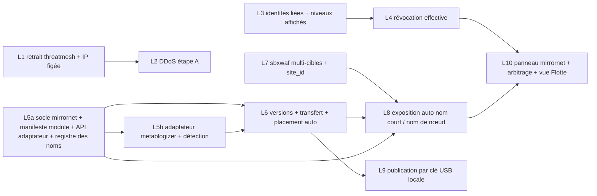

<!--
  SPDX-License-Identifier: LicenseRef-CMSD-1.0
  Copyright (c) 2026 CyberMind — Gérald Kerma <devel@cybermind.fr>
  Source-Disclosed License — All rights reserved except as expressly granted.
  See LICENCE-CMSD-1.0.md for terms.
-->

# Plan de l'Alpha 21 — MirrorNet fondations (#3429, phase B)

CONCEPTION à valider avant tout code. Un lot = une issue = un worktree = une PR (`AGENTS.md`, flux de travail).
Chaque lot monte la version des paquets touchés, met à jour leur README si API/TOML/`debian/control` change, et
porte ses tests. Déploiement : par apt, banc **gk6/gk4 d'abord**, gk2 en dernier, sur accord ; gk9 pour la clé USB.

## 0. Arbitrages et vision (2026-11-03)

La **vision du propriétaire** et la règle de **conflit de nom court** (`architecture.md` § 0) font foi :

- **Automatique** : publication sur un nœud (`toto.<nœud>.secubox.in`, y compris clé USB locale) → nom court
  `toto.secubox.in` annoncé par le maillage, miroir d'office sur un autre nœud, répartition des visites ; aucun geste
  du propriétaire ni signature pour diffuser.
- **Conflit** : premier publieur garde le nom court ; contenu différent ultérieur reste sur son nom de nœud ; antériorité
  non établie → aucun nom court jusqu'à arbitrage administrateur ; même contenu = miroir. Antériorité : horodatage
  d'annonce signé par la box, marge d'horloge, fenêtre de convergence (`distributed-hosting.md` § 6).
- **Signature OpenPGP des sites : REPORTÉE** (décision 3). A21 = authenticité par l'identité du nœud (annuaire +
  WireGuard) et niveaux de confiance affichés.
- **Inchangé** : décision 1 (modules maîtres + `mirrornet.d` + API adaptateur ; mirrornet = plan de contrôle), décision
  2 (`ConfigBlob` par version), décision 4 (routes sbxwaf multi-cibles), décision 5 (modes de défense) ; gk2 seule
  entrée Internet (sert sa copie ou relaie par wg-mesh).
- Services locaux distribués et services équivalents (Voice Studio gk3) : **conception seulement** ; adaptateur en A22 ;
  gk3 intouchable.

Périmètre A21 : manifeste de module + API adaptateur (avec détection des publications) + adaptateur metablogizer,
registre des noms courts (antériorité, conflits, arbitrage), placement automatique des miroirs, liaison des identités,
niveaux affichés sans effet, révocation effective, sbxwaf multi-cibles pour le statique, transfert vérifié, publication
par clé USB locale, panneau mirrornet et vue Flotte, DDoS étape A, retrait threatmesh.

**Hors A21** : signature des sites et tout ce qui en dépend (record `Proprietaire`, `gpgv` par service, support USB
signé et révocation de support, délégués, chaîne multi-nœuds d'un même propriétaire) — **chantier ultérieur** ;
adaptateurs streamlit et Voice Studio, partage de charge entre services équivalents, écritures répliquées, quorum,
réputation, bans fédérés MCD, KeySuccession, keepalived, DNS multi-cibles.

## 1. Ordre et dépendances

Files parallélisables : **défense** (L1 → L2), **confiance** (L3 → L4), **hébergement** (L5a → L5b → L6 → L8, L7 en
parallèle, L9 après L6). L10 ferme l'Alpha 21.

**Ordre de fusion** : L1, L3, L5a, L7, L5b, L2, L4, L6, L8, L9, L10.

## 2. Lots

### L1 — Retrait de threatmesh et IP de gk2 retirée de l'unité générique (#3417, correctif immédiat)

| Rubrique | Contenu |
|---|---|
| Fichiers | `secubox-threatmesh/api/main.py` (retrait de `POST /mesh/ingest`, `:236-251`, et de la diffusion `:165-182`), `secubox-threatmesh/systemd/secubox-threatmesh.service:13` (plus de `0.0.0.0:8780`), `secubox-threatmesh/nftables.d/secubox-threatmesh.nft`, `secubox-toolbox/sbin/secubox-blacklist-sync` (plus d'IoC maillage), `secubox-waf-ng/systemd/secubox-waf-ng.service:147` (`--actor-ban-protegees` lu depuis un fichier) ; `debian/postinst` (migration de la plage de gk2) |
| Interfaces | suppression d'une route non signée ; `/etc/secubox/ddos.toml` `[admin]` amorcé |
| Tests | plus d'écoute TCP 8780 ; `blacklist-sync` sans source maillage ; postinst préserve la plage protégée de gk2 |
| Risques | perte du partage non signé avant la MCD (accepté) ; plage protégée perdue si migration ratée → test dédié |
| Dépendances | aucune |

### L2 — DDoS étape A, durcissement local (#3417)

| Rubrique | Contenu |
|---|---|
| Fichiers | `/etc/secubox/ddos.toml` (schéma), drop-in NOUVEAU `secubox-hardening/nft/` → `/etc/nftables.d/secubox-ddos.nft` (`inet secubox_ddos`, compteurs), `secubox-waf-ng/config/secubox-waf-ratelimit.nft`, `secubox-hardening/conf/99-secubox-hardening.conf`, `secubox-haproxy/sbin/haproxyctl:1060-1068` |
| Interfaces | `ddos.toml` `[admin]`, `[seuils]`, `mode = "compteurs" \| "drop"` ; lecture `GET` (`require_lecture`) |
| Tests | `nft -c` ; table présente après `flush ruleset` ; `allow_admin` avant tout meter ; sets bornés ; HAProxy `-c` |
| Risques | coupure admin ; CGNAT ; mémoire ; **jamais** d'action sur l'interface WAN ; compteurs d'abord |
| Dépendances | L1 |

### L3 — Identités liées et niveaux de confiance affichés (N2, N3 lecture)

| Rubrique | Contenu |
|---|---|
| Fichiers | `secubox-annuaire/annuaire/model.py:505-532` (`NodeRecord` : `openpgp_empreinte`, `cert_sbx_serie` optionnels — clé **de box**, sans rapport avec la signature de site reportée), NOUVEAU `secubox-annuaire/annuaire/confiance.py`, `secubox-annuaire/api/main.py` (`GET /confiance`), `secubox-p2p/api/mesh.py` (comparaison WG ↔ `NodeRecord`, journal seul) |
| Interfaces | `GET /api/v1/annuaire/confiance` → `[{did, nom, niveau, cause, lie}]` ; Grants `mirrornet.partenaire` / `mirrornet.confiance` |
| Tests | table de vérité ; ancien `NodeRecord` lu ; Grant TRUSTED d'une box non ancrée ignoré ; aucun changement de wg rendu |
| Risques | montée de schéma `extra="forbid"` → champs publiés quand tout le parc lit la version (drapeau) |
| Dépendances | aucune |

### L4 — Révocation effective sur le transport (N4)

| Rubrique | Contenu |
|---|---|
| Fichiers | `secubox-p2p` : verbe root `revocations-appliquer`, minuterie 30 s, `api/oubli.py`, projection `pairs-enroles.json` ; exception RULES-CODE si unité root |
| Interfaces | audit `pair_revoque_applique` ; appel `mirrornetctl route-retirer` et suspension des noms courts du nœud révoqué quand L8 existe (sinon no-op) |
| Tests | pair en ligne retiré ; maître ancré et soi refusés ; annuaire absent → rien ; < 60 s (gk4) ; noms courts du révoqué suspendus (après L8) |
| Risques | révocation par erreur → confirmation administrateur (`POST /revoke`, `secubox-annuaire/api/main.py:393`) ; jamais d'action WAN |
| Dépendances | L3 |

### L5a — Socle `secubox-mirrornet`, manifeste de module, API adaptateur, registre des noms courts (N1)

| Rubrique | Contenu |
|---|---|
| Fichiers | NOUVEAU `packages/secubox-mirrornet/` (`api/`, `debian/`, `systemd/`, `apparmor/`, `sbin/mirrornetctl`, `tests/`, README) ; lecteur `mirrornet.d` (modèle `secubox-zia/api/capabilities.py:35,162-174`) ; schémas du manifeste de module et du manifeste de service **généré** ; spécification et client de l'API adaptateur (avec `publications`) ; NOUVEAU `registre_noms.py` : fonction pure d'antériorité (annonces `nom.<nom>.<nœud>`, `marge_horloge`, `fenetre_convergence`, arbitrage, source révoquée/absente) ; `/etc/secubox/mirrornet.toml` |
| Interfaces | `GET /api/v1/mirrornet/{modules,services,service/{nom},noms}` (`require_lecture`) ; `POST /nom/arbitrer` (`require_jwt`, maître ancré) ; `ConfigBlob` scopes `nom.<nom>.<nœud>`, `nom.<nom>.arbitrage`, `mirrornet.parametres` |
| Tests | manifeste de module strict ; manifeste de service (schéma, noms réservés, `waf_bypass` refusé) ; **registre** : premier publieur, contenu différent ultérieur refusé, simultanées → bloqué, antidatage borné, partition → contesté, même contenu → miroir, source révoquée → suspendu, absente → conservé, arbitrage prime ; 4R ; adaptateur factice ; socle systemd § 10 |
| Risques | aucun effet réseau ni contenu (lecture, calcul, contrat) |
| Dépendances | aucune |

### L5b — Adaptateur metablogizer et détection des publications (N1)

| Rubrique | Contenu |
|---|---|
| Fichiers | `secubox-metablogizer` : `mirrornet.d/metablogizer.toml` (`debian/rules`) ; routes `/api/v1/metablogizer/mirrornet/{publications,exporter,installer,activer,desinstaller,etat}` ; notification à mirrornet à la publication (`site_publish`, `sbin/metablogizerctl:134`) ; versions côte à côte + lien `courante` ; vhost de copie `:8472` (127.0.0.1 + IP wg-mesh) ; sonde `/.secubox/version` ; réutilise `_extract_archive` (`composants/publish/api/main.py:812`) |
| Interfaces | API adaptateur v1 ; aucune route existante modifiée |
| Tests | contrat L5a rejoué ; publication détectée sans geste ; archive hostile ; bascule atomique sous lecture ; sites non distribuables inchangés |
| Risques | régression des sites de gk2 → l'adaptateur n'agit que sur les sites publiés après activation de mirrornet ; `/srv` sur `/data` exigé. **Point ouvert** : diffuser d'office les sites déjà publiés sur gk2 ou seulement les nouveaux |
| Dépendances | L5a |

### L6 — Versions, transfert vérifié, placement automatique des miroirs (N6)

| Rubrique | Contenu |
|---|---|
| Fichiers | `secubox-mirrornet` (annonces `service.<nom>.v.<empreinte16>`, objets opaques, nginx `:8471` wg-mesh, drop-in nft, placement `copies.<nom>`, refus de copie et re-placement, sondes, `installer`/`activer`) ; correction du chemin cité par `.claude/RULES-CODE.md` § 1 |
| Interfaces | `GET /versions/{nom}`, `/objets/<empreinte>` ; `[hebergement] accepter` dans `mirrornet.toml` |
| Tests | annonce d'un nœud non enrôlé ou révoqué ignorée ; empreinte fausse → autre source ; ≥ 1 copie hors du nœud source sans geste ; refus de quota → autre nœud ; fast-forward ; bascule atomique ; disque insuffisant |
| Risques | disque de gk2 (`/data` exigé) ; débit WAN ; nœud source compromis non révoqué = diffusion (limite assumée sans signature) |
| Dépendances | L5a, L5b |

### L7 — sbxwaf multi-cibles et `site_id` (N5)

| Rubrique | Contenu |
|---|---|
| Fichiers | `secubox-toolbox-ng/cmd/sbxwaf/routes.go:106,285`, lecture de `/run/secubox/mirrornet/sante.json`, `secubox-toolbox-ng/internal/actor/envelope/envelope.go:100-108` (`site_id`) ; `secubox-core/usr/sbin/secubox-waf-route` (verbe multi-cibles) ; AppArmor de sbxwaf |
| Interfaces | format de route `load-balancing.md` § 2 (décision 4) ; `Lookup` sans E/S |
| Tests | golden test forme tableau ; forme objet ; bench latence ; enveloppe ActorD rétrocompatible |
| Risques | WAF de la seule box exposée : gk6 → gk4 → gk2, retour arrière prêt ; aucune route existante modifiée |
| Dépendances | aucune |

### L8 — Exposition automatique : nom de nœud, nom court, certificats

| Rubrique | Contenu |
|---|---|
| Fichiers | `secubox-mirrornet/sbin/mirrornetctl` (`vhost-poser`, `route-poser`, `route-retirer` via `haproxyctl vhost add` et `secubox-waf-route`), réaction aux changements du registre des noms (titulaire → route multi-cibles ; refusé/bloqué → nom de nœud seul ; suspendu → retrait), `secubox-dns/composants/dns-provider/api/joker.py` (`*.secubox.in`), sudoers argv exact, exception RULES-CODE |
| Interfaces | `<nom>.<nœud>.secubox.in` posé dès la publication ; `<nom>.secubox.in` posé à la titularité ; sur gk2 : copie locale ou relais wg-mesh |
| Tests | aucun `waf_bypass` ; refus d'écraser une route étrangère ; nom bloqué jamais exposé ; passage titulaire → bloqué retire le nom court ; certificat relu |
| Risques | joker de l'apex et vhosts existants de gk2 ; nginx :80 = HAProxy |
| Dépendances | L5a, L6, L7 |

### L9 — Publication par clé USB locale

| Rubrique | Contenu |
|---|---|
| Fichiers | `secubox-mirrornet` : règle udev `SBXSITE`, unité root `mirrornet-usb@.service` (monter/copier/démonter), contrôle de schéma non root, remise à l'adaptateur, `[usb]` dans `mirrornet.toml` ; exception RULES-CODE § 10 |
| Interfaces | aucune route d'adoption : publication automatique ; `GET /usb` (dernières lectures, `require_lecture`) |
| Tests | `usb-master-source.md` § 7 ; banc gk9 |
| Risques | support hostile (`ro,nodev,nosuid,noexec`, aucun analyseur root) ; confusion avec `SBXPROFIL` (test) ; publication par accès physique (réglage `[usb] publication`) |
| Dépendances | L6 |

### L10 — Panneau de master control, arbitrage des conflits, vue Flotte (N13)

| Rubrique | Contenu |
|---|---|
| Fichiers | NOUVEAU `secubox-mirrornet/www/mirrornet/` (modules déclarés, services, copies par nœud, versions, état du nom court, conflits, routes) ; `secubox-annuaire/www/fleet/` (onglet), `GET /flotte`, carte Hall |
| Interfaces | `GET /api/v1/mirrornet/flotte` (`require_lecture`) ; geste A21 unique : **arbitrer un conflit** (`POST /nom/arbitrer`, `require_jwt`, audit) ; avertissement « gk2 entrée unique » |
| Tests | vue Flotte sans route mutante ; arbitrage sous `require_jwt` seul, audité ; dégradation sans backend ; charte `.claude/WEBUI-PANEL-GUIDELINES.md` |
| Risques | charge sur gk2 : agrégat en cache fichier (`.claude/reference/PERF-CACHE.md`) |
| Dépendances | L4, L8 |

## 3. Tests de banc et critère de sortie

Banc : **gk2** (seule entrée Internet), **gk6**, **gk4** ; **gk9** pour la clé USB (matériel, mémoire, `/data` et
adresse maillée **NON VÉRIFIÉS**, à relever en tête de campagne ; à défaut, gk6). gk1 et gk3 intouchables.

| Lot | Banc |
|---|---|
| L1, L2 | gk4/gk6 puis gk2 (compteurs seuls sur gk2) |
| L3, L4 | gk6/gk4 enrôlés ; révocation de gk4 |
| L5b, L6 | publication sur gk6 → copie d'office sur gk4 ou gk2 ; quota |
| L7 | gk6 → gk4 → gk2, table de routes réelle relue |
| L8 | `toto.gk6.secubox.in` puis `toto.secubox.in` via gk2 ; conflit gk6/gk4 |
| L9 | clé `SBXSITE` sur gk9 → `toto.gk9.secubox.in` → nom court → copie |
| L10 | arbitrage d'un conflit bloqué depuis gk2 |

Sortie : scénarios S1 à S13 de `testing.md` passés, mesures ARM64 et x86_64 consignées, aucun `waf_bypass` ajouté,
masterlink absent par défaut, entrée `HISTORY.md` par lot, issues fermées une fois déployées (`closes #N` puis
`scripts/sync-issues.sh`).

## 4. Après l'A21

- **Alpha 22** : adaptateur streamlit ; adaptateur Voice Studio et partage de charge entre services équivalents (banc
  hors gk3) ; gestes du panneau relayés par le pilotage ; écritures répliquées (N8), réputation (N7), MCD (N9),
  niveaux à effet (filtrage des publieurs).
- **Chantier ultérieur (décision 3 reportée)** : signature locale des sites, record `Proprietaire`, `gpgv` par service,
  support USB signé et révocation de support, chaîne d'un même propriétaire sur plusieurs nœuds.

## 5. Points ouverts

1. « Même propriétaire » sans signature : A21 le réduit au même contenu ; rattacher un contenu nouveau d'un même
   propriétaire sur un autre nœud exige un arbitrage ou la signature reportée.
2. Valeurs de `marge_horloge` (120 s), `fenetre_convergence` (10 min), `delai_abandon` (30 j) à confirmer ; horloges
   NTP du parc NON VÉRIFIÉES.
3. **Tranché (propriétaire, 2026-11-04)** : diffusion d'office des **nouveaux** sites seulement ; un site déjà publié ne se diffuse que par activation manuelle, avec un bouton pour mailler ou démailler un site depuis le maître (panneau metablogizer, à porter par L5b et L10).
4. Publication USB activée par défaut sur toute box (vision) ou coupée sur les box accessibles à des tiers : **à l'étude par le propriétaire** (bloque L9).
5. Garde de service des appels mirrornet → adaptateur (socket locale) à définir.
6. Filtrage effectif des publieurs par niveau en A21 (aujourd'hui : affiché seulement, tout nœud enrôlé publie).
