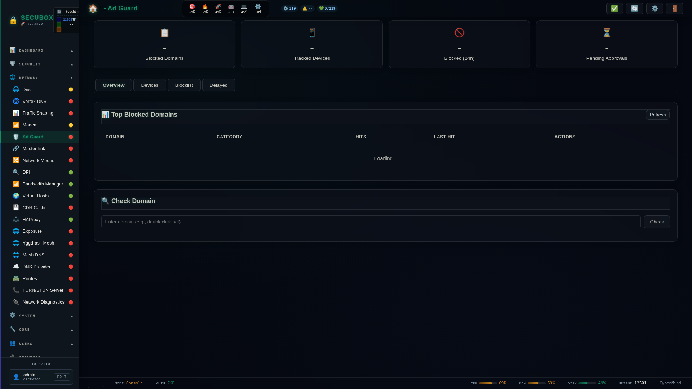

<!--
  SPDX-License-Identifier: LicenseRef-CMSD-1.0
  Copyright (c) 2026 CyberMind — Gérald Kerma <devel@cybermind.fr>
  Source-Disclosed License — All rights reserved except as expressly granted.
  See LICENCE-CMSD-1.0.md for terms.
-->

# 🚫 AdGuard

AdGuard Home DNS blocking

**Category:** DNS

## Screenshot



## Features

- Ad blocking
- Tracking protection
- Parental control
- Statistics

## Installation

```bash
# Add SecuBox repository
curl -fsSL https://apt.secubox.in/install.sh | sudo bash

# Install package
sudo apt install secubox-ad-guard
```

## Configuration

Configuration file: `/etc/secubox/ad-guard.toml`

## API Endpoints

- `GET /api/v1/ad-guard/status` - Module status
- `GET /api/v1/ad-guard/health` - Health check

## License

LicenseRef-CMSD-1.0 (Source-Disclosed License) — CyberMind © 2024-2026.
See [LICENCE-CMSD-1.0.md](../../LICENCE-CMSD-1.0.md).


## POC « DNS AdBlock TV » (1.2.0, #1943)

Mesure ce que le filtrage DNS bloque réellement pour des appareils choisis (Freebox TV) : **OBSERVE** (rien n'est bloqué, on compte ce qui l'aurait été) ou
**BLOCK**. Formulation : *réduction des domaines publicitaires/tracking résolus par DNS* — pas une suppression de publicités. Ni MITM, ni cookie, ni URL.
**Inactif par défaut.** Conception et audit : `docs/poc-dns-adblock-tv.md` ; résultats : `docs/poc-dns-adblock-tv-results.md`.

| Pièce | Rôle |
|---|---|
| `api/dnstv.py`, `api/dnstv_routes.py` | bibliothèque (analyseur du journal d'Unbound, classeur, état, SQLite, configuration Unbound) et routes `/api/v1/ad-guard/adblock-tv/*` |
| `sbin/secubox-adguard-tv` | **seule porte root** : `apply` / `disable` / `status` ; relit et revalide l'état, refuse les liens symboliques, `unbound-checkconf` avant de garder |
| `sbin/secubox-adguard-dnsfeed` | démon (`secubox`) : compteurs par jour / appareil / domaine / décision (`ALLOWED`, `BLOCKED`, `UPSTREAM_ERROR`) depuis `journalctl -u unbound` |
| `lists/` | jeu de test versionné (`# version:`, `MANIFEST.json`) : advertising, tracking, telemetry, social, custom |
| `tools/dns-tv-test.py` | test côté client : résolution, temps, statut ; `BLOCKED` seulement avec un résolveur de référence |
| `tools/dns-limits-lab.py` | banc local (vrai Unbound) qui **démontre** les limites A–G |
| `tools/tv-before-after.py` | procédure A/B/C sur un appareil réel, par différence de relevés |

Routes (`require_lecture` en lecture, `require_jwt` pour agir) : `status`, `etat`, `clients`, `mode`, `stats`, `export`, `clients/vus`, `custom`, `sonde`, `path-test`, `bypass`, `limites`.

```
# activer
(onglet « DNS AdBlock TV » : ajouter l'appareil, cocher Activé)   puis   systemctl enable --now secubox-ad-guard-dnsfeed
# tests
cd packages/secubox-ad-guard && python3 -m pytest tests          # le banc Unbound se saute si `unbound` est absent
python3 tools/dns-limits-lab.py --rapport reports/dns-limits.json
python3 tools/dns-tv-test.py --serveur 192.168.1.200 --reference 1.1.1.1 --list tools/test-domains.txt --rapport reports/dns-test.json
# retour arrière (le retrait du paquet le fait aussi)
sudo secubox-adguard-tv disable && sudo systemctl disable --now secubox-ad-guard-dnsfeed
```

### Fichier d'échange pour le DPI (1.6.0, #1960)

`dpi-feed.json` (`0600`) : un résumé par appareil du LAN (MAC) pour le jour courant — requêtes, blocages, noms, **top 10 des services** (organisation + type) et types. Recalculé au plus
toutes les 5 minutes par `secubox-adguard-auto`. Aucun nom de domaine demandé n'y figure ; pas de volumes. Lu par `secubox-dpi` (`GET /api/v1/dpi/lan_dns`).

### Mode auto (1.4.0, #1954)

Un appareil en mode `auto` voit ses domaines publicitaires **appris** (comparaison des requêtes pendant les coupures et en lecture normale), proposés comme
*candidats*, puis **essayés 24 h** et **confirmés** par l'administrateur ; un essai non confirmé est retiré. Retour arrière : bouton « Ça ne marche plus » et
signaux indirects. Spécification : `docs/superpowers/specs/2026-10-03-adguard-tv-auto-design.md`.

| Pièce | Rôle |
|---|---|
| `api/dnstv_regles.py` | règle (appareil, domaine, état), machine à états, `regles.json` (écriture atomique, lecture sans lien symbolique) |
| `api/dnstv_detect.py` / `api/dnstv_signaux.py` | détection des candidats et signaux de casse (seuils de départ, à calibrer) |
| `api/dnstv_auto.py`, `sbin/secubox-adguard-auto` | moteur d'un passage, lancé chaque minute par `secubox-ad-guard-auto.timer` |
| `secubox-adguard-tv regles-appliquer` | application **à chaud** (`unbound-control view_local_zone`), repli sur rechargement complet |

### Autorisations par appareil (1.6.2, #1965)

Le puits complet peut refuser un nom nécessaire à un service (cas réel : `licensing.bitmovin.com` empêchait le replay RMC). `etat.json` porte `autorisations` {identifiant de l'appareil -> domaines} :
un `local-zone-override` par adresse exempte l'appareil de CE nom, sans toucher aux autres clients (mesuré sur Unbound 1.17.1, y compris dans une vue `view-first`). Routes : `POST auto/appareils/{nom}/autoriser`
(`AutoriserIn{domaine, actif}`), `GET auto/appareils/{nom}/refus?minutes=` ; panneau : bouton « Autorisations » par appareil. Un changement recharge Unbound (≈ 7 s sans DNS) et s'audite.

### Suivi des IPv6 de confidentialité et plafond (1.7.3, #2146)

Le suivi rattache à un appareil (par sa MAC) ses nouvelles adresses vues par le DNS, dans la limite de 4 adresses par appareil. Quand le plafond est atteint, une **IPv6 qui n'a plus été vue
depuis 6 heures**, et plus ancienne que la nouvelle, lui cède sa place, même si elle avait été déclarée : sans cela, les IPv6 de confidentialité périmées occupaient les quatre places pour toujours, la TV
sortait de sa vue au premier changement d'adresse et perdait ses exemptions (cas réel : replay Free qui tournait sans fin, `imasdk.googleapis.com` bloqué). Jamais l'IPv4, jamais une adresse encore vue.

### Ajout automatique, puits complet et agrégation (1.5.0, #1959)

Un appareil qui interroge des serveurs d'insertion publicitaire ET au moins deux services de contenu est reconnu (« TV/streamer probable »), regroupé par **MAC**, puis ajouté en
mode par défaut avec le **profil de base** (`lists/profil-tv-base.txt`, 35 domaines validés). `ajout_auto` est **faux par défaut** ; l'administrateur l'active dans le panneau.
Garde-fous : 3 appareils par jour, un changement du périmètre par heure (rechargement d'Unbound ≈ 10 s), 32 adresses, liste `ignores`, audit. En mode `auto` la vue Unbound porte
`view-first: yes` : l'appareil **garde le puits de production** et ses règles s'y ajoutent (réglage `puits` par appareil ; faux = ancien comportement transparent).
Le DNS ne distingue pas une TV d'un téléphone qui regarde le même replay : « Retirer et ne plus ajouter » suffit. Seuils : section `[adblock_tv_auto]` (valeurs de départ).

| Pièce | Rôle |
|---|---|
| `api/dnstv_detecteur.py` | détection par comportement, compteurs par jour regroupés par MAC |
| `api/dnstv_ajout.py` | ajout, suivi des adresses (IPv6 qui change), plafonds, `suivi-ajout.json` |
| `api/dnstv_profil.py` | graine, profil agrégé (`profil-agrege.json`), candidats communs |

Routes : `auto/detection`, `auto/detection/reglage`, `auto/appareils/{nom}/ignorer`, `auto/appareils/{nom}/puits`, `auto/profil`. Modèle Pydantic : `ReglageDetectionIn{ajout_auto?, mode_defaut?}`, `PuitsIn{actif}`.
L'état gagne `mode_defaut`, `ajout_auto`, `ignores` ; chaque appareil `mac`, `origine`, `ajoute`, `preuve`, `puits` (écrits seulement hors défaut).

Le contrôleur root range son instantané, sa marque « désactivé » et son verrou dans `/var/lib/secubox-adguard-tv/` (root, 0700), **hors** de l'arbre de
`secubox`. `sudo secubox-adguard-tv disable` est **durable** : il retire le drop-in et pose la marque ; la minuterie ne réactive pas le POC (seul `apply` le fait).
Pour tout arrêter : `sudo secubox-adguard-tv disable && sudo systemctl disable --now secubox-ad-guard-auto.timer`.
En mode `auto`, l'appareil sort du puits DNS de production (vue transparente propre à lui) : seules ses règles s'appliquent. Le NOM de l'appareil est son
identité : deux appareils auto ne doivent pas avoir des noms qui ne diffèrent que par la casse ou la ponctuation (refusé).

Routes (`require_lecture` / `require_jwt`) : `auto/regles`, `auto/regles/{id}/{essayer|confirmer|rejeter|retirer|rouvrir}`, `auto/appareils/{appareil}/ca-ne-marche-plus`,
`auto/reglage`, `auto/reglage/auto-essai`, et `dns-box` (fiche en lecture seule des adresses DNS de la box, #1938). TOML : section `[adblock_tv_auto]` (`declencheurs`, `seuil_refus_min`, `duree_rafale_min`, `min_requetes_actif`).
Modèle Pydantic : `AutoEssaiIn{actif}`. L'état gagne `auto_essai` (faux par défaut).

Limite connue du module existant : l'exemption d'un client par une vue Unbound **vide** (allowlist d'IP de `secubox-adblock-sync`) ne fonctionne pas ;
une vue doit contenir une zone transparente (`local-zone: "." transparent`). Voir l'audit, §5.

### Listes DNS compilées (1.16.0, #3205)

`secubox-adblock-sync` et `secubox-adguard-adult-sync` ne touchent plus Unbound : ils **déposent** leur rendu
(`95-secubox-adblock.conf`, `96-secubox-adult.conf`) dans `/var/lib/secubox-dns-listes/sources`. Le service root
`secubox-dns-listes` (secubox-core ≥ 1.8.3) compile les trois listes (webfilter, adblock, adult) en un seul
`92-secubox-listes.conf` à étiquettes, vérifie, recharge et revient en arrière au moindre échec. Statut des
synchronisations : `source` (`depose`, `inchange`, `retire`, `absent`) et `application: "secubox-dns-listes"` ;
`reloaded` disparaît. `/statut-direct` lit `puits.recharge` dans `/var/lib/secubox-dns-listes/etat.json`
(`null` tant que l'application est en cours, `false` et `puits.erreur` sur un échec).

### Panneau simplifié (1.8.0, #2174)

La page s'ouvre sur l'essentiel : l'état en une phrase, une carte par appareil avec un interrupteur « Anti-pub » (mode `auto` en interne, `off` à l'arrêt), et la liste « Une pub passe encore ? ». Les anciens onglets (Overview, Devices, Blocklist, Delayed, DNS AdBlock TV) et les modes observe, block, off sont sous « Avancé ». Un appareil déclaré sans mode est en `auto` par défaut.

| Route | Garde | Rôle |
|---|---|---|
| `GET /adblock-tv/gardien` | `require_lecture_nominative` | Guardian (#2287) : appareils connectés (NAC), DNS du jour, menaces 24 h (actord, `null` si indisponible), courbe 7 jours, types, catégories, appareils principaux ; cache 60 s. Page : `/guardian/` (`?embed=1` cardlet, `?demo=1` démonstration annoncée) |
| `GET /adblock-tv/simple` | `require_lecture` | cartes par appareil (adresses regroupées), protégés, blocages 24 h |
| `POST /adblock-tv/simple/appareils/{nom}/protection` | `require_jwt` | `{"actif": bool}` ; applique puis relit le drop-in Unbound ; réponse `verifie` / `ecart` |
| `GET /adblock-tv/simple/suspects?minutes=60` | `require_lecture` | noms servis qui ressemblent à une pub (mot entier dans un libellé), hors bloqués et jugés légitimes |
| `POST /adblock-tv/simple/suspects/legitime` | `require_jwt` | `{"domaine": ...}` ; mémorisé dans `suspects-ignores.json` (500 au plus) |
| `GET /adblock-tv/appareils` | `require_lecture` | SBX TV PRIVACY (#3374) : un élément par MAC — `mac`, `nom`, `noms`, `ips` (clients, NAC, `ip neigh`), `mode`, `profil`, `profil_source` (`nac`, `manuel`, `observation`), `profil_confiance` (0-100), `preuves`, `nac` ; clients sans MAC : `mac` = null |
| `POST /adblock-tv/appareils/{mac}/profil` | `require_jwt` | `{"type": "FREEBOX_PLAYER"\|"ANDROID_TV"\|"GOOGLE_TV"\|"SAMSUNG_TIZEN"\|"LG_WEBOS"\|"APPLE_TV"\|"GENERIC_SMART_TV"\|"INCONNU"\|null}` : correction manuelle (prime toujours), `null` la retire ; aucun effet DNS |

`/status` (`clients[*]`, clé `appareils`) et `/auto/detection` (`appareils[*]`) gagnent `profil`, `profil_source`, `profil_confiance` et `ips` ; aucun champ retiré. État `etat.json` en schéma 2 (#3374) : `clients` inchangé (une entrée par adresse), plus `schema: 2` et `appareils` (MAC → `nom`, `profil` manuel). Migration au chargement (API et moteur auto), idempotente, sauvegarde unique `etat.json.avant-3374` ; le NAC est lu en lecture seule (`/var/lib/secubox/nac/devices.db`, fichier ordinaire, propriétaire vérifié, 64 Mio au plus), repli `ip neigh`. Conception : `docs/superpowers/specs/2026-11-01-sbx-tv-privacy-lot1-design.md`.

### Taxonomie unique (lot 2, 1.18.0, #3374)

| Route | Garde | Rôle |
|---|---|---|
| `GET /adblock-tv/classification?mac=&categorie=&limite=` | `require_lecture_nominative` | lu dans le cache `classification-cache.db` (SQLite découpé depuis 1.20.0, 0640) que le moteur AUTO rafraîchit toutes les 5 min ; cache absent : `domaines: []`, `cache: false`. Par ligne : `domaine`, `mac` **tronquée**, `categorie`, `source` (`liste`, `apprentissage`, `ndpi`, `manuelle`, `profil`, ou `aucune`), `confiance`, `derniere_observation` **au jour**, `requetes`, `bloquees`, `ancienne`, `protegee` |
| `GET /adblock-tv/classification/detail?mac=&categorie=&limite=` | `require_jwt` | même cache, MAC complète, `ips`, horodatage à la seconde (`precision`) |
| `POST /adblock-tv/classification` | `require_jwt` | `{"domaine", "categorie" \| null, "mac" \| null}` (`extra=forbid`) : correction manuelle, par MAC ou pour toute la maison ; `null` la retire ; refusée si trop large (suffixe public, parent d'une entrée protégée de la référence) ; auditée dans `audit.log` par `sudo secubox-adguard-tv audit-classification` (enregistrement sur l'entrée standard, revalidé par root) AVANT écriture ; aucun effet DNS immédiat |

Catégories : `PUBLICITE`, `TRACKING`, `TELEMETRIE`, `STREAMING`, `CDN`, `DRM`, `AUTHENTIFICATION`, `MISE_A_JOUR`, `SERVICES_CONSTRUCTEUR`, `INCONNU` (`api/dnstv_taxonomie.py`, correspondance depuis les anciennes valeurs). **Garde** : `STREAMING`, `CDN`, `DRM`, `AUTHENTIFICATION`, `MISE_A_JOUR` et `INCONNU` ne sont jamais mis en essai ni confirmés par le moteur AUTO (essai automatique, confirmation automatique, profil de base à l'ajout) ; ils restent proposés en candidats. Seule une décision de l'administrateur (règle confirmée à la main sur au moins un appareil — valable alors pour tous les chemins automatiques et tous les appareils —, ou correction de catégorie) lève la garde. Corrections illisibles : ajout, profil, essai et confirmation automatiques suspendus (fermé en cas d'échec). `systeme` et `connectivite` de services.txt sont INCONNU, donc protégés. Référence sourcée : `lists/reference-tv.txt` (au manifeste). Corrections : `classification.json` dans le dossier d'état, écrit atomiquement sous le verrou des règles. Conception : `docs/superpowers/specs/2026-11-01-sbx-tv-privacy-lot2-design.md`.

« Bloquer » réutilise `POST /adblock-tv/custom`. La vérification compare, pour chaque adresse de l'appareil, la vue Unbound attendue (`sbx-tv-auto-<slug>`, ou aucune pour `off`) à celle du drop-in.

### Données personnelles et mode tableau de bord (1.19.0, #3374)

Garde `require_lecture_nominative` (`api/dnstv_routes.py`) : `require_lecture`, puis **403** sauf pour un administrateur réel
(`est_admin_reel`) ou le porteur délégué du pilotage rendu par la garde (déjà borné à GET/HEAD par `secubox_core.auth`).
Refusés : le porteur anonyme du mode tableau de bord (`[tableau_de_bord] actif`, LAN nginx sans jeton ; sur gk2 ce « LAN »
inclut le réseau de la box opérateur) et tout jeton d'usager. Elle garde toute route qui renvoie une MAC, une adresse, un nom
d'appareil, des domaines ou des compteurs par appareil, ou la topologie de la box : `/appareils`, `/classification`, `/stats`,
`/export`, `/clients/vus`, `/path-test`, `/bypass`, `/sources`, `/live`, `/serie`, `/flux`, `/auto/regles`, `/auto/reglage`,
`/auto/detection`, `/auto/appareils/{nom}/refus`, `/simple`, `/simple/suspects`, `/gardien`, `/dns-box`.
`GET /adblock-tv/status` reste en `require_lecture` ; à tout autre lecteur qu'un administrateur, il rend `clients: []`,
`appareils: []` et `erreur` en booléen (sans texte). Restent servis au tableau de bord, sans donnée par appareil : `/limites`,
`/custom`, `/auto/profil`. La page `/guardian/` demande donc désormais une session d'administrateur.

### Page SBX TV Privacy (1.19.0, #3374)

`/tv-privacy/` (menu « SBX TV Privacy », catégorie `wall`, `menu.d/161-tv-privacy.json`) : page Aurora autonome, une colonne
sur téléphone, `?demo=1` (démonstration annoncée, aucune écriture), `?embed=1`, hauteur postée (`sbxVue`, `onglet: tv-privacy`).
Trois onglets : **Vue générale** (équipements détectés et protégés — mode ≠ observe —, domaines par catégorie, événements de la
dernière heure via `/live`), **Équipements** (`GET /adblock-tv/appareils` ; IPv4 en tête, IPv6 repliées, `modes_divergents`
signalé ; « Corriger le profil » → `POST /adblock-tv/appareils/{mac}/profil` après confirmation dans la page), **Analyseur**
(`GET /adblock-tv/classification/detail`, repli sur `/classification` sans droits d'administrateur ; filtres appareil et
catégorie ; « Afficher plus » augmente `limite` par 100 jusqu'à 1000, la route n'a pas de décalage ; « Corriger » →
`POST /adblock-tv/classification` après confirmation). Session d'administrateur requise ; toute donnée reçue est posée par `textContent` ; CSP stricte en `<meta>` (`default-src 'self'`, script et style en ligne autorisés par leur sha256, vérifiés par `tests/test_page_tv_privacy_3374.py`).

### Protection (lot 3, 1.20.0, #3374)

Conception : `docs/superpowers/specs/2026-11-01-sbx-tv-privacy-lot3-design.md`. Message affiché partout : « SBX TV Privacy bloque
les pubs que la TV va chercher, pas celles qu'un service insère dans sa propre vidéo ».

- **Modes** : `OBSERVE`, `PROTECT` (l'ancien `block`), `AUTO`, `OFF`. `POST /adblock-tv/mode` et `/clients` acceptent `protect`
  (toute casse) et `block` ; le stockage garde `block` (aucune migration) ; les réponses ajoutent `mode_nom`. Première installation
  seulement (postinst `configure` sans version précédente, aucun `etat.json`) : l'état initial est posé avec `mode_defaut = auto` et `ajout_auto` pris dans `[adblock_tv] ajout_auto_initial` (vrai dans le TOML livré) ; un état absent ne l'active jamais.
- **Suffixe de recherche** : `x.doubleclick.net.home` (ou `.lan`, `.localdomain`) est ramené au domaine réel à l'ingestion, à la
  classification et dans les agrégats. Référence : `license.oqee.net` DRM ; `api.oqee.net`, `img1/img2.oqee.net`,
  `stream.proxad.net` STREAMING (mesure gk2 2026-11-01). Une correction de catégorie qui couvrirait une entrée protégée de
  `services.txt` (ex. `free.fr`, `proxad.net`) est refusée.
- **Cache** : `classification-cache.db` (SQLite, remplacé atomiquement par le moteur, l'ancien JSON est supprimé) ; toutes les
  lectures sont des requêtes bornées.

| Route | Garde | Effet |
|---|---|---|
| `GET /adblock-tv/protection/analyse` | `require_lecture_nominative` | `fenetre` (1h, 24h, 7j, 30j), `mac`, `categorie`, `decision` (bloque, autorise, candidat, protege), `source` (répétables, 10 au plus), `confiance_min/max`, `q` (64 car. `[a-z0-9.-]`), `domaine`/`racine` exacts, `agreger` (domaine, racine, categorie, appareil, aucun), `decalage`, `limite` ≤ 200 (25) : `metriques` (domaines, requêtes, part bloquée, par catégorie, top 5 domaines et appareils, nouveaux), `agregats`, `lignes`, `total`, `admin`. MAC tronquée hors administrateur réel |
| `GET /adblock-tv/protection/analyse.csv` | `require_jwt` | export CSV du résultat filtré (50 000 lignes au plus, cellules neutralisées) |
| `GET /adblock-tv/protection/evenements?heures=1\|24&detail=` | `require_lecture_nominative` | requêtes récentes agrégées par appareil × domaine réel (occurrences, premier, dernier, décision dominante, nouveau, erreurs), blocages puis nouveautés puis fréquence ; `detail=1` administrateur |
| `POST /adblock-tv/protection/observe` | `require_jwt` | `{"appareil": nom \| null}` : retour en OBSERVE (un ou tous), pause oubliée |
| `POST /adblock-tv/protection/pause` | `require_jwt` | `{"appareil", "minutes": 15\|60\|240}` : OBSERVE jusqu'à l'échéance (`pauses.json`), reprise automatique par `secubox-adguard-auto` |
| `POST /adblock-tv/protection/reprendre` | `require_jwt` | reprise immédiate (modes d'avant) |
| `GET/POST /adblock-tv/protection/exceptions` | lecture nominative / `require_jwt` | modèle unique appareil × domaine (`exceptions.json`) : `autoriser` (règle rejetée, jamais reproposée, + autorisation au puits si AUTO) ou `bloquer` (règle confirmée par l'administrateur) ; la vue unifiée ajoute les autorisations au puits et les suspects légitimes ; hors champ documentés : liste blanche globale de `main.py`, adult-exempt |
| `GET /adblock-tv/protection/journal?heures=&detail=` | `require_lecture_nominative` | journal des décisions (`decisions.jsonl`, 1 Mio + une rotation, MAC tronquée), agrégé par appareil × domaine × action ; `detail=1` administrateur |
| `GET /adblock-tv/protection/journal.csv` | `require_jwt` | export CSV du journal |
| `GET /adblock-tv/protection/diagnostic` | `require_lecture_nominative` | erreurs DNS 24 h agrégées, exceptions, pauses, retours arrière 7 j, modes |
| `GET /adblock-tv/protection/usager/tv` | **`require_personne`** | liste minimale des TV du périmètre : `id`, `nom`, `protege`, `pause_jusqu_a` (ni MAC, ni adresse, ni domaine) |
| `POST /adblock-tv/protection/usager/debloquer` | **`require_personne`** | `{tv: id\|"toutes", geste: "pause", minutes: 15\|60\|240\|1440}` (`extra=forbid`) : une PAUSE de 24 h au plus, reprise automatique ; jamais d'observation sans échéance (réservée à l'administrateur) ; 5 gestes appliqués / 10 min par porteur, 20 pour la box (429) ; `sub` absent : 403 ; journal `origine=usager` |

Chaque geste est d'abord écrit dans `audit.log` par `sudo secubox-adguard-tv audit-protection` (JSON sur l'entrée standard :
acteur, origine usager|admin|auto, geste, appareils, durée, domaine, type ; revalidé par root ; un échec refuse le geste). Les
exceptions valent en AUTO et en PROTECT (vue propre `sbx-tv-block-<appareil>` : « autoriser » prime sur la liste livrée,
« bloquer » ajoute un NXDOMAIN) ; « bloquer » est refusé en OBSERVE (sans pause), le plafond d'autorisations rend 409, et
bloquer une catégorie protégée autre qu'INCONNU exige `force`. Événements et diagnostic : ni adresse ni motif pour un lecteur
qui n'est pas administrateur réel. Chaque geste qui change un mode passe ensuite par `sudo secubox-adguard-tv apply` (audit des changements de mode dans `audit.log`) ou
`regles-appliquer` ; en cas d'échec, état, pauses et règles reviennent à leur version précédente. Écritures sous le verrou des
règles, fichiers 0640 écrits atomiquement, liens symboliques refusés. Le journal se déduit de l'historique des règles (moteur
et routes). Pilotage : les gestes administrateur sont ouverts au relais (`routes-ouvertes.d`), pas la route d'usager.

Page `/tv-privacy/` (1.20.0) : dans la coque de l'administration (menu latéral `/shared/sidebar.js` chargé hors `?embed=1` et hors
démonstration ; CSP `script-src 'self'` + sha256, idem `style-src`), cinq onglets : Vue générale (bouton « Ça ne marche plus ? Je
débloque », événements agrégés 1 h / 24 h dépliables), Équipements, Analyseur (métriques, filtres combinables retirables un à un,
agrégats dépliables, listing 25 par page, export CSV), Protection (modes, OBSERVE, pause, reprise, exceptions, journal), Diagnostic.

## Capteur DNS d'Actor Intelligence (#2240)

`secubox-ad-guard-dnssensor.timer` (chaque minute, utilisateur `secubox`, groupe `actord-ingest` en plus, durcissement complet) lance `secubox-adguard-dnssensor`. Il lit le magasin d'ad-guard en lecture seule et dépose une enveloppe `dns` vers actord **uniquement** pour un domaine malveillant ou anormal ; une requête ordinaire ne laisse aucune trace.

| Règle | Déclencheur |
|---|---|
| `dns.listed` | domaine (ou parent) dans `/etc/secubox/actor/dns-malveillants.txt` (vide par défaut ; exemple dans `/usr/share/secubox/ad-guard/config/`) |
| `dns.dga` | ≥ 3 domaines d'allure aléatoire, inconnus de l'historique, demandés par un même appareil en 10 min |
| `dns.tunnel` | ≥ 30 sous-noms longs distincts, ou ≥ 20 requêtes TXT/NULL/ANY, vers un même domaine en 10 min — **même un domaine normal** |
| `dns.drift.spike` | domaine connu (≥ 3 jours) demandé ≥ 10× son pic quotidien habituel dans l'heure |
| `dns.drift.subdomains` | domaine connu qui reçoit ≥ 25 sous-noms jamais vus, à étiquette longue, en 10 min |

**Alertes de dns-guard (#2702).** Chaque constat nouveau est aussi écrit dans `/var/lib/secubox/dns-guard/alerts.jsonl`, le fichier que lit la page `/dns-guard/` (domaines suspects, types d'anomalie, clients concernés). Même règle : le domaine enregistré, l'appareil et la règle, jamais un sous-nom ni le texte libre du constat. Au premier passage, les constats des 24 dernières heures déjà mémorisés par le capteur y sont rattrapés (gravité « moyenne » par défaut, marqués `rattrape` dans `details`). Si dns-guard n'est pas installé (dossier absent), le capteur n'écrit rien et continue.

L'appareil est la source de l'enveloppe ; seul le domaine enregistré est conservé, jamais les sous-noms. Un constat n'est ré-émis qu'au bout de 6 h. `secubox-adguard-dnssensor --dry-run` montre ce que le capteur verrait sans rien envoyer. **Non couvert** : le détournement d'un domaine normal vers une adresse inattendue demande les réponses DNS, que le magasin ne garde pas.

### Détournement d'un domaine normal (réponses d'Unbound)

`secubox-ad-guard-dnsdump.timer` (5 min) prend un instantané des seules réponses A/AAAA du cache d'Unbound (`sudo -n secubox-adguard-tv cache-dump`, argument exact : le contrôleur root imprime sur la sortie standard et n'écrit rien). Le capteur compare ces réponses à une **référence apprise en silence pendant 3 jours** (`reponses.db`, par domaine : ASN via GeoLite2-ASN si disponible, sinon préfixe /16 ou /32).

| Règle | Déclencheur | Source de l'enveloppe |
|---|---|---|
| `dns.hijack.new_net` | un nom d'un domaine connu et stable résout vers un réseau jamais vu (au plus 5 réseaux dans la référence : un CDN qui tourne n'en a pas) | l'adresse inattendue |
| `dns.hijack.special` | un nom public résout vers loopback, privé, lien-local, nul, CGNAT ou multicast | l'appareil qui a demandé le domaine |

Une adresse suspecte n'entre pas dans la référence : elle est re-signalée (6 h) jusqu'à ce que l'opérateur la confirme avec `secubox-adguard-dnssensor --accepter DOMAINE`. Un nom toujours privé (zone locale) n'est jamais jugé. `--dry-run` travaille sur une copie : il n'apprend rien.


## État en direct (#2706)

`GET /api/v1/ad-guard/statut-direct` (lecture seule, cache 5 s) : résolveur, puits DNS, listes (nombre, âge), capteur DNS, flux de compteurs, clients actifs. Une valeur illisible vaut `null`, jamais un faux OK.

## Pilotage distant (#3126, L5)

`pilotage/routes-ouvertes.d/ad-guard.toml`, installé dans `/usr/share/secubox/pilotage/routes-ouvertes.d/` (root, 0644),
déclare les seules écritures que le porteur délégué du pilotage (portée `admin`) peut faire sur ce module : celles
qu'appellent ses pages. Toute autre écriture déléguée est refusée par `secubox_core.auth` (403) ; les lectures
restent soumises à la liste de refus (secrets). Voir le README de secubox-core.
