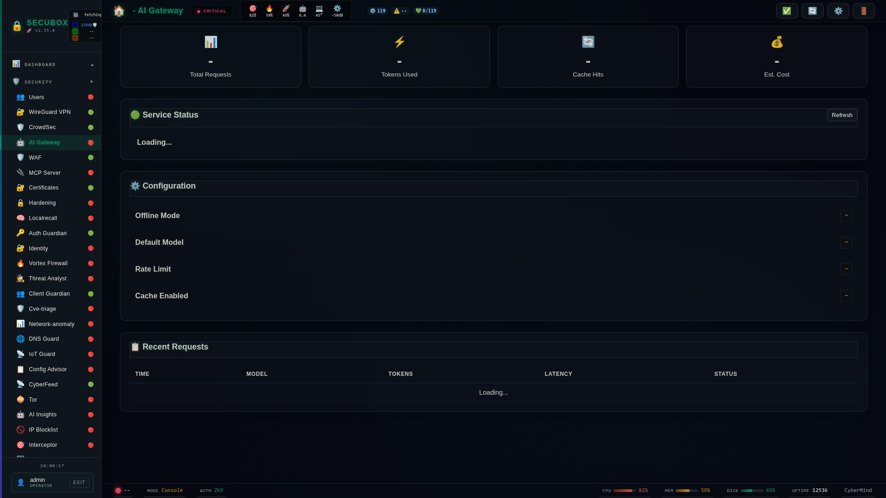

<!--
  SPDX-License-Identifier: LicenseRef-CMSD-1.0
  Copyright (c) 2026 CyberMind — Gérald Kerma <devel@cybermind.fr>
  Source-Disclosed License — All rights reserved except as expressly granted.
  See LICENCE-CMSD-1.0.md for terms.
-->

# 🚪 AI Gateway

AI model API gateway

**Category:** AI

## Screenshot



## Features

- Rate limiting
- Load balancing
- Caching
- Logging

## Installation

```bash
# Add SecuBox repository
curl -fsSL https://apt.secubox.in/install.sh | sudo bash

# Install package
sudo apt install secubox-ai-gateway
```

## Configuration

Configuration file: `/etc/secubox/ai-gateway.toml`

## API Endpoints

- `GET /api/v1/ai-gateway/status` - Module status
- `GET /api/v1/ai-gateway/health` - Health check
- `POST /api/v1/ai-gateway/v1/chat/completions` - OpenAI-compatible chat; `content` may be a string or a list of
  parts: `text`, `image_url` (JPEG/PNG/WebP/GIF, 8 MB), `input_audio` (WAV/MP3, 8 MB), `input_video` (MP4/WebM/MOV/MKV,
  32 MB). Media must be inline `data:` URLs (no remote URL, no file path); any request with media stays on the box
  (`local_only`). 400 = media refused, 422 = the local engine does not handle that modality, 502 = provider error.
- `GET /api/v1/ai-gateway/capabilities` - accepted inputs and limits, and the local engine's real modalities
  (read from llama-server `/props`, never assumed)

## Multimodal (images, video)

Page `/ai-gateway/multimodal.html`: drop an image or a short video, ask a question, the local engine answers.
Needs a local engine with a vision projector, e.g. `llama-server -m <model>.gguf --mmproj <mmproj>.gguf --video-fps 1`
(video is split into frames by ffmpeg on the engine side). On CPU only: about 30 s per image, 1 to 2 min for a few
seconds of video.

## License

LicenseRef-CMSD-1.0 (Source-Disclosed License) — CyberMind © 2024-2026.
See [LICENCE-CMSD-1.0.md](../../LICENCE-CMSD-1.0.md).
