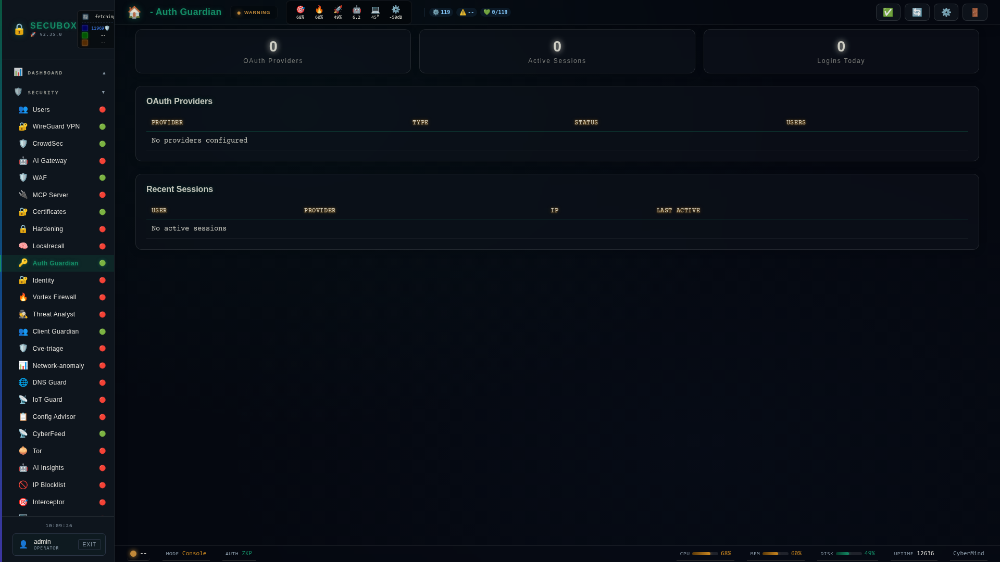

<!--
  SPDX-License-Identifier: LicenseRef-CMSD-1.0
  Copyright (c) 2026 CyberMind — Gérald Kerma <devel@cybermind.fr>
  Source-Disclosed License — All rights reserved except as expressly granted.
  See LICENCE-CMSD-1.0.md for terms.
-->

# 🔐 Auth Guardian

Unified authentication management

**Category:** Security

## Second facteur par compte (1.8.0, #2745)

Chaque compte porte un champ `otp_mode`, qui l'emporte sur le réglage général `otp_lan` (#1699) :

| `otp_mode` | Code TOTP exigé |
|---|---|
| `defaut` (champ absent ou inconnu) | selon le réglage général : facultatif sur le LAN, donc **hors LAN seulement** (c'est le défaut de l'administrateur) |
| `hors_lan` | hors du LAN seulement |
| `toujours` | partout, LAN compris ; un administrateur sans TOTP enrôlé doit l'enrôler à la connexion |
| `jamais` | jamais, même depuis internet, même pour un compte enrôlé : **le secret est conservé**, réactiver ne demande pas de ré-enrôlement |

`PUT /api/v1/users/user/{nom}/otp-mode` (droit `users.edit`) avec `{mode}` ; pour `jamais` sur un **administrateur**, `{mode: "jamais", confirmer: true}` (un booléen) est exigé, car cela ouvre
l'administration depuis internet avec le seul mot de passe. Chaque changement est journalisé (`otp_mode_change` : compte, ancien et nouveau mode, appelant, confirmation). La page « Utilisateurs »
(onglet Comptes système) porte un sélecteur par compte, la politique effective en clair, et une confirmation intégrée avec avertissement pour un administrateur.

Garde-fous : le LAN est le verdict de nginx (`X-SecuBox-LAN: 1`), jamais l'adresse (#2743 : sans la directive dans `secubox-proxy.conf`, l'API croit tout client « WAN ») ; **une connexion depuis le WAN
sans second facteur n'ouvre jamais le coffre** (il s'ouvre avec le mot de passe) ; le journal de connexion distingue « désactivé (compte) » de « facultatif (LAN) ».

## Screenshot



## Features

- OAuth2
- LDAP
- 2FA/TOTP
- Session management

## Installation

```bash
# Add SecuBox repository
curl -fsSL https://apt.secubox.in/install.sh | sudo bash

# Install package
sudo apt install secubox-auth
```

## Configuration

Configuration file: `/etc/secubox/auth.toml`

## API Endpoints

- `GET /api/v1/auth/status` - Module status
- `GET /api/v1/auth/health` - Health check

## License

LicenseRef-CMSD-1.0 (Source-Disclosed License) — CyberMind © 2024-2026.
See [LICENCE-CMSD-1.0.md](../../LICENCE-CMSD-1.0.md).
