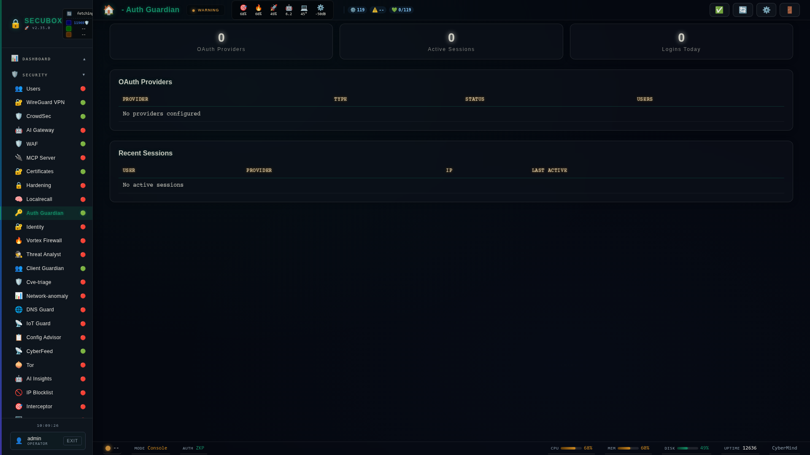

<!--
  SPDX-License-Identifier: LicenseRef-CMSD-1.0
  Copyright (c) 2026 CyberMind — Gérald Kerma <devel@cybermind.fr>
  Source-Disclosed License — All rights reserved except as expressly granted.
  See LICENCE-CMSD-1.0.md for terms.
-->

# 🔐 Auth Guardian

Unified authentication management

**Category:** Security

## Second facteur par compte (1.8.0, #2745)

Chaque compte porte un champ `otp_mode`, qui l'emporte sur le réglage général `otp_lan` (#1699) :

| `otp_mode` | Code TOTP exigé |
|---|---|
| `defaut` (champ absent ou inconnu) | selon le réglage général : facultatif sur le LAN, donc **hors LAN seulement** (c'est le défaut de l'administrateur) |
| `hors_lan` | hors du LAN seulement |
| `toujours` | partout, LAN compris ; un administrateur sans TOTP enrôlé doit l'enrôler à la connexion |
| `jamais` | jamais, même depuis internet, même pour un compte enrôlé : **le secret est conservé**, réactiver ne demande pas de ré-enrôlement |

`PUT /api/v1/users/user/{nom}/otp-mode` (droit `users.edit`) avec `{mode}` ; pour `jamais` sur un **administrateur**, `{mode: "jamais", confirmer: true}` (un booléen) est exigé, car cela ouvre
l'administration depuis internet avec le seul mot de passe. Chaque changement est journalisé (`otp_mode_change` : compte, ancien et nouveau mode, appelant, confirmation). La page « Utilisateurs »
(onglet Comptes système) porte un sélecteur par compte, la politique effective en clair, et une confirmation intégrée avec avertissement pour un administrateur.

Garde-fous : le LAN est le verdict de nginx (`X-SecuBox-LAN: 1`), jamais l'adresse (#2743 : sans la directive dans `secubox-proxy.conf`, l'API croit tout client « WAN ») ; **une connexion depuis le WAN
sans second facteur n'ouvre jamais le coffre** (il s'ouvre avec le mot de passe) ; le journal de connexion distingue « désactivé (compte) » de « facultatif (LAN) ».

## Screenshot



## Features

- OAuth2
- LDAP
- 2FA/TOTP
- Session management

## Installation

```bash
# Add SecuBox repository
curl -fsSL https://apt.secubox.in/install.sh | sudo bash

# Install package
sudo apt install secubox-auth
```

## Configuration

Configuration file: `/etc/secubox/auth.toml`

## API Endpoints

- `GET /api/v1/auth/status` - Module status
- `GET /api/v1/auth/health` - Health check

## License

LicenseRef-CMSD-1.0 (Source-Disclosed License) — CyberMind © 2024-2026.
See [LICENCE-CMSD-1.0.md](../../LICENCE-CMSD-1.0.md).

## Mot de passe par défaut (#3401)

- `GET /api/v1/auth/mot-de-passe-defaut` : `{etat: actif|inactif|inconnu, actif, inconnu, compte, message, lien}` pour un administrateur réel (`require_jwt`, 401 sinon) — lu par le bandeau santé partagé.
- `POST /login` avec le mot de passe par défaut : le changement est **toujours** demandé (`setup_token` à usage unique), depuis la zone de confiance seulement (verdict LAN nginx : LAN, loopback, kiosque ; plus le maillage 10.10.0.0/24 et 10.64.0.0/16). Hors zone : le même 401 qu'un mauvais mot de passe, tentative auditée.
- `POST /api/v1/auth/plus-tard` (preuve : le `setup_token`) : « Plus tard » — échange le jeton contre une session pour cette connexion seulement ; `admin` au mot de passe par défaut, zone de confiance, audité (`mot_de_passe_defaut_reporte`), rien de persisté.

## Comptes administrateur sans mot de passe (1.8.22, #3708)

Règle unique : `secubox_core.comptes_admin`. Un administrateur est **configuré** s'il est humain, actif, de rôle `admin`,
avec un mot de passe argon2 choisi : ni le mot de passe du premier démarrage, ni une empreinte illisible, ni un compte de
service (`console`, kiosque, IA, webhooks, compte de `[console] compte`, comptes délégués).

| Moment | Box sans administrateur configuré | Box configurée |
|---|---|---|
| Semis (postinst) | `admin`, et le compte au nom de la machine si aucun admin n'a de mot de passe (le défaut en est un) | `admin` s'il manque, aussitôt refermé ; jamais le nom de la machine |
| Migration (postinst) | rien | tout admin actif sans mot de passe est **désactivé** (jamais supprimé), une ligne `admin_sans_mot_de_passe_desactive` par compte dans `/var/log/secubox/audit.log` ; audit impossible : rien n'est changé |
| Renommage de la box | le compte sans mot de passe de l'ancien nom prend le nouveau (`compte_machine_renomme`) | il est désactivé |
| `POST /login`, mot de passe vide | première configuration depuis le LAN (#1707) | 401 uniforme, audité (`premiere_configuration_refusee`), **pour tout compte** sans mot de passe |
| `POST /set-password` | — | revérifié à la pose : un jeton obtenu avant ne sert plus, un mot de passe posé entre-temps n'est jamais écrasé |

Ne sont jamais touchés : un compte à mot de passe, un compte de service, un non-administrateur, le dernier admin actif.
Retour arrière : `usersctl set-password NOM` puis `usersctl enable NOM` (rouvert **sans** mot de passe, le compte est
refermé à la mise à jour suivante). À la main : `usersctl desactiver-admins-sans-mot-de-passe`.
Un compte créé sans mot de passe (`usersctl add`, import) sur une box configurée se configure par un administrateur
(page Utilisateurs ou `usersctl set-password`), plus par la page de connexion.
