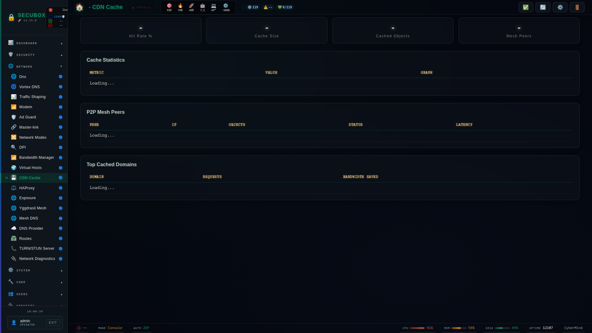

<!--
  SPDX-License-Identifier: LicenseRef-CMSD-1.0
  Copyright (c) 2026 CyberMind — Gérald Kerma <devel@cybermind.fr>
  Source-Disclosed License — All rights reserved except as expressly granted.
  See LICENCE-CMSD-1.0.md for terms.
-->

# 🚀 CDN Cache

Content delivery cache

**Category:** Network

## Screenshot



## Features

- Cache management
- Purge
- Statistics
- Edge rules

## Installation

```bash
# Add SecuBox repository
curl -fsSL https://apt.secubox.in/install.sh | sudo bash

# Install package
sudo apt install secubox-cdn
```

## Configuration

Configuration file: `/etc/secubox/cdn.toml`

## API Endpoints

- `GET /api/v1/cdn/status` - Module status
- `GET /api/v1/cdn/health` - Health check

## License

LicenseRef-CMSD-1.0 (Source-Disclosed License) — CyberMind © 2024-2026.
See [LICENCE-CMSD-1.0.md](../../LICENCE-CMSD-1.0.md).

## Caches de la box (1.4.0)

`GET /api/v1/cdn/caches` (lecture seule, JWT) : taille, nombre de fichiers et dernière activité de chaque cache de `/var/cache/secubox`. Un dossier fermé au service rend `lisible: false` et des mesures `null`. Les politiques CDN de `/etc/secubox/cdn.json` sont enregistrées mais lues par aucun moteur : elles ne changent rien au trafic.

## Miroir APT local (1.5.0, ex-module Mirror)

`GET /api/v1/cdn/miroirs` (lecture seule, JWT) : le dépôt APT hébergé par la box (`/data/apt`) — suites, architectures, composants, nombre de paquets (fichiers `Packages`), taille du pool. Seuls l'en-tête `Release` et le nombre de paquets sont lus. `/mirror/` redirige vers `/cdn/`.
