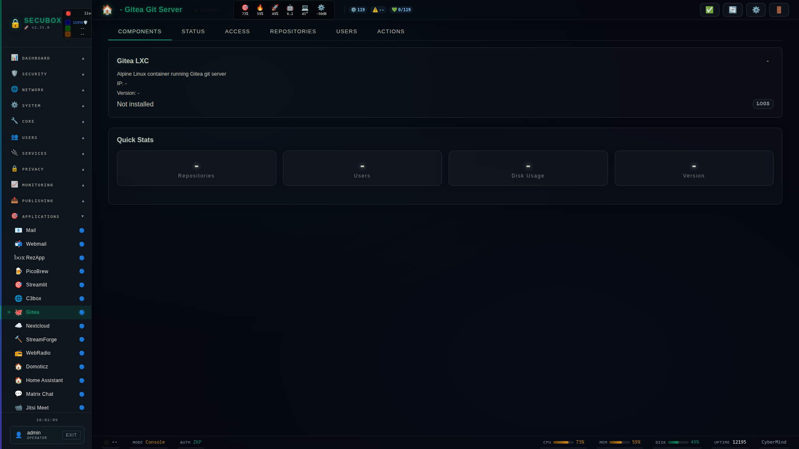

<!--
  SPDX-License-Identifier: LicenseRef-CMSD-1.0
  Copyright (c) 2026 CyberMind — Gérald Kerma <devel@cybermind.fr>
  Source-Disclosed License — All rights reserved except as expressly granted.
  See LICENCE-CMSD-1.0.md for terms.
-->

# 🦊 Gitea

Git server (LXC)

**Category:** Services

## Screenshot



## Features

- Repositories
- Users
- SSH/HTTP
- LFS
- Actions

## Installation

```bash
# Add SecuBox repository
curl -fsSL https://apt.secubox.in/install.sh | sudo bash

# Install package
sudo apt install secubox-gitea
```

## Configuration

Configuration file: `/etc/secubox/gitea.toml`

## Mémoire (#3941)

Le conteneur a un budget (`memory.max`, 512M par défaut) sans frein (`memory.high`) et un échange borné à la moitié : un
frein sous le plafond avec l'échange interdit étouffait la forge (13 700 relectures de pages/s, 504). Une configuration
existante est migrée à la mise à jour par `secubox-lxc-memoire` (secubox-system), copie `config.avant-3941`, sans redémarrage.

`giteactl memoire` pose `GOMEMLIMIT` à 70 % du budget effectif (`gitea.service.d/50-secubox-memoire.conf` dans le conteneur,
ou `start-gitea.sh` sous Alpine). Lancé au `configure`, idempotent ; la valeur ne vaut qu'au prochain redémarrage du service.
Une valeur locale se pose dans un drop-in de nom supérieur. L'`app.ini` existant (secrets) n'est jamais réécrit.

## API Endpoints

- `GET /api/v1/gitea/status` - Module status
- `GET /api/v1/gitea/health` - Health check

## License

LicenseRef-CMSD-1.0 (Source-Disclosed License) — CyberMind © 2024-2026.
See [LICENCE-CMSD-1.0.md](../../LICENCE-CMSD-1.0.md).
