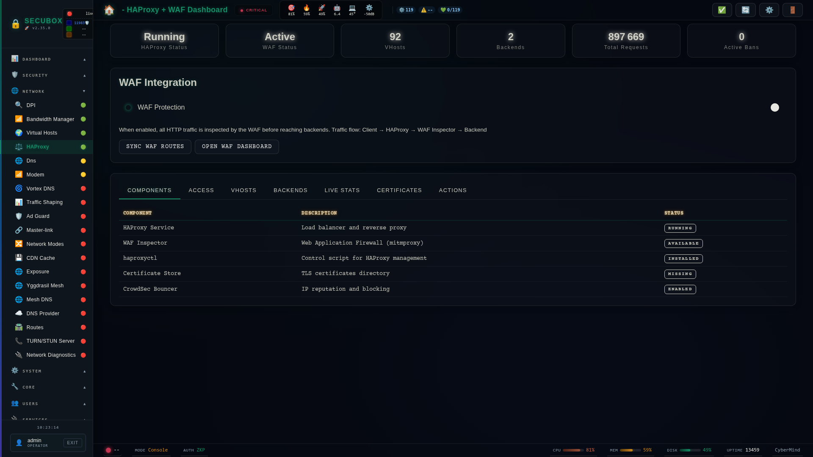

<!--
  SPDX-License-Identifier: LicenseRef-CMSD-1.0
  Copyright (c) 2026 CyberMind — Gérald Kerma <devel@cybermind.fr>
  Source-Disclosed License — All rights reserved except as expressly granted.
  See LICENCE-CMSD-1.0.md for terms.
-->

# ⚡ HAProxy

Load balancer with TLS 1.3

**Category:** Network

## Screenshot



## Features

- Backend management
- Stats
- ACLs
- SSL termination
- Health checks

## Installation

```bash
# Add SecuBox repository
curl -fsSL https://apt.secubox.in/install.sh | sudo bash

# Install package
sudo apt install secubox-haproxy
```

## Configuration

Configuration file: `/etc/secubox/haproxy.toml`

### Onions (#3112, #3123)

`haproxyctl generate` émet toujours le frontal `onion-in`, lié à `127.0.0.1:<onion_in_port>`
(clé facultative de `haproxy.toml`, défaut **9180** ; jamais 80 ni 9080). C'est la cible de **tout**
service onion (webui, vhosts, metablogizer : `HiddenServicePort 80 127.0.0.1:9180`), à la place de
nginx :9080 ou du frontal public `http-in` :80 en direct.

Ce frontal :

1. refuse (404) tout Host qui ne finit pas en `.onion` : un nom clair (`admin.<box>`, un vhost public)
   ne se joint pas par un onion, et l'on ne relie pas un onion aux domaines de la box ;
2. efface `X-Forwarded-For`, `Forwarded`, `X-Real-IP`, `X-Client-IP`, `X-Forwarded-Host` et tout
   `X-SecuBox-*` du client ;
3. pose l'adresse marqueur **192.0.2.80** (TEST-NET-1, RFC 5737, « client onion », hors de toute
   plage LAN) par `set-src` et `X-Forwarded-For`, et ajoute `X-SecuBox-Onion: 1` ;
4. passe par `sbxwaf_inspector`.

nginx voit donc 192.0.2.80, et `$lan_client` vaut 0. sbxwaf route par Host `<onion>.onion`. La route
de l'onion du webui (vers nginx :9080) est posée par le composant exposure via `secubox-waf-route` ;
un onion sans route reçoit 421. Les frontaux publics `http-in` et `https-in` refusent (404) un Host
`.onion` venu d'ailleurs que la boucle locale.

## API Endpoints

- `GET /api/v1/haproxy/status` - Module status
- `GET /api/v1/haproxy/health` - Health check

## License

LicenseRef-CMSD-1.0 (Source-Disclosed License) — CyberMind © 2024-2026.
See [LICENCE-CMSD-1.0.md](../../LICENCE-CMSD-1.0.md).
