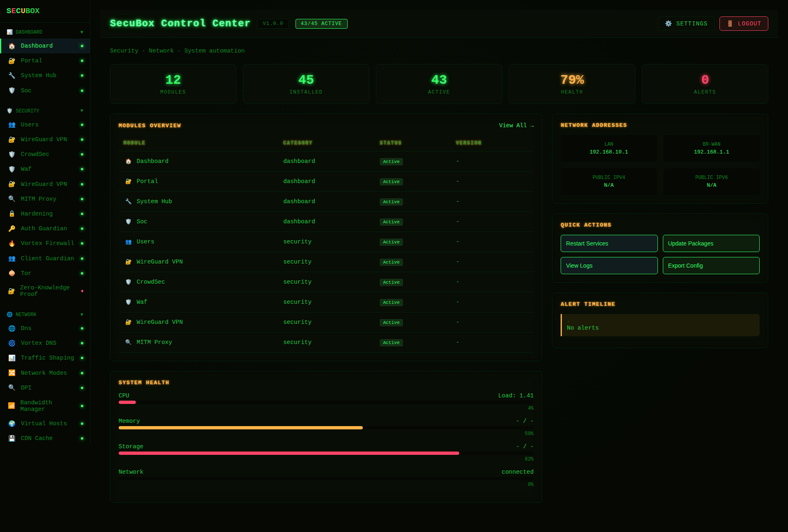

<!--
  SPDX-License-Identifier: LicenseRef-CMSD-1.0
  Copyright (c) 2026 CyberMind — Gérald Kerma <devel@cybermind.fr>
  Source-Disclosed License — All rights reserved except as expressly granted.
  See LICENCE-CMSD-1.0.md for terms.
-->

# 🏠 SecuBox Hub

Central dashboard and control center

**Category:** Dashboard

## Screenshot



## Features

- System overview
- Service monitoring
- Quick actions
- Metrics
- Pages d'erreur nginx (mire commune, #3885) : 404, 421, 500, 502, 503, 504 dans
  `/etc/secubox/errorpages/` ; voir `errorpages/README.md`

## Installation

```bash
# Add SecuBox repository
curl -fsSL https://apt.secubox.in/install.sh | sudo bash

# Install package
sudo apt install secubox-hub
```

## Configuration

Configuration file: `/etc/secubox/hub.toml`

## API Endpoints

- `GET /api/v1/hub/status` - Module status
- `GET /api/v1/hub/health` - Health check

## Graphiques vivants : `/shared/pouls.js` (#3945)

Composant partagé, sans bibliothèque, pour les cartes du monde, compteurs et barres : une mesure est **fixe au présent** (elle bat) ;
elle **recule** sur ses dernières mesures réelles (date écrite, orange), rebondit et revient (« maintenant », vert). Rien n'est
inventé : l'interpolation n'existe que pendant le mouvement, tout arrêt tombe sur un relevé réel, `null` reste « non mesuré ».
Sous deux mesures, en mouvement réduit, au bouton « ⏸ fixe », hors écran ou onglet caché : rien ne bouge et aucun minuteur ne tourne.
Au survol, arrêt sur un relevé réel ; au focus clavier, retour au présent. Une seule mesure recule à la fois par page.

Une page le charge par `createElement('script')` (`/shared/pouls.js`) ; absent, la page reste fixe. Une page publique sous CSP
stricte en porte une copie identique (secubox-live, test). Aucun HTML ni `<style>` injecté (CSSOM seul), couleurs réglables par
`--sbxp-passe`, `--sbxp-direct`, `--sbxp-baisse`.

| Appel | Rôle |
|---|---|
| `SbxPouls.carte(svg, o)` | couche posée sur la carte de la page : `instantanes` `[{t ou genere_le (s), pays:[{code,n}] ou null}]` (13 au plus), `centres` `{CC:[lat,lon]}` (grille 120 × 60) ou fonction code → `[x,y]`, `coul`, `echelle` (unité des rayons), `liste` / `ecarts` `{CC: élément}`, `fond` (points de la page, estompés au passé), `coeur:false` (pas de cœur blanc au présent), `sujet` |
| `SbxPouls.compteur(el, o)` | le chiffre recule : `valeurs`, `libelles` (dates), `format`, `barres` (mini-série de la page) ou `svg` (mini-série à dessiner), `total:true` quand le chiffre n'est pas un point de la série (seule la date porte alors la valeur) |
| `SbxPouls.barres(svg, o)` | `valeurs`, `libelles`, `barres` (celles de la page, sinon dessinées avec trace fantôme) |
| `SbxPouls.orchestre(liste)` | ordre de passage ; rend `{rejoue()}` (sans appel : ordre de création) |
| `SbxPouls.bouton(hôte, classe)` | « 💓 vivant / ⏸ fixe », retenu par le navigateur (`localStorage`, clé `sbx-pouls`) |
| `SbxPouls.memoire(clé, instantané, pas)` | relevés successifs gardés par l'onglet (`sessionStorage`, 12, 3 h) quand le serveur n'a pas d'historique |

Options communes : `cle` (même clé = même mesure : un nouvel appel, ou `mesure.maj(o)`, met à jour sans relancer l'animation, même si
la page a refait ses éléments ; `mesure.fin()` la retire), `zone` (survol et visibilité), `quand` (hôte de la date), `maintenant` (texte
du présent, ex. « au relevé » quand le relevé est ancien).

## License

LicenseRef-CMSD-1.0 (Source-Disclosed License) — CyberMind © 2024-2026.
See [LICENCE-CMSD-1.0.md](../../LICENCE-CMSD-1.0.md).
