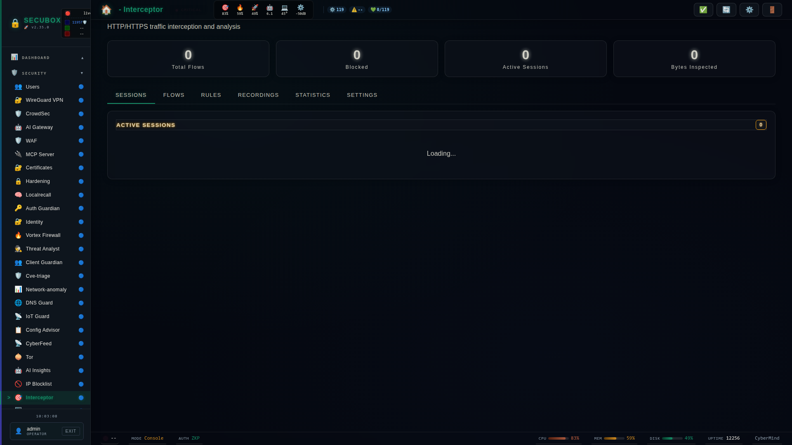

<!--
  SPDX-License-Identifier: LicenseRef-CMSD-1.0
  Copyright (c) 2026 CyberMind — Gérald Kerma <devel@cybermind.fr>
  Source-Disclosed License — All rights reserved except as expressly granted.
  See LICENCE-CMSD-1.0.md for terms.
-->

# 📡 Traffic Interceptor

Network traffic interception and analysis

**Category:** Security

## Screenshot



## Features

Supervision en lecture seule de l'inspection du trafic. L'inspection elle-même est faite par `sbxmitm`
(`secubox-toolbox-ng-worker@1..4`, tunnel `wg-toolbox`) et `sbxwaf` ; ce module montre leur état réel.

- État des moteurs : unité systemd et port d'écoute de chaque moteur
- Activité : connexions vues (client-hello TLS), hôtes (SNI) et empreintes JA4, par minute
- Niveau d'inspection par pair WireGuard et répartition des niveaux du Toolbox
- Exclusions : hôtes en bypass et en splice (non déchiffrés)

## Installation

```bash
# Add SecuBox repository
curl -fsSL https://apt.secubox.in/install.sh | sudo bash

# Install package
sudo apt install secubox-interceptor
```

## API Endpoints (lecture seule, JWT lecture)

| Route | Contenu |
|---|---|
| `GET /api/v1/interceptor/health` | Santé du module |
| `GET /api/v1/interceptor/status` | Résumé (moteurs actifs, connexions 60 min, pairs) |
| `GET /api/v1/interceptor/moteurs` | État systemd et port d'écoute de sbxmitm 1..4 et sbxwaf |
| `GET /api/v1/interceptor/activite?minutes=60` | Connexions, hôtes, JA4, série par minute (5 à 240 min), tirés du journal de sbxmitm |
| `GET /api/v1/interceptor/niveaux` | Niveau d'inspection par pair et répartition cumulée |
| `GET /api/v1/interceptor/exclusions` | Listes bypass, splice et filtres désactivés |

Une source illisible renvoie `null`, jamais un zéro inventé. Aucune route d'écriture.

## License

LicenseRef-CMSD-1.0 (Source-Disclosed License) — CyberMind © 2024-2026.
See [LICENCE-CMSD-1.0.md](../../LICENCE-CMSD-1.0.md).
