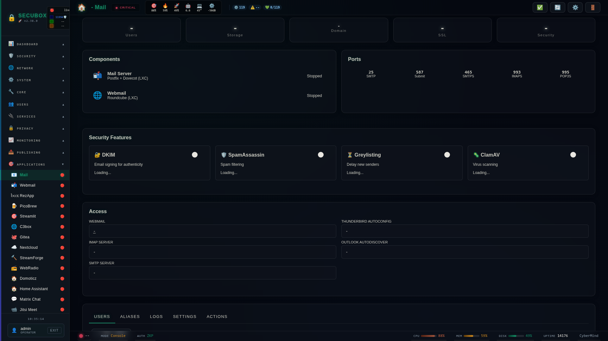

<!--
  SPDX-License-Identifier: LicenseRef-CMSD-1.0
  Copyright (c) 2026 CyberMind — Gérald Kerma <devel@cybermind.fr>
  Source-Disclosed License — All rights reserved except as expressly granted.
  See LICENCE-CMSD-1.0.md for terms.
-->

# 📧 Mail Server

Postfix/Dovecot mail server

**Category:** Email

## Screenshot



## Features

- Domains
- Mailboxes
- DKIM
- SpamAssassin
- ClamAV

## Installation

```bash
# Add SecuBox repository
curl -fsSL https://apt.secubox.in/install.sh | sudo bash

# Install package
sudo apt install secubox-mail
```

## Configuration

Configuration file: `/etc/secubox/mail.toml`

## API Endpoints

- `GET /api/v1/mail/status` - Module status
- `GET /api/v1/mail/health` - Health check

## Membres d'un alias (#3347)

Une ligne de la carte `/data/volumes/mail/config/virtual` porte un alias et ses destinataires (`contact@secubox.in gk2@secubox.in, cedre83@secubox.in`).

- `mailctl alias membre-add <alias> <adresse>` / `mailctl alias membre-del <alias> <adresse>` : adresse validée (une seule, sans virgule ni espace), pas de doublon, jamais le dernier membre (supprimer l'alias à la place) ; fichier réécrit d'un bloc puis carte recompilée (`alias_recompile`), entrée `alias_membre_ajoute` / `alias_membre_retire` dans `/var/log/secubox/audit.log`.
- API (`require_jwt`) : `POST /alias/{alias}/membres` `{"cible": "…"}`, `DELETE /alias/{alias}/membres/{cible}` ; 422 adresse invalide, 409 refus (doublon, absent, dernier membre, alias inconnu). `GET /aliases` rend `membres` (toutes les cibles) ; `target` garde la liste jointe.
- Page Mail › Alias : chaque membre avec « Retirer » (absent pour le dernier) et un champ « Ajouter un membre ».

## License

LicenseRef-CMSD-1.0 (Source-Disclosed License) — CyberMind © 2024-2026.
See [LICENCE-CMSD-1.0.md](../../LICENCE-CMSD-1.0.md).

## Gestes mailctl — socle (#1169)

| Commande | Effet |
|----------|-------|
| `mailctl maildir-reconcile` | Bascule idempotente mbox→Maildir (backup préalable obligatoire, no-op si déjà Maildir) |
| `mailctl sieve enable\|status` | Active Pigeonhole/ManageSieve (:4190) ; sieve par défaut spam→Junk |
| `mailctl antivirus on\|off\|status` | ClamAV dans le LXC dédié `clamav` (paquet `secubox-clamav`, éveillé à la demande, #1912) ; off par défaut |
| `mailctl ssl renew` | Renouvelle le cert LE mail + redéploie + reload (timer hebdo auto) |
| `mailctl backup` / `restore <archive>` | Filet de sûreté (tar horodaté de vmail+config+dovecot.conf) |
| `mailctl services` | Surcharges systemd du conteneur : sans bac à sable (dovecot, clamav-daemon, #3667) ; relance automatique de Postfix (`postfix@`) et Dovecot ; rspamd et clamav-daemon tués en premier par l'OOM (`OOMScoreAdjust=500`, un négatif est refusé dans le LXC sans privilèges) (#3842) |
| `mailctl antispam on\|off\|status` | rspamd désactivable (#3845) : `off` vide les milters de Postfix puis arrête et désactive rspamd ; `on` l'inverse ; audit `antispam_active` / `antispam_desactive`. **`off` coupe aussi la signature DKIM du courrier sortant** (et l'antivirus, porté par rspamd). Page : carte « Antispam (Rspamd) », routes `GET /spam/status`, `POST /spam/enable\|disable` (require_jwt) |
| `mailctl veille` | Lancée toutes les 5 min par `secubox-mail-veille.timer` : relance `postfix@-`, `dovecot` ou `rspamd` en échec dans le conteneur (journal `secubox-mail`) ; sort en erreur s'il ne repart pas, l'unité apparaît alors en échec dans le relevé de flotte (#3842) |

### Options TOML ajoutées

```toml
[mail.antivirus]
enabled = false   # true → module antivirus Rspamd vers le LXC clamav (secubox-clamav, #1912)
```

Le paquet livre aussi l'autoconfig RFC 6186 (`config-v1.1.xml`) et les
enregistrements SRV Unbound (`_imaps`/`_submission`/`_submissions`/`_pop3s`),
posés idempotemment à l'installation.
