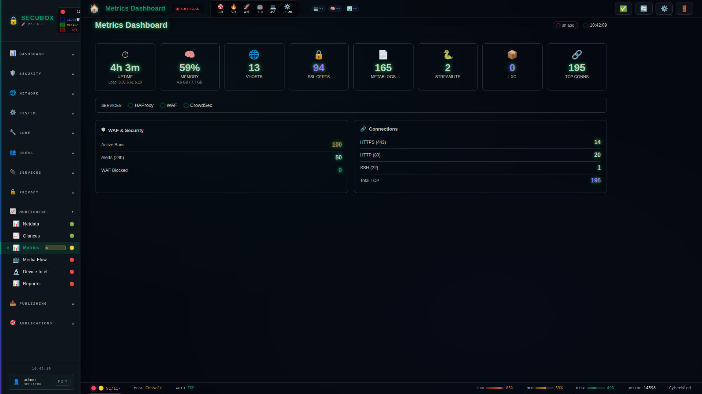

<!--
  SPDX-License-Identifier: LicenseRef-CMSD-1.0
  Copyright (c) 2026 CyberMind — Gérald Kerma <devel@cybermind.fr>
  Source-Disclosed License — All rights reserved except as expressly granted.
  See LICENCE-CMSD-1.0.md for terms.
-->

# 📈 System Metrics

Real-time system metrics dashboard

**Category:** Dashboard

## Screenshot



## Features

- CPU/Memory
- Network stats
- Disk I/O
- Historical data

## Installation

```bash
# Add SecuBox repository
curl -fsSL https://apt.secubox.in/install.sh | sudo bash

# Install package
sudo apt install secubox-metrics
```

## Configuration

Configuration file: `/etc/secubox/metrics.toml`

```toml
[cache]
intervalle_leger = 60   # s, borne 15..3600 : rafraichissement de fond de waf + connexions (#3295)
```

Le cache `/var/cache/secubox/metrics-cache.json` voit ses blocs `waf` et `connections` rafraichis en
fond (l'`overview`, couteux, est conserve). Monte dans l'agregateur, le lifespan ne tourne pas : la
boucle demarre a la premiere requete vhost-stats. Un redemarrage de prudence toutes les 6 h est porte
par `secubox-metrics-redemarrage.timer` (a retirer apres mesure de la RSS sur 24 h).

## API Endpoints

- `GET /api/v1/metrics/status` - Module status
- `GET /api/v1/metrics/health` - Health check
- `GET /api/v1/metrics/summary` - cpu / mem / load du widget de la barre
  laterale (admin, `require_jwt`) ; ne lance aucun sous-processus

## Endpoints — live panel (issue #92)

These endpoints feed the health-banner live panel. They are CORS-open and
guarded by `require_lecture` since #1256 (a token, or the LAN dashboard mode).

| Method | Path                              | Schema (high-level)                                  |
|--------|-----------------------------------|------------------------------------------------------|
| GET    | `/api/v1/metrics/visitor-origin`  | `{enabled, window_minutes, entries:[{asn,org,count}]}`|
| GET    | `/api/v1/metrics/live-hosts`      | `{enabled, window_minutes, entries:[{host,count}], total_requests}` |
| GET    | `/api/v1/metrics/live`            | temps réel (#2763), sans cache : `{ts, box, debit:{rx,tx}, charge, memoire_pct, connexions:{entrantes:[{code,n}], sortantes:[{code,n}], lan, inconnu, total}}` — connexions TCP établies par PAYS (entrantes : ports 22/80/443), jamais d'adresse IP ; `box` = `SECUBOX_PAYS` (ISO-2, « FR » par défaut) |
| GET    | `/api/v1/metrics/series`          | courbes (#2765) : `?duree=<s>` ou `?depuis=&jusqua=<epoch>`, `?points=` (≤ 600) → `{t:[…], series:{cpu,mem,charge,rx,tx,conn,disque:[…|null]}, pas_s, duree_s, points}` ; relevé par minute, 7 jours (`secubox-metrics-serie.timer`) |
| GET    | `/api/v1/metrics/systeme`         | instantané système non bloquant (#2767) : `{cpu:{total,coeurs,nb}, memoire, swap, disques, reseau, temperatures, charge, uptime_s, processus:[{pid,nom,cpu,memoire}]}` — jamais de ligne de commande ni d'utilisateur ; page `/glances/direct.html` |
| GET    | `/api/v1/metrics/cert-status`     | `{enabled, summary, next_renewal, warnings}`          |

`live-hosts` counts requests per vhost from `/var/log/nginx/<vhost>_access.log`
(the service user joins the `adm` group). `total_requests` is the denominator of
the WAF block rate (`waf.blocked_pct`, `waf.blocks_1h` in `/health/summary`).

## Endpoints — audit des cookies (RGPD / ePrivacy, #159)

Relayed by nginx through `/etc/nginx/secubox-routes.d/metrics-cookie-audit.conf`.
Disabled by default (`[cookie_audit] enabled = false`).

| Method | Path                            | Guard             | Content                                   |
|--------|---------------------------------|-------------------|-------------------------------------------|
| POST   | `/api/v1/cookie-audit/ingest`   | `require_lecture` | browser snapshot (hashed values), 5 MB cap per host |
| GET    | `/api/v1/cookie-audit/report`   | `require_jwt`     | per-vhost detail (`?host=` for one)       |
| GET    | `/api/v1/cookie-audit/summary`  | `require_lecture` | counters only, no host names              |

Config blocks live in `/etc/secubox/secubox.conf`:

```toml
[visitor_origin]
enabled = true
min_count = 5

[live_hosts]
enabled = true

[cert_status]
enabled = true
warn_days = 30
```

ASN database refresh (#194): `secubox-geoipupdate.timer` runs
`/usr/bin/secubox-geoipupdate-fetch` weekly. With `geoipupdate` installed and a
MaxMind licence at `/etc/secubox/secrets/maxmind.conf` it uses MaxMind;
otherwise it falls back to the free DB-IP ASN lite database (no signup).

## Endpoint — historique de la memoire (#2146)

| Methode | Route | Garde | Role |
|---|---|---|---|
| GET | `/api/v1/metrics/memory/history?heures=24` | `require_lecture` | serie des releves (5 min, 7 jours max), alertes, croissance de la memoire noyau en Mo/h, conteneurs et services étouffés |

Un timer (`secubox-metrics-memoire.timer`, 5 min) ecrit `/var/lib/secubox/metrics/memoire.jsonl`. Il surveille la memoire
**noyau non recuperable** (`SUnreclaim`) — c'est elle qui avait atteint 4,2 Go sur gk2 sans que rien ne le releve — la
memoire disponible et le swap, en part de la RAM, et signale une croissance soutenue du noyau avant le seuil. Les alertes
(`ALERTE memoire : ...`) vont au journal du service.

**Étouffement (#3941)** : le meme releve lit les cgroups (fichiers seulement, 400 au plus, aucun parcours de processus) des
conteneurs LXC et des services bornes : relectures de pages par seconde, PSI memoire `some avg60`, courant contre limite
(frein ou plafond). Étouffé = plus de 93 % de sa PROPRE limite ET (plus de 1 000 relectures/s OU PSI > 20) ; sans limite propre, jamais (une
pression générale ne désigne pas chaque service). Audit : dix lignes par passage au plus, puis « et N autres ». La route rend
`etouffes: [{cle, nom, genre, refaults_s, psi_some_avg60, courant_mb, limite_mb, part, depuis_s}]` ; au-dela de dix
minutes : alerte (page et journal), `modules.memoire = warn` dans `/health/summary` (nombre seulement), une ligne
`type: memoire` dans `audit.log` au debut (`etouffement`) et a la fin (`fin_etouffement`).

## Graphiques vivants (1.31.0, #3945)

Composant `/shared/pouls.js` (secubox-hub ≥ 1.13.0 ; absent, pages fixes). Vue d'ensemble : cartes attaques et visiteurs (relevés
successifs de l'onglet, `sessionStorage`, 12 au plus, 3 h), mémoire et charge (un point réel par heure de `/memory/history`, puis la
valeur affichée). Sites : carte des visites (relevés de l'onglet), visiteurs, requêtes et erreurs (série par jour : le total ne bouge
pas, la date porte la valeur du jour). La carte du détail d'un site reste fixe : aucun historique par site et par relevé.

## Rapport de pilotage hebdomadaire et relevé quotidien (1.32.0, #3970)

Six feuilles A4 paysage, version papier de la charte Aurora (fpdf2 seul) : synthèse (verdict + six chiffres avec série et écart),
trafic par couches, origines des requêtes hostiles, défense, acteurs suivis, décisions et santé. Période : les 7 derniers jours
complets de Paris. Livré **désactivé** ; l'ancien rapport du lundi est inchangé.

```toml
[rapport.pilotage]
actif = false              # true pour envoyer (minuteur à activer aussi : secubox-metrics-rapport-pilotage.timer)
destinataire = ""          # à défaut, celui de [rapport.waf] ; aucun destinataire = rien ne part
noeud = ""                 # nom du nœud dans Status Live (défaut : nom d'hôte)
```

```sh
python3 -m api.rapport_pilotage --sortie /tmp/pilotage.pdf   # générer sans envoyer (données réelles)
python3 -m api.rapport_pilotage --exemple --sortie ex.pdf    # jeu fictif, annoncé « Données d'exemple »
python3 -m api.releve_quotidien [--jour AAAA-MM-JJ]          # relevé (minuterie quotidienne 00:20)
```

Sources (lecture seule, en flux, bornées) : `waf-threats.log` et ses rotations `.N.gz` (couches, catégories, heures, sites, pays par
GeoLite2-Country si présente), `bans.jsonl`, `mesures.jsonl` (adresses proposées au ban sans suite), `dnstv.db` d'ad-guard (jours
UTC), `vhost-jours.json` (résumé léger écrit par ce service, sans adresse), `disponibilite.json` exporté par Status Live (secubox-status ≥ 0.1.5),
sonde `health/status.json` et `health-doctor.json` (instantanés), actord (vue réduite), `populations.json`.

Règles : une mesure absente est « non mesuré » ; un chiffre de la semaine exige ses 7 jours mesurés, l'écart exige aussi la semaine
précédente ; décisions par seuils écrits dans `rapport_pilotage.py` (service vital en échec, site injoignable, adresses proposées au
ban sans suite, acteur à bloquer sans mesure, disponibilité < 99,5 %, temps de réponse médian > 500 ms, site recevant ≥ 50 % et
≥ 1 000 requêtes bloquées, journal du WAF illisible), trois au plus ; aucune adresse IP ni identifiant d'acteur (acteurs A, B, C…).

Relevé : `/var/lib/secubox/metrics/releve/releve-AAAAMM.jsonl`, une ligne par jour (≤ 32 Kio), remplacée par écriture atomique,
13 mois gardés ; il rattrape les jours manquants des 7 derniers et sert de repli au rapport quand les journaux ont tourné.

## Entrée / sortie par site (1.33.0, #4011)

| Méthode | Route | Garde | Réponse |
|---|---|---|---|
| GET | `/api/v1/metrics/entree-sortie` | `require_jwt` | `{genere, complet, sources:{nginx,waf,bans}, passe_degradee?, regles, total, vhosts:[…]}` |

Chaque site (et `total`) porte `fenetres` (`1h`, `8h`, `1j`, `7j` closes, `en_cours`), `tendance` (même règle
que les ruptures du WAF #4005 : médiane de 3 à 6 fenêtres précédentes de même longueur, facteur 3) et
`histo_24h`. Une fenêtre : `entree` (requêtes, octets des réponses, adresses-heure, `par_visite`
humain/robot/outil/aspirateur/sonde, `par_page` page/statique/api/forge/medias/admin/autre, `croise`),
`reductions` (`bans` : paquets refusés par nftables avant HTTP, imputés au site visité en dernier ;
`waf` : requêtes bloquées ; `erreurs` : 4xx/5xx), `sortie` (2xx/3xx, octets) et `visiteurs` (vrais visiteurs
humains : sessions sans cookie par empreinte salée du jour, pause > 30 min, pages par session, durée médiane
et p75 ; une session d'une seule page n'a pas de durée).

Tâche de fond toutes les 120 s, lecture incrémentale de `secubox-hosts.log` (ou des `*_access.log`), de
`waf-threats.log` et des compteurs de `waf_ban`/`waf_ban6` (`nft -j list set`, `CAP_NET_ADMIN` de l'unité).
Cache : `/var/cache/secubox/metrics/entree-sortie.json` (rapport, double tampon : une passe dégradée ne
remplace jamais un rapport complet) et `entree-sortie-etat.json` (compteurs horaires 5 j, journaliers 50 j).
Aucune adresse, aucun agent, aucune empreinte n'y est écrit. L'auto-test du WAF est exclu.
Page : section « Entrée / sortie » de `/metrics/vhosts.html`.

## License

LicenseRef-CMSD-1.0 (Source-Disclosed License) — CyberMind © 2024-2026.
See [LICENCE-CMSD-1.0.md](../../LICENCE-CMSD-1.0.md).
