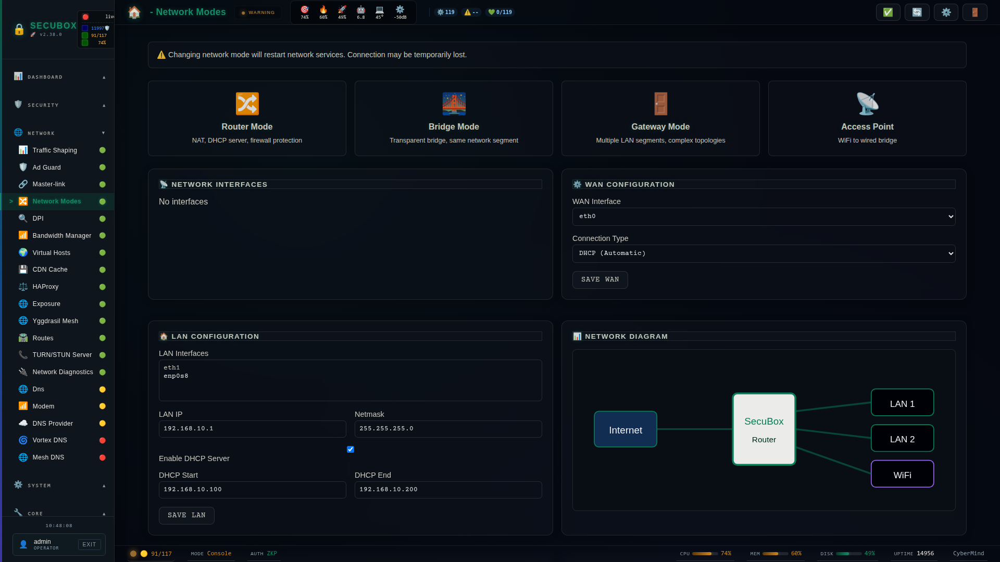

<!--
  SPDX-License-Identifier: LicenseRef-CMSD-1.0
  Copyright (c) 2026 CyberMind — Gérald Kerma <devel@cybermind.fr>
  Source-Disclosed License — All rights reserved except as expressly granted.
  See LICENCE-CMSD-1.0.md for terms.
-->

# 🌐 Network Modes

Network topology configuration

**Category:** Network

## Screenshot



## Features

- Router mode
- Bridge mode
- AP mode
- VLAN

## Installation

```bash
# Add SecuBox repository
curl -fsSL https://apt.secubox.in/install.sh | sudo bash

# Install package
sudo apt install secubox-netmodes
```

## Configuration

Configuration file: `/etc/secubox/netmodes.toml`

## API Endpoints

- `GET /api/v1/netmodes/status` - Module status
- `GET /api/v1/netmodes/health` - Health check

## Mode routeur durable (MOCHAbin)

Depuis 1.4.0 (#3189), corrigé en 1.4.1. Le LAN du MOCHAbin (pont `br-lan` sur `lan0`..`lan3`, DHCP, DNS, NAT)
est posé par systemd-networkd, dnsmasq, Unbound et nftables, sans netplan : aucune commande ne relance ni ne reconfigure une
interface `eth*` (le WAN mvpp2 bloque son PHY si son lien est relancé à distance). Sur MOCHAbin, les anciennes routes
netplan (`/apply_mode`, `/auto_apply`, `/rollback`…) répondent 409.

### Configuration

`/etc/secubox/netmodes/routeur.toml` (0640, root), écrit par le contrôleur à chaque application :

```toml
[lan]
adresse = "192.168.42.1/24"      # adresse du pont, préfixe du LAN
dhcp_debut = "192.168.42.100"
dhcp_fin = "192.168.42.199"
bail = "12h"                     # 1 à 9999, en m ou h
ports = ["lan0", "lan1", "lan2", "lan3"]
wan = "eth2"                     # lu seulement : NAT et transit, jamais reconfiguré
```

Refusés : `192.168.255.0/24` (gestion), `10.100.0.0/24` (LXC), tout réseau déjà porté par une autre interface, une
plage DHCP hors du réseau ou qui contient l'adresse du pont.

### Contrôleur `netmodesctl` (root)

Seule surface privilégiée du module ; l'API (utilisateur `secubox-netmodes`) l'appelle par `sudo -n`, à verbes exacts
(`/etc/sudoers.d/secubox-netmodes`). Sortie : toujours un JSON. Codes : 0 succès, 2 usage ou acteur invalide, 3 refus
(configuration ou garde), 4 occupé, 1 autre échec.

| Verbe | Rôle |
|---|---|
| `routeur-etat` | état (`inactif`, `en_attente`, `actif`), configuration, minuteur, DHCP, adresses du pont |
| `routeur-appliquer <acteur>` | configuration JSON sur l'entrée standard : sauvegarde, rendu, validation (`nft -c`, `unbound-checkconf`, `nginx -t` par `systemd-run`), bascule, minuteur de retour |
| `routeur-confirmer <acteur>` | garde la nouvelle configuration, annule le retour automatique |
| `routeur-retour <acteur>` | restaure la dernière sauvegarde (`minuteur` : seulement si l'application attend sa confirmation) |
| `routeur-retour-demarrage` | au démarrage (`secubox-netmodes-retour-boot.service`), défait une application restée en attente ; jamais accordé à l'API |

Avant toute écriture, `routeur-appliquer` refuse si netplan déclare `br-lan`, si le pseudo-routeur (#2940) est actif,
si `net.ipv4.ip_forward` ne vaut pas 1, si `dnsmasq.service` est actif, si `/etc/nftables.conf` n'inclut pas
`/etc/nftables.d/*.nft` (le pare-feu du LAN ne serait pas rechargé au démarrage), ou si l'ancien
`/etc/systemd/network/10-br-lan.network` ne vise pas `br-lan` seul (section `[Match]` réduite à la ligne
`Name=br-lan` : sinon le mettre de côté reconfigurerait d'autres interfaces, le WAN compris). Pendant la bascule,
Unbound n'est redémarré (coupure du DNS de toute la box) que si son drop-in change ; après la relance du DHCP,
dnsmasq doit être vu actif deux fois de suite (5 s au plus), sinon la bascule est défaite. Un `routeur.toml` illisible
(édité à la main, non UTF-8) rend l'état `config_invalide` et n'empêche jamais le retour.

**Pont `br-lan` (1.4.1).** networkd ne crée, puis n'asservit ses ports, qu'à un netdev qu'il a créé lui-même : un
`br-lan` déjà là (pont fait main, ancien netdev) donne « Failed to create netdev: File exists » et des ports
« configuring » à jamais. Quand les fichiers du pont changent (ou qu'un pont fait main est remplacé), le contrôleur
supprime `br-lan`, et lui seul, avant `networkctl reload`, puis reconfigure les ports seuls (`networkctl reconfigure
lan0 …`, jamais `br-lan`). Il relit ensuite le résultat, toutes les 2 s et 30 s au plus : chaque port a `br-lan` pour
maître (avec ou sans porteuse), `br-lan` est UP et porte l'adresse configurée ; sinon la bascule est défaite. Un `br-lan`
dont les ports n'ont pas `br-lan` pour maître (netdev de networkd en échec) est lui aussi supprimé avant reload, même
si ses fichiers ne changent pas. Au retour, même règle, et le pont du `routeur.toml` restauré est relu de la même façon
(pas prêt : retour incomplet) ; un pont fait main que networkd ne saurait recréer (seul un `.network` le vise) est
gardé, et son absence rend le retour incomplet.

**Unbound lent (1.4.1).** Sur gk2, Unbound met jusqu'à 115 s à s'arrêter et 38 à 112 s à démarrer. Il est relancé par
`systemctl restart --no-block` puis attendu jusqu'à sa vraie issue (relevé toutes les 5 s) : actif et nouvellement
démarré (`ActiveEnterTimestampMonotonic`), `failed` après le début du nouveau démarrage, ou délai dépassé. Le délai
vient de l'unité : `TimeoutStopUSec` + `TimeoutStartUSec` + 30 s, borné à [180 s, 900 s] (illisible ou `infinity` :
900 s). Même attente au retour et au démarrage ; `secubox-netmodes-retour-boot.service` a `TimeoutStartSec=1200`.
Le verrou partagé avec `secubox-dns-lan` est tenu de la pose des fichiers jusqu'à la relance d'Unbound. Le retour d'une
bascule en échec ne relance Unbound que si la bascule l'avait relancé (un échec au pont ne coupe plus le DNS de la
box) ; le minuteur, le démarrage et l'administrateur le relancent si le drop-in restauré diffère de celui en place.

**API et Unbound lent.** L'API attend le contrôleur 150 s, le relais de l'agrégateur 200 s. Sur une box où Unbound
redémarre lentement (gk2), `POST /routeur/appliquer` ou `/routeur/retour` peut répondre 502 ou 504 alors que la bascule
se poursuit : seul le client `sudo` est tué au délai, le contrôleur ignore TERM, HUP et INT pendant la bascule (et
survit à un redémarrage de l'API, `KillMode=process`) ; il la défait lui-même si une étape échoue, et la garde de
3 minutes, armée à sa fin, la protège ensuite. Relire alors `GET /routeur/etat` (`en_attente` : confirmer depuis la
nouvelle adresse). La voie prise en charge sur ces box est la console (`netmodesctl routeur-appliquer <acteur>`) ou le
panneau asynchrone à venir (#3190) ; l'API n'est pas rendue synchrone longue.

Chaque décision est écrite dans `/var/log/secubox/audit.log` (une ligne JSON, `"module": "netmodes"`).

### Routes

| Méthode | Route | Garde | Contrôleur |
|---|---|---|---|
| GET | `/api/v1/netmodes/routeur/etat` | `require_lecture` | `routeur-etat` |
| POST | `/api/v1/netmodes/routeur/apercu` | `require_jwt` | aucun : fichiers rendus, rien d'écrit |
| POST | `/api/v1/netmodes/routeur/appliquer` | `require_jwt`, corps `"confirmer": "routeur"` | `routeur-appliquer` |
| POST | `/api/v1/netmodes/routeur/confirmer` | `require_jwt` | `routeur-confirmer` |
| POST | `/api/v1/netmodes/routeur/retour` | `require_jwt`, corps `"confirmer": "retour"` | `routeur-retour` |

### Fichiers écrits

| Fichier | Lu par |
|---|---|
| `/etc/systemd/network/05-secubox-br-lan.netdev`, `/etc/systemd/network/05-secubox-br-lan.network`, `/etc/systemd/network/05-secubox-lan-ports.network` | systemd-networkd |
| `/var/lib/secubox-netmodes/lan-dhcp.conf` | dnsmasq de `secubox-lan-dhcp.service` |
| `/etc/unbound/unbound.conf.d/95-secubox-lan-routeur.conf` | Unbound |
| `/etc/nftables.d/zz-secubox-netmodes-lan.nft` | nftables (règles d'entrée commentées, table `inet secubox_netmodes_lan`) |
| `/etc/nginx/secubox-lan-geo.d/netmodes-lan.conf` | nginx (bloc géo du LAN, secubox-hub) |
| `/etc/secubox/netmodes/routeur.toml` | le contrôleur |

Sauvegardes (`sauvegardes/<horodatage>/`) et état (`routeur-etat.json`) vivent dans `/var/lib/secubox-netmodes`, arbre
root seul (0700) dont le contrôleur vérifie propriétaire et mode à chaque usage. Les baux restent dans
`/var/lib/misc/dnsmasq.leases` (lus par le NAC).

### Retour automatique sous 3 minutes

Une application arme d'abord la garde (état `en_attente`), puis bascule et lance une unité transitoire
`secubox-netmodes-retour` (180 s). Sans `POST /routeur/confirmer` dans les 3 minutes, la sauvegarde est restaurée.
Confirmer depuis la nouvelle adresse : appliquer depuis l'ancien LAN coupe la connexion (la réponse l'annonce). Une
coupure ou un redémarrage avant la confirmation est défait au démarrage par `secubox-netmodes-retour-boot.service`.

### Unités

- `secubox-netmodes.service` : API, utilisateur `secubox-netmodes`, profil AppArmor `secubox-netmodes-api`,
  `KillMode=process` (un contrôleur en pleine bascule survit à un redémarrage de l'API). État des anciens modes :
  `/var/lib/secubox-netmodes-api/state.json` (`StateDirectory`).
- `secubox-lan-dhcp.service` : dnsmasq en DHCP seul (`Type=exec`), profil AppArmor `secubox-lan-dhcp` ; ni activé ni
  démarré par le paquet, le contrôleur l'active à la bascule et le désactive au retour.
- `secubox-netmodes-retour-boot.service` : oneshot root durci, activé par le paquet, ordonné avant
  `secubox-lan-dhcp.service` : après un redémarrage, aucun bail n'est servi sur un sous-réseau non confirmé.

Retirer ou mettre à jour le paquet n'arrête que l'API : le LAN posé reste en place.

## License

LicenseRef-CMSD-1.0 (Source-Disclosed License) — CyberMind © 2024-2026.
See [LICENCE-CMSD-1.0.md](../../LICENCE-CMSD-1.0.md).
