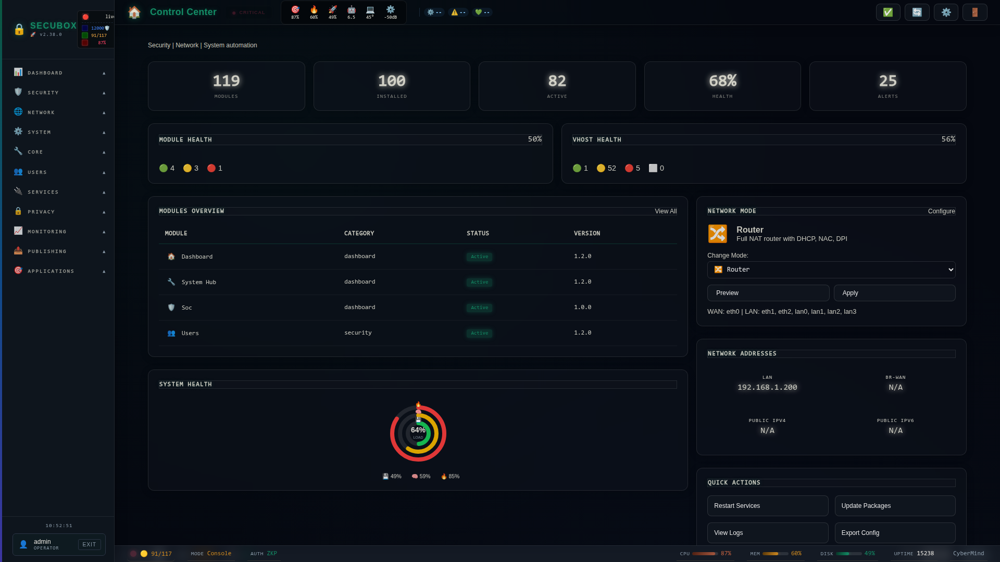

<!--
  SPDX-License-Identifier: LicenseRef-CMSD-1.0
  Copyright (c) 2026 CyberMind — Gérald Kerma <devel@cybermind.fr>
  Source-Disclosed License — All rights reserved except as expressly granted.
  See LICENCE-CMSD-1.0.md for terms.
-->

# 🔗 P2P Network

Peer-to-peer networking

**Category:** VPN

## Screenshot



## Features

- Direct connections
- NAT traversal
- Encryption
- DHT

## Installation

```bash
# Add SecuBox repository
curl -fsSL https://apt.secubox.in/install.sh | sudo bash

# Install package
sudo apt install secubox-p2p
```

## Configuration

Configuration file: `/etc/secubox/p2p.toml`

## API Endpoints

- `GET /api/v1/p2p/status` - Module status
- `GET /api/v1/p2p/health` - Health check

## Evolutions (#774): DHT discovery, service federation health-checks, hierarchical master-link

Three additional subsystems, built on top of the existing WireGuard mesh and
the annuaire-backed identity/registry. **All three are OFF by default** and
are OPAD opt-in (enable explicitly in `/etc/secubox/p2p.toml`) — with every
section absent or disabled, `secubox-p2p` behaves exactly as before.

### DHT discovery (`api/dht.py`)

A custom Kademlia DHT (asyncio/UDP, JSON wire protocol) that lets nodes
publish and resolve **signed reachability records** (`{did, id_pubkey,
wg_pubkey, endpoint, ts, sig}`, Ed25519-signed) without depending on the
central annuaire being reachable. It implements standard Kademlia buckets
(k=20, alpha=3, 160-bit id space via SHA1(did)), an iterative `find_node` /
`find_value` lookup, bootstrap from annuaire nodes and/or seed addresses, and
persists its routing table to disk across restarts. It also carries an
advisory (unsigned) key/value store used to mirror federation health
snapshots (see below).

- `GET /dht/peers` — public read; routing-table snapshot (`enabled`, `peers`,
  `buckets`). Returns `{"enabled": false, "peers": [], "buckets": 0}` when the
  DHT is disabled.
- `POST /dht/announce` — JWT required; signs and publishes this node's own
  reachability record to the DHT (k nodes closest to its own id). Returns
  `{"ok": true, "key": <node_id_hex>}`. 400 if DHT is disabled.
- `GET /dht/find/{did}` — public read; resolves a DID to its verified
  reachability record via an iterative lookup. 404 if not found, 400 if DHT
  is disabled.

### Service federation health-checks (`api/federation.py`)

An opt-in async health-checker that sweeps the services published in the
local annuaire catalog and records debounced up/down status (a service only
flips to "down" after `fail_threshold` consecutive failures, avoiding flapping
on a single blip). The default probe (`default_probe`) does an HTTP(S)
`GET <endpoint><health_path>` when the service exposes an http(s) endpoint, or
a plain TCP connect otherwise; probes run concurrently under a semaphore cap.
When the DHT is also enabled, every sweep additionally mirrors the health
snapshot into the DHT's advisory store (`make_dht_publisher`), so health
status becomes visible to other DHT nodes too.

- `GET /federation/services` — public read; the federated service list (from
  the annuaire) with each entry's current health status. Always returns the
  service list even when health-checks are disabled (health reported as
  `"unknown"`); `enabled` reflects whether the background checker is running.
- `POST /federation/healthcheck` — JWT required; forces an immediate
  health-check sweep. Returns `{"ok": true, "probed": <n>}`. 400 if
  health-checks are disabled.

### Hierarchical master-link (`api/masterlink.py`)

A deterministic master-election and heartbeat-based failover state machine
for a small hierarchy of nodes (e.g. designating one mesh node as the
service-federation "master"). Election picks the candidate with the lowest
`(priority, node_id_hex)` tuple; a monotonic term (persisted to disk,
`TermStore`) guards against split-brain, and equal-term collisions between
two self-elected masters are resolved with the same deterministic tie-break so
exactly one survives. Heartbeats are Ed25519-signed (bound to the sender's
identity key) and broadcast over UDP to the configured peer addresses; a
satellite that stops hearing valid heartbeats for `election_timeout` seconds
starts a new election.

- `GET /masterlink/topology` — public read; this node's view of the topology
  (`master`, `term`, `self_role`, `self_id`, `peers`). Returns
  `{"enabled": false}` when master-link is disabled.
- `POST /masterlink/promote` — JWT required; forces an on-demand promotion
  attempt (bumps the term and re-runs the election immediately, rather than
  waiting for `election_timeout`). Returns `{"promoted", "term", "master",
  "role"}`. 400 if master-link is disabled.

### Configuration (`/etc/secubox/p2p.toml`)

Each subsystem has its own section in `p2p.toml`, all disabled by default.
The real defaults, from `api/mesh.py` (`DHT_DEFAULTS` / `FEDERATION_DEFAULTS`
/ `MASTERLINK_DEFAULTS`):

```toml
[dht]
enabled = false
port = 51823
bootstrap = []            # list of "host:port" seed addresses
announce = false
announce_interval = 900
rps = 50

[federation]
health_checks = false
interval = 30             # seconds between sweeps
probe_timeout = 5
max_concurrency = 20
fail_threshold = 3        # consecutive failures before marking a service "down"

[masterlink]
enabled = false
role_preference = "auto"
priority = 100            # lower priority value wins the election
heartbeat_interval = 5
election_timeout = 15
port = 51824
peer_addrs = []           # list of "host:port" masterlink peer endpoints
```

Startup for all three subsystems is best-effort: if a section is disabled, if
the node has no annuaire identity yet, or if the transport fails to bind, the
subsystem is simply left off (`app.state.dht` / `app.state.masterlink` /
`app.state.health_checker` stay `None`) and the rest of `secubox-p2p` starts
normally.

### Audit log

Two security-relevant events are appended to `/var/log/secubox/p2p-audit.log`
(JSON lines, best-effort/append-only): `dht_announce` (when a node publishes
its own reachability record) and `masterlink_promote` (every on-demand
promotion attempt, successful or not).

## Relais WAN par le maillage (#1670, #1672, #1682)

Un nœud sans accès Internet (ex. gk3) est servi par un nœud qui en a un (ex. gk2), à travers `wg-mesh`. Le TLS se termine sur le relais et son WAF inspecte tout ; le trafic va ensuite au pair en HTTP, chiffré par WireGuard.

| Commande | Où | Effet |
|---|---|---|
| `secubox-relais-maillage relayer <nom> <ip-maillée> [port]` | relais | Relaie un nom : pair vérifié, DNS public vérifié, certificat (joker s'il existe), vhost HAProxy derrière le WAF, route sbxwaf |
| `secubox-relais-maillage retirer <nom>` | relais | Retire le vhost et la route (certificat et DNS inchangés) |
| `secubox-relais-maillage relayer --sans-sonde <nom> <ip-maillée> [port]` | relais | **Root, réservé au retour arrière** de `secubox-pilotage-vhost` (#3126) : mêmes contrôles et mêmes vhost/route, sans sonde du pair ni DNS — jamais pour exposer un nouveau nom |
| `secubox-relais-maillage pair-de <box>` | relais | IP maillée du pair `<box>` (wg_mesh.json, présent une fois et connu de wg-mesh), lue sous le verrou commun |
| `secubox-relais-maillage etat` | relais | Noms relayés vers le maillage |
| `secubox-relais-maillage ouvrir <ip-relais> [port]` | pair | Port des vhosts ouvert au seul relais ; nginx croit l'adresse de visiteur qu'il transmet |
| `secubox-relais-maillage synchroniser` | partout | Minuteur horaire `secubox-relais-maillage.timer` (voir ci-dessous) |

`relayer`, `retirer` et `synchroniser` tiennent le verrou commun `/var/lib/secubox-pilotage-pages/verrou-relais.lock` (flock) pendant toute leur passe, comme `secubox-pilotage-vhost` pendant un basculement (#3126). Un `admin.<box>` listé dans `exclusions-relais.json` n'est ni créé ni retiré ; fichier présent mais non sûr : aucun `admin.<box>` créé ni retiré dans le doute.

**Noms d'une box sans webos (#3126 L5, E4).** Pour un pair connu du pilotage du maître **dont webos ne répond pas** (pas de `/public/noms`), `synchroniser` lit ses noms dans le plan d'exposition `/var/lib/secubox/pilotage/exposition.json` écrit par `secubox-pilotage` (noms déclarés par l'agent, `Device.X_SECUBOX_Exposure.Names`) au lieu de `webos/public/noms`. Aucune route sans jeton n'est ajoutée au contrôleur : le plan est un fichier, relu par root sans suivre de lien (fichier ordinaire, un seul lien, non inscriptible par groupe/autres, ≤ 1 Mio). Repli sur `webos/public/noms` si le plan est absent, non sûr, illisible, d'une autre version, si le relevé de la box a plus de 24 h, si l'adresse du pair n'y figure pas une seule fois ou si le nom de box diffère de celui de `wg_mesh.json`. Les noms sont revalidés (`<svc>.<box>.secubox.in`, svc `^[a-z0-9-]{1,40}$`, 64 au plus) puis passent les mêmes contrôles qu'avant (domaine du pair, exclusions, DNS public). Box déclarée « distante » : `admin.<box>` n'est jamais publié ni retiré par la synchronisation. Noms venus du plan : jamais de retrait (seulement des ajouts ; les retraits restent à webos ou au basculement du pilotage), au plus `nouveaux_noms_max` (défaut 3, `relais-maillage.toml`) nouveaux noms par passe et par box (quota Let's Encrypt). Dossier et fichier du plan : au compte `secubox-pilotage` ou à root, sans écriture groupe/autres ; suffixe des noms dérivé de la zone du relais. Les ports du plan (tous les ports TCP en écoute, sans protocole ni module) ne sont **jamais** relayés : les ports bruts restent ceux que la box publie par `webos/public/ports`.

**Exposition par défaut (`synchroniser`).**
- *Sur un satellite* : le port est ouvert au maître maillé.
- *Sur le relais* : pour chaque pair, lecture de `GET /api/v1/webos/public/noms`. Un nom `<service>.<domaine-du-pair>` est relayé seulement si :
  1. avec `services_des_pairs = "communs"` seulement : `<service>.<domaine-du-relais>` est lui-même exposé par le relais. Par défaut (`"tous"`, #3132), les services propres au pair sont publiés aussi ;
  2. le service n'est pas exclu (défaut : `wpad`, `boot`) ;
  3. le domaine du pair n'est pas celui du relais ;
  4. le DNS public du nom pointe vers le relais ;
  5. le service répond sur le pair (pas de 5xx).

Un nom relayé vers un pair qui, joint avec succès, ne le publie plus est retiré (vhost, route, Hall du parc) ; un pair injoignable garde ses noms (#3132).

Un seul certificat joker `*.<domaine-du-pair>` est émis par DNS-01 (acme.sh + Gandi LiveDNS), renouvelé comme `*.gk2.secubox.in`.

Réglages facultatifs, `/etc/secubox/relais-maillage.toml` :

```toml
auto = true                  # false : plus d'exposition automatique
exclure = ["wpad", "boot"]   # services jamais relayés
services_des_pairs = "tous"  # "communs" : seulement les services que le relais expose lui-même
```

Les vhosts des services répondent à `<service>.*` en plus de leur nom gk2 : c'est ce qui permet à un pair de servir ses services sous son propre domaine.

## Association automatique au maillage (#3100)

| Commande | Où | Effet |
|---|---|---|
| `sbx-mesh-invite --code [--nom N] [--flash] [--ttl S] [--adresse A] [--json]` | maître | Code `sbxmesh1.…` (automesh) ; seul le SHA-256 du jeton est gardé. `--flash` : ne vaut que pour N et remplace la clé du pair approuvé de ce nom |
| `sbx-mesh-ancre rattraper [--dump F]` | pair | Pose l'ancre du maître depuis le tunnel existant (rôle `peer`/`satellite`, un seul pair couvrant le réseau maillé) ; sinon audit `ancre_non_rattrapee` avec sa raison |

- **Ancre** : `/etc/secubox/p2p/ancre-maitre.json` (clé publique, adresse, nom, empreinte du maître).
  Présente, elle impose à `sbx-mesh-join` de ne rejoindre que ce maître.
- **Nom déjà pris** : hors jeton `flash`, `POST /api/v1/p2p/master-link/join` répond 409
  « nom déjà pris : préparer un flash sur le maître (page Netboot) ou retirer l'ancien pair ».
  Les jetons `flash` sont émis par secubox-netboot sur préparation de l'administrateur seulement.
- Audit (`/var/log/secubox/audit.log`) : `code_emis`, décisions de jonction, `ancre_rattrapee`,
  `ancre_non_rattrapee` ; jamais de jeton ni de code.

## Liens directs (#3133)

`sudo -u secubox secubox-maillage-pairs [synchroniser|etat]` (sans privilège ; `synchroniser` refuse de tourner en root, `etat` reste permis, `User=secubox` ; l'application passe par `sbx-mesh-up` (root) ; minuterie `secubox-maillage-pairs.timer` : 2 min après le démarrage,
puis toutes les minutes, ±10 s ; charge sur le maître : au plus 32 requêtes par minute) relie les pairs en direct, sans passer par le maître, pour le trafic entre eux.

- Le maître publie `GET /api/v1/p2p/master-link/pairs` (`{"version":1,"pairs":[{nom, mesh_ip, cle_publique, endpoint}]}`).
- Le pair ne lit cette liste que sur `http://<mesh_ip du maître>:7331` (le maître est l'entrée de `wg_mesh.json` dont la
  clé est celle de l'ancre), à travers le tunnel : sans redirection, 6 s, 256 Kio. Tout échec (réseau, 4xx/5xx — le
  maître répond 503 quand sa propre mesure des poignées manque —, JSON, version, ancre absente ou autre maître)
  n'ajoute, ne promeut ni ne retire rien, mais les **rétrogradations s'appliquent quand même** : elles ne dépendent que
  des poignées locales (soupape de sécurité, jamais suspendue au maître). Une liste vide valide retire seulement les liens directs.
- Les liens sont des entrées `direct: true` de `wg_mesh.json` ; `secubox-p2p-mesh.path` déclenche `sbx-mesh-up`
  (`wg syncconf`). Jamais de `wg set`. **Sonde puis promotion** (champ `direct_etat`, `direct_depuis` = dernier
  changement d'état) :
  - pair listé par le maître → **sonde** : clé, endpoint et `PersistentKeepalive = 25`, **sans `AllowedIPs`** : elle ne
    prend aucun trafic au maître ; ses keepalives provoquent la poignée de main si l'autre pair a lui aussi notre clé ;
  - poignée de main de moins de 180 s → **actif** : `AllowedIPs = <ip>/32`, le trafic vers ce pair passe en direct ;
  - actif sans poignée depuis plus de 180 s (et promu depuis plus de 180 s) → redevient **sonde** : le `/32` disparaît,
    le trafic revient au maître ; la sonde reste et se repromeut d'elle-même quand le chemin revient ;
  - entrée retirée seulement quand le maître ne liste plus le pair.

  Un pair qui ne participe pas (ancien p2p, liens désactivés, chemin direct injoignable) n'a jamais notre clé : aucune
  poignée, la sonde reste inerte et rien n'est capté. Coût d'une sonde : une tentative de poignée toutes les 5 à 25 s
  vers au plus 32 endpoints. Limites connues (bornes = 180 s + une période ;
  mesurées par la simulation à deux nœuds, 20 graines) : à la coupure d'un chemin direct actif, le trafic est perdu
  jusqu'au passage de la minuterie qui suit les 180 s sans poignée (110 à 170 s mesurés, borne 250 s) ; à la promotion,
  les deux pairs peuvent être en désaccord au plus une période (l'un actif, l'autre encore sonde : 60 s mesurés au plus) ;
  convergence en 95 s au plus après que chacun a la clé de l'autre.
  Sans mesure de ses propres poignées (fichier `wg-mesh-handshakes.json` absent ou périmé), le pair ne change rien.
  `mesh.render_wg_conf` n'écrit `AllowedIPs` pour une entrée directe que si elle est `actif`, et ne lui donne jamais le
  réseau maillé entier.
- Écriture de `wg_mesh.json` : relecture juste avant le calcul, remplacement atomique, mode conservé (fchmod sur le descripteur), propriétaire = celui du processus.
  L'API écrit aussi ce fichier : la fenêtre de concurrence est courte et acceptée.
- Réglage : `/etc/secubox/p2p.toml`, `[maillage] liens_directs = true` (défaut ; `false` : plus aucune requête au
  maître ni ajout, et toutes les entrées directes de CETTE box, sondes et actifs, sont retirées au passage suivant).
- `etat` : `{"actif": <réglage>, "liens_directs": [entrées directes avec direct_etat], "sondes": n, "actifs": n}`.
- Audit : `pair_direct_ajoute` (sonde), `pair_direct_promu`, `pair_direct_retrograde`, `pair_direct_retire` (nom, clé
  publique, mesh_ip) ; seulement pour ce qui a réellement changé dans le fichier écrit.
- `secubox-relais-maillage` ignore les entrées `direct: true` (un lien direct n'est pas un pair à relayer) et tolère
  la sortie `(none)` de `wg show allowed-ips` pour une sonde.
- Variables `SBX_PAIRS_*` (dont `SBX_PAIRS_MAITRE_URL`) : réservées aux tests ; ne jamais les poser en production,
  `SBX_PAIRS_MAITRE_URL` remplaçant l'adresse du maître.

## Projection des pairs enrôlés pour le pilotage (#3126)

`/var/lib/secubox/p2p` est 0700 `secubox` : le contrôleur du pilotage (compte `secubox-pilotage`) n'y lit rien. À chaque écriture de
`peers.json`, l'API publie `/var/lib/secubox/p2p-public/pairs-enroles.json` (dossier 0755 `secubox` créé par le postinst, fichier 0644,
renommage atomique par descripteur, lien jamais suivi) : `{"version": 1, "pairs": [{"name", "mesh_ip", "fingerprint", "joined_via"}]}`,
pairs ENRÔLÉS seulement (aucune découverte mDNS, aucune clé, aucun jeton, aucune adresse LAN). Le postinst la republie depuis `peers.json`
(`runuser -u secubox -- python3 -I /usr/lib/secubox/p2p/api/pairs_enroles.py`). Un échec de publication est journalisé et ne bloque
jamais l'écriture du registre.

## License

LicenseRef-CMSD-1.0 (Source-Disclosed License) — CyberMind © 2024-2026.
See [LICENCE-CMSD-1.0.md](../../LICENCE-CMSD-1.0.md).
