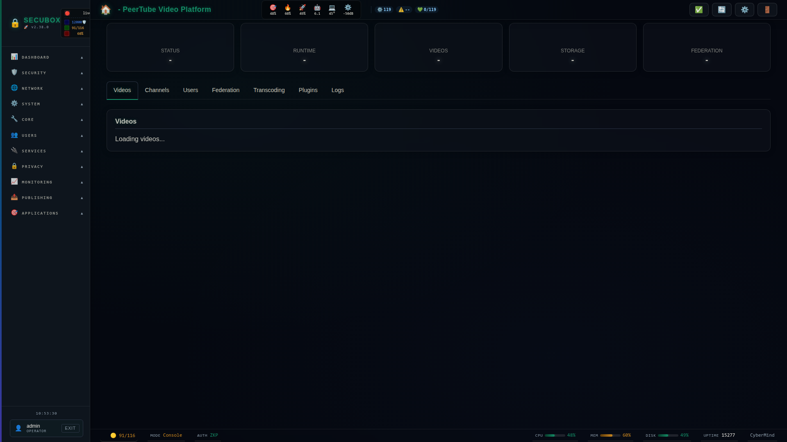

<!--
  SPDX-License-Identifier: LicenseRef-CMSD-1.0
  Copyright (c) 2026 CyberMind — Gérald Kerma <devel@cybermind.fr>
  Source-Disclosed License — All rights reserved except as expressly granted.
  See LICENCE-CMSD-1.0.md for terms.
-->

# 📺 PeerTube

Federated video platform

**Category:** Media

## Screenshot



## Features

- Video hosting
- Federation
- Live streaming
- Comments

## Installation

```bash
# Add SecuBox repository
curl -fsSL https://apt.secubox.in/install.sh | sudo bash

# Install package
sudo apt install secubox-peertube
```

## Configuration

Configuration file: `/etc/secubox/peertube.toml`

## Direct (live) et rediffusions (#3890)

OBS publie en RTMP depuis le réseau local (1935, jamais exposé) ; les
spectateurs passent par le WAF. Le réglage se fait par l'API d'administration
de PeerTube, jamais en éditant `production.yaml`.

```bash
peertubectl direct activer          # section live seule ; crée la liste « À garder »
peertubectl direct etat             # réglages du direct, en JSON
peertubectl rediffusions purger --simuler   # ce qui serait effacé, sans rien effacer
peertubectl rediffusions purger     # efface (une ligne d'audit par vidéo)
```

- `direct activer` lit `GET /api/v1/config/custom`, ne change que `live`
  (`enabled`, `allowReplay` à vrai, `transcoding.enabled` à faux : la qualité
  d'OBS est relayée, 720p conseillé ; `maxDuration`, `maxInstanceLives`,
  `maxUserLives`) et renvoie le tout par `PUT`. Idempotent. PeerTube refuse la
  rediffusion si le transcodage des **vidéos** (`transcoding.enabled`) est
  éteint : le verbe s'arrête alors sans rien écrire. Il crée aussi la liste de
  lecture privée **« À garder »** du compte root si elle manque. Cocher
  « enregistrer la rediffusion » reste un choix fait à la création du direct.
- Une rediffusion est **gardée** si elle est dans « À garder » ; sinon
  `secubox-peertube-rediffusions.timer` (chaque nuit, unité oneshot sous
  `secubox`, durcie) l'efface après `jours_conservation` jours. Une vidéo est
  reconnue comme rediffusion par `GET /api/v1/videos/{id}/live-session`
  (200 = rediffusion, 404 = vidéo ordinaire) ; jamais une vidéo téléversée,
  jamais un direct en cours. Sans la liste, ou au moindre échec d'API, rien
  n'est effacé et le code de sortie est non nul.

```toml
[direct]
jours_conservation      = 7    # rediffusion gardée N jours, puis effacée
duree_max_heures        = 6    # un direct oublié s'arrête seul ; 0 = illimité
directs_max_instance    = 2
directs_max_utilisateur = 1
```

## API Endpoints

- `GET /api/v1/peertube/status` - Module status
- `GET /api/v1/peertube/health` - Health check

## License

LicenseRef-CMSD-1.0 (Source-Disclosed License) — CyberMind © 2024-2026.
See [LICENCE-CMSD-1.0.md](../../LICENCE-CMSD-1.0.md).
