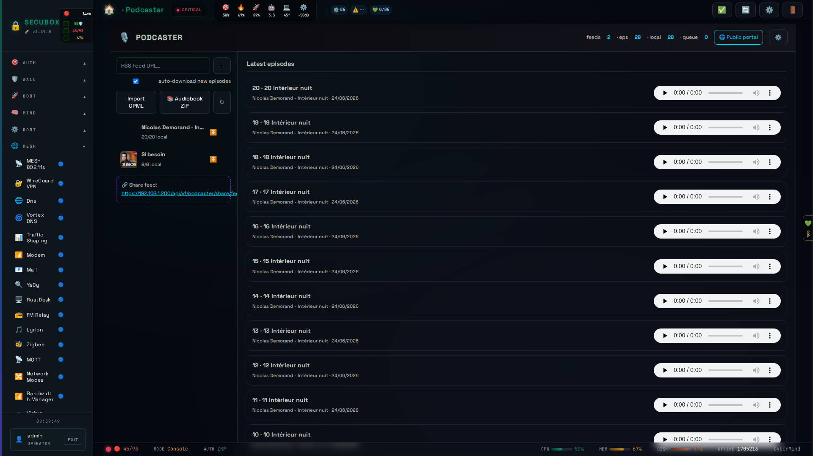

<!--
  SPDX-License-Identifier: LicenseRef-CMSD-1.0
  Copyright (c) 2026 CyberMind — Gérald Kerma <devel@cybermind.fr>
  Source-Disclosed License — All rights reserved except as expressly granted.
  See LICENCE-CMSD-1.0.md for terms.
-->

# 🎙️ Podcaster

Modern podcast manager

**Category:** Media

## Screenshot



## Features

- Feed management
- Episodes
- Transcoding
- RSS publish

## Installation

```bash
# Add SecuBox repository
curl -fsSL https://apt.secubox.in/install.sh | sudo bash

# Install package
sudo apt install secubox-podcaster
```

## Configuration

Configuration file: `/etc/secubox/podcaster.toml`

## API Endpoints

- `GET /api/v1/podcaster/status` - Module status
- `GET /api/v1/podcaster/health` - Health check
- `GET /api/v1/podcaster/public/library` - bibliothèque publique (lecture) : `episodes`, `feeds` (titre → compte) et, depuis 1.6.0,
  `podcasts` (un par podcast ayant des épisodes téléchargés : `id`, `title`, `description`, `image`, `episodes`, `last`, `bytes`, `rss`, `zip`)
- `GET /api/v1/podcaster/share/feed.xml` - flux RSS global des épisodes téléchargés
- `GET /api/v1/podcaster/share/feed/{fid}.xml` - flux RSS d'un seul podcast (titre, description, pochette, ses épisodes téléchargés) ; 404 si inconnu
- `GET /api/v1/podcaster/public/feed/{fid}/zip` - archive ZIP des épisodes téléchargés d'un podcast

## License

LicenseRef-CMSD-1.0 (Source-Disclosed License) — CyberMind © 2024-2026.
See [LICENCE-CMSD-1.0.md](../../LICENCE-CMSD-1.0.md).
