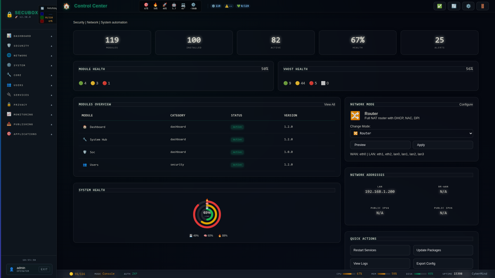

<!--
  SPDX-License-Identifier: LicenseRef-CMSD-1.0
  Copyright (c) 2026 CyberMind — Gérald Kerma <devel@cybermind.fr>
  Source-Disclosed License — All rights reserved except as expressly granted.
  See LICENCE-CMSD-1.0.md for terms.
-->

# 🔐 Login Portal

Authentication portal with JWT

**Category:** Access

## Screenshot



## Features

- JWT auth
- Sessions
- Password recovery
- Captive portal

## Installation

```bash
# Add SecuBox repository
curl -fsSL https://apt.secubox.in/install.sh | sudo bash

# Install package
sudo apt install secubox-portal
```

## Configuration

Configuration file: `/etc/secubox/portal.toml`

## API Endpoints

- `GET /api/v1/portal/status` - Module status
- `GET /api/v1/portal/health` - Health check

## License

LicenseRef-CMSD-1.0 (Source-Disclosed License) — CyberMind © 2024-2026.
See [LICENCE-CMSD-1.0.md](../../LICENCE-CMSD-1.0.md).

## Session (#3704)

`GET /api/v1/portal/verify` rend la session SecuBox de la requête (jeton de l'admin en Bearer, sinon cookie
`secubox_session`), validée par `secubox_core.auth`. `GET /api/v1/portal/sessions` (administrateur réel, `require_jwt`)
liste les sessions ouvertes du registre partagé de secubox-auth (`/var/lib/secubox/auth/sessions.json`), sans leur
identifiant ; `DELETE /api/v1/portal/sessions/{compte}` coupe toutes les sessions du compte par l'événement
`sessions_coupees` de secubox-auth.
