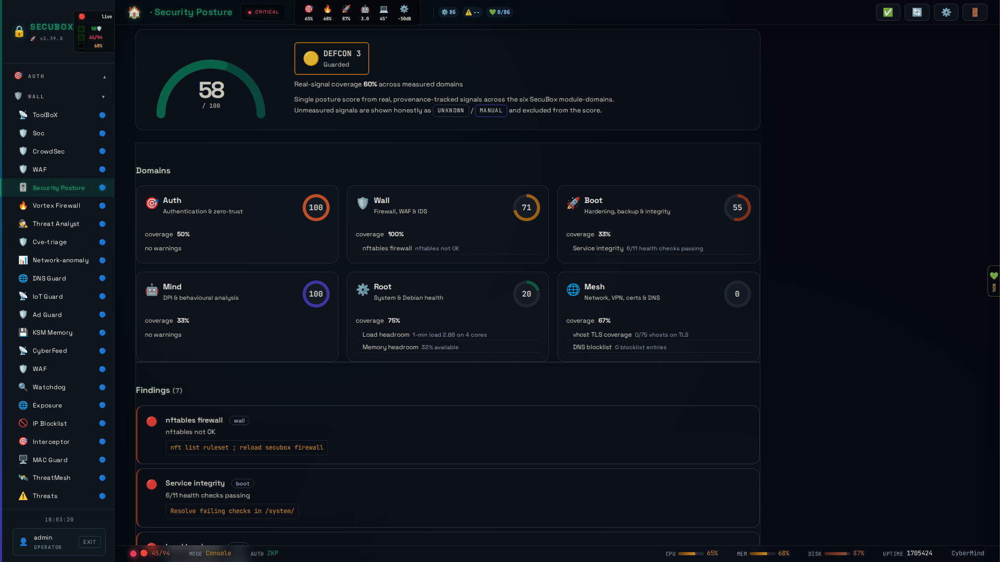

<!--
  SPDX-License-Identifier: LicenseRef-CMSD-1.0
  Copyright (c) 2026 CyberMind — Gérald Kerma <devel@cybermind.fr>
  Source-Disclosed License — All rights reserved except as expressly granted.
  See LICENCE-CMSD-1.0.md for terms.
-->

# 🎯 Security Posture

Honest board-truthful security scorecard

**Category:** Security

## Screenshot



## Features

- Scorecard
- Control checks
- Gaps
- Trend

## Installation

```bash
# Add SecuBox repository
curl -fsSL https://apt.secubox.in/install.sh | sudo bash

# Install package
sudo apt install secubox-security-posture
```

## Configuration

Configuration file: `/etc/secubox/security-posture.toml`

Filtres du WAF proposés par l'IA (#3732, #3745) : nombre de nouveaux filtres acceptés, réglable dans
`/etc/secubox/cve-triage.toml` :

```toml
[filtres_ia]
plafond_heure = 10    # 1..1000, défaut 10
plafond_jour  = 50    # 1..5000, défaut 50 (24 h glissantes)
```

Relever ces valeurs sert à charger d'un coup toute la base connue (amorçage), puis à revenir aux défauts.

## API Endpoints

- `GET /api/v1/security-posture/status` - Module status
- `GET /api/v1/security-posture/health` - Health check

## License

LicenseRef-CMSD-1.0 (Source-Disclosed License) — CyberMind © 2024-2026.
See [LICENCE-CMSD-1.0.md](../../LICENCE-CMSD-1.0.md).
