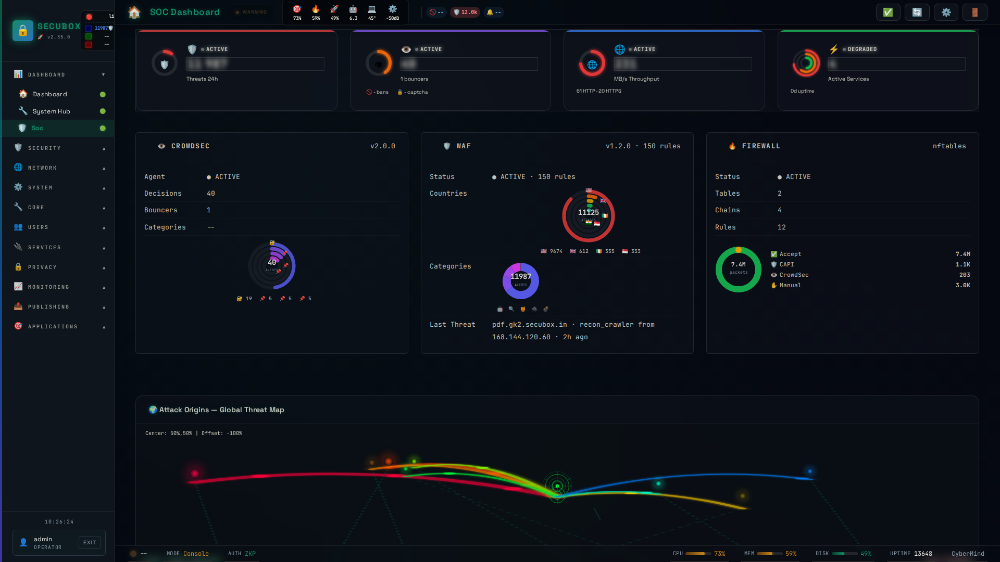

<!--
  SPDX-License-Identifier: LicenseRef-CMSD-1.0
  Copyright (c) 2026 CyberMind — Gérald Kerma <devel@cybermind.fr>
  Source-Disclosed License — All rights reserved except as expressly granted.
  See LICENCE-CMSD-1.0.md for terms.
-->

# 🛡️ Security Operations Center

SOC with world clock, threat map, tickets

**Category:** Dashboard

## Screenshot



## Features

- World clock
- Threat map
- Ticket system
- P2P intel
- Alerts

## Installation

```bash
# Add SecuBox repository
curl -fsSL https://apt.secubox.in/install.sh | sudo bash

# Install package
sudo apt install secubox-soc
```

## Configuration

Configuration file: `/etc/secubox/soc.toml`

## API Endpoints

- `GET /api/v1/soc/status` - Module status
- `GET /api/v1/soc/health` - Health check

## Vigie SOC, Guardian et le WAF (1.12.1, #3922)

Une place par panneau : le WAF garde le détail, le SOC en donne la synthèse.

- Les onglets de `/soc/` n'encadrent plus aucune page du WAF (Menaces, Attaquants, Campagnes, Surfaces, Visites,
  Historique). Un seul lien « Détail dans le WAF ↗ » ouvre `/waf/` en navigation de premier niveau.
- Guardian (`guardian.html`) ne recalcule plus la carte des attaques, « Ce qui protège », les derniers événements, la
  répartition par catégorie ni la courbe par jour : ces panneaux restent dans le WAF. Il garde le réseau, le DPI, les
  appareils, les leurres, le mode et le filtrage web.
- À leur place, une bande « Pare-feu applicatif » (`waf/stats` et `waf/history` déjà lus, aucune route nouvelle) :
  alertes du jour, critiques et hautes, catégorie dominante, évolution d'hier contre avant-hier (deux journées
  complètes, la journée en cours est écartée ; le chiffre est omis s'il manque des jours). Chaque chiffre renvoie à
  la page du WAF et la bande porte un lien « Détail dans le WAF → ».
- Bloc « Campagnes en cours » (1.13.0, #3919) : 4 populations d'attaquants au plus, lues dans `waf/populations` (nom, adresses, état, 7 jours) ; tout le bloc mène à `/waf/campagnes.html`, rendu par `cartes-campagnes.js` et `reperes.js`, copies identiques de celles de secubox-waf-ng.

## SADE — Cyber Defense Live

Console de défense active du SOC : page `/soc/defense.html`, routes montées sous `/defense` (préfixe `/api/v1/soc`
côté public). Elle agrège actord, le WAF et le maillage ; une source injoignable s'affiche « relevé indisponible ».

### Routes `/defense/*`

| Route | Garde | Rôle |
|---|---|---|
| `GET /status`, `/threats`, `/threats/{id}`, `/actions`, `/mesh`, `/incidents`, `/policies`, `/proposals` | `require_lecture` | Vues de lecture |
| `POST /mode` | `require_jwt` | Change le mode (audit écrit avant le COMMIT) |
| `POST /approve`, `POST /refuse` | `require_jwt` | Approuve ou refuse une proposition, désignée par son empreinte ; `simuler: true` ne fait rien et ne trace que le verdict |
| `POST /reprendre` | `require_jwt` | Débloque une décision restée `en_cours` (retour `en_attente`) |
| `POST /liste-blanche`, `POST /liste-blanche/retirer` | `require_jwt` | Ajoute (`{cidr, motif}`) ou retire (`{cidr}`) un réseau protégé : au plus /24 en IPv4, /48 en IPv6 (jamais un préfixe IPv6 qui porte de l IPv4), 64 ajouts ; ajout et retrait confirmés dans la page ; entrées système non retirables ; audit `sade-liste-blanche-ajout` / `-retrait` avant le COMMIT. Aussi en ligne de commande : `cd /usr/lib/secubox/soc && runuser -u secubox -- python3 -m api.liste_blanche lister\|ajouter <cidr> <motif>\|retirer <cidr>` |

Lectures : chaque source est lue avec un délai de 20 s. Une vue est servie 15 s depuis le cache. Quand une source
est muette, le dernier relevé complet de moins de 15 min reste servi, avec son heure (`releve_a`) : la page affiche
alors « RELEVÉ DU HH:MM », jamais « EN DIRECT ». `/mesh` donne le nom d'hôte de la box (`identifiant` = nœud
threatmesh) et `pairs_silencieux` (attendu depuis threatmesh 1.2.0, #3450). `/incidents` regroupe les événements
identiques d'une même minute (`n`) ; un outil deviné par actord (« …? ») est écrit « … (probable) ».

### Modes

- `observe` (défaut) : lecture seule, aucun geste.
- `reactive` : ouvert ; la file d'approbation agit, sur approbation d'un administrateur.
- `active` : ouvert. Le chemin manuel de `reactive` reste valable, et l'exécuteur automatique du cas sûr
  (`secubox-soc-sade-auto.timer`, toutes les 2 min) bannit seul les propositions d'actord de score 60 à 79 (bande
  contenir ; 80 à 94 exigerait une récidive confirmée par le code, non livrée en v1 : proposé), d'au plus
  8 adresses publiques hors liste blanche, passerelles et pairs du maillage, pour 24 h au plus (4 h par défaut), par
  `sudo wafctl ban`. Pairs : `/var/lib/secubox/p2p/wg_mesh.json` (`mesh_ip`, `endpoint` ; surcharge
  `SECUBOX_SOC_WG_MESH`) — illisible ⇒ aucun ban du passage (`pairs_illisibles`), absent ⇒ box sans maillage — plus
  threatmesh `/peers` s'il répond. Seules les propositions **vues pour la première fois après le passage en ACTIVE**
  (`propositions_vues`, migration 0002, comparée à `mode.depuis`) sont traitées : l'arriéré reste à la main. Plafond
  de 20 adresses par heure : au-delà, retour en `observe` (même par-dessus un passage concurrent en `reactive` : plus
  strict seulement), audit `sade-auto-plafond`, et la page affiche « retour en OBSERVE par le plafond (HH:MM) ». Un
  refus humain lie l'exécuteur par empreinte ET par adresse : une adresse refusée un jour par un opérateur exclut toute
  proposition qui la contient. Seuls les verdicts de garde de `wafctl` (`refus:privee|protegee|box|pair|invalide`,
  adresse privée ou invalide) concluent `refuse` ; tout autre échec (garde illisible, nft, délai, sudo) remet la
  décision `en_attente` et arrête le passage. Un passage n'entame plus de proposition après 3 min. Hors mode `active`,
  l'exécuteur ne bannit rien (il note seulement la première vue des propositions).

  **Limite v1 — à faire avant d'activer ACTIVE** : l'adresse publique de sortie de la box et l'adresse publique du
  poste d'administration ne sont PAS détectées automatiquement. Les ajouter à la liste blanche avant de passer en
  `active` (sinon elles seraient bannissables si actord les proposait).
- `/policies` porte un bloc `auto` : `plafond_heure`, `bans_derniere_heure` (adresses réclamées par l'exécuteur sur
  l'heure glissante, tout état confondu : le compte du plafond, affiché « Décisions automatiques : n / 20 sur
  l'heure »), `score` (`[60, 79]`), `ttl_max_s`, `adresses_max`, `mode_par` (auteur du dernier changement de mode :
  `sade-auto` pour tous, un nom humain pour l'administrateur seulement, sinon `null`) et `mode_depuis`.
- **Resserrer ne dépend jamais de l'audit (1.12.0)** : ouvrir (`reactive`, `active`) exige l'audit écrit avant le
  COMMIT (sinon 503 `audit_indisponible`, mode inchangé) ; passer en `observe` (coupure manuelle ou retour forcé par
  le plafond) est TOUJOURS validé, avec la remise de la file (`annulee_observe`), puis les lignes d'audit sont écrites
  au mieux. En échec : erreur au journal du service, alerte `audit_indisponible` en base (table `alertes`, migration
  0003), visible dans `/defense/status` (`audit_indisponible` = horodatage) et dans la réponse de `POST /mode`
  (`audit_indisponible: true`) ; l'alerte s'efface au prochain changement de mode audité.
- `aggressive` : toujours fermé, refusé par `POST /mode` avec 409 `gestes_non_livres` ; bouton désactivé, titre
  « seuils abaissés, réservé au banc — ouverture sur accord du propriétaire » (SADE § Modes, déploiement étape 5).

### Phases (`/defense/status` → `phases`, 1.12.0)

Les cartes 1 et 2 suivent le mode. Les cartes 3 et 4 sont livrées (`livree: true`) et portent leur critère mesuré
(`api/phases.py`, mesures gardées 60 s et calculées en vol unique, mode relu en direct) ; une valeur vaut `null` quand sa source manque ou se
lit mal — la page écrit alors « relevé indisponible », jamais 0.

```
{"p3": {"livree": true, "active": bool|null, "lecture_bornee": bool,
        "critere": {"rediriges_24h": int|null, "tentatives_valides_24h": int|null}},
 "p4": {"livree": true, "active": bool|null,
        "critere": {"partages": int|null, "revus_chez_pairs": int|null, "contenus_chez_pairs": int|null,
                    "filtres_confirmes": int|null}}}
```

- `p3.active` : mode `active` ET au moins un `leurre`, ou un `ban` / `ban_bloc` d'office (`mode: auto`), daté des
  dernières 24 h dans `/var/lib/secubox/waf/ai-ban.jsonl` (un ban annulé pour défaut d'audit est écarté) ; hors
  `active` : `false` ; journal illisible : `null`.
- `rediriges_24h` : SOMME des champs `servies` des lignes `leurre_redirige` de `waf-threats.log` sur 24 h (une ligne
  est bornée par adresse et porte le nombre de requêtes servies qu'elle représente). `tentatives_valides_24h` (page : « tentatives laissées passer ») : lignes
  `action: detect` d'une adresse non locale (détectées puis laissées passer jusqu'au service). Lecture par la fin,
  16 Mio au plus, fichier courant puis `waf-threats.log.1` s'il ne couvre pas 24 h ; budget épuisé avant 24 h :
  `lecture_bornee: true` et la page écrit « au moins N ».
- `partages`, `revus_chez_pairs`, `contenus_chez_pairs` : résumé `/run/secubox/waf-indices-etat.json` de
  secubox-waf-indices, lu directement (le lecteur `indices_etat` de secubox-waf-ng est recopié, même validation :
  fichier ordinaire à root ou `secubox`, sans écriture du groupe ni des autres, ≤ 64 Kio, de moins de 30 min) — pas
  d'import entre paquets.
- `filtres_confirmes` : l'état « confirmé » d'un filtre de l'IA n'existe que sur gk3 ; gk2 le remplace par **« filtre
  IA actif depuis au moins 24 h »**. Actifs : cache `/var/lib/secubox/waf/filtres-ia.json` de l'onglet Filtres IA du
  WAF (moins d'1 h) ; date d'application : lignes `leurre_filtres-ia-appliquer` / `-retirer` (résultat `ok`) que
  secubox-cvectl écrit dans `audit.log` (puis `.1`), 4 Mio par fichier. Une ligne d'application tronquée (ids
  manquants), une fenêtre de moins de 24 h ou un état incohérent rendent `null`.
- `p4.active` : au moins un indicateur partagé non échu (7 j) ou un filtre confirmé ; `null` si l'on ne peut trancher.
- Accès (compte `secubox` de l'API, sans profil AppArmor ni `ProtectSystem` à ce jour, #3847) : `ai-ban.jsonl` et
  `waf-threats.log` sont 0660 au groupe `secubox-waf`, dont `secubox` est membre (postinst de secubox-waf-ng) ; le
  résumé des indices est 0644 ; le cache des filtres et `audit.log` sont au compte `secubox`. Aucun droit d'écriture
  nouveau.

Surcharges (tests) : `SECUBOX_SOC_AI_BAN`, `SECUBOX_SOC_WAF_MENACES`, `SECUBOX_SOC_INDICES`, `SECUBOX_SOC_FILTRES_IA`,
`SECUBOX_AUDIT_LOG`.
- **Publication pour gk2 (#3723, 1.11.0)** : `/run/secubox/sade-mode.json` (0644, renommage atomique d'un temporaire
  du même dossier : jamais de fichier partiel) = `{"mode", "depuis", "liste_blanche"}`, où `depuis` est l'instant de
  la publication et `liste_blanche` les réseaux de la liste blanche (entrées amorcées comprises). Réécrit après
  `changer_mode`, après chaque ajout ou retrait de la liste blanche, au démarrage de l'API puis toutes les 60 s
  (battement). L'API du WAF (`gestes_ia.mode_sade`) en tire la porte des gestes d'office du compte `ai-ban` et tient
  pour `observe` un fichier daté de plus de 15 min : un SOC arrêté ferme l'automatique de gk2. Base illisible : rien
  n'est publié (le fichier vieillit). L'exécuteur `sade-auto` ne peut pas écrire `/run/secubox` (bac à sable) : son
  retour en `observe` est publié par le battement suivant (60 s au plus). Surcharge : `SECUBOX_SOC_SADE_MODE`.
  Un échec de publication est bruyant : journal en erreur à chaque essai, ligne d'audit `sade-mode-publication-echec`
  (`cause` : `base_illisible`, `fichier_etranger` quand un fichier d'un autre compte occupe la place dans
  `/run/secubox` 1777 et ne peut être remplacé, ou l'erreur système) à chaque changement de cause, puis
  `sade-mode-publication-retablie`. gk2 ne croit le fichier que s'il appartient à root ou à `secubox`, sans écriture
  du groupe ni des autres. Limite : tout processus qui tourne sous le compte `secubox` (l'API SOC, l'agrégateur, et
  les autres modules de ce compte) peut l'écrire.

### Données et audit

- Base SQLite `/var/lib/secubox/soc/defense.db` (surcharge : variable `SECUBOX_SOC_DEFENSE_DB`) : mode, décisions,
  liste blanche, première vue des propositions ; schéma par migrations (`api/migrations/0001-defense.sql`,
  `0002-propositions-vues.sql`).
- Chaque décision de sécurité est écrite, avec fsync, dans `/var/log/secubox/audit.log` (append-only) avant d'être
  validée ; si l'audit échoue, rien n'est fait (503 `audit_indisponible`). Format : UNE ligne JSON par décision
  (`json.dumps`, `ensure_ascii=True`, comme `secubox_core.auth`), clés dans l'ordre `ts` (ISO-8601 UTC), `module`
  (`"soc"`), `action`, `operateur`, puis les champs propres à l'action (`empreinte`, `acteur`, `adresses`, `geste`,
  `duree`, `score`, `generation`, `issue`, `cause`, `verdict`, `operation` pour une simulation, …).
  Valeurs de `action` : `sade-mode`, `sade-simule`, `sade-approuve-demande`, `sade-approuve-resultat`, `sade-refuse`,
  `sade-approuve-refus`, `sade-refuse-refus`, `sade-reprise`, et, pour l'exécuteur (`operateur` = `sade-auto`) :
  `sade-auto-demande` (avant les bans), `sade-auto-resultat` (issue) et `sade-auto-plafond` (retour en observe).
- Unité `secubox-soc-sade-auto.service` (oneshot, utilisateur `secubox`, `NoNewPrivileges=no` pour sudo, exception
  § 10) lancée par `secubox-soc-sade-auto.timer` ; le sudoers `SBX_WAF_BANMANUEL` de secubox-waf-ng accorde `wafctl ban`.

### Compteurs de `/defense/status`

- `evenements_24h` : somme de l'activité 24 h d'actord, calculée sur ses 5000 derniers événements seulement ;
  `evenements_24h_plafonne` vaut `true` quand l'échantillon est plein (ou de taille inconnue) : le chiffre est alors un
  minimum (la page affiche « ≥ N, échantillon plafonné par actord »).
- `a_valider` : propositions d'actord en attente de décision (même règle que `/defense/proposals`), `null` si la base
  d'état est illisible.
- `blocages_actifs` : bans que le WAF déclare appliqués (`application.ok`) ; `blocages_enregistres` : bans inscrits au
  WAF ; `blocages_application` : état d'application du WAF. `application.ok` faux : 0 actif ; absent : `null`.

### Liste blanche

Réseaux jamais bannis : RFC 1918, boucle locale, lien-local, CGNAT, ::1, fc00::/7, fe80::/10. Les entrées amorcées
sont verrouillées par des triggers SQL (ni suppression, ni modification, ni remplacement). Toute adresse d'une
proposition est contrôlée ; échec fermé.

### Approbation

- Une décision est identifiée par l'**empreinte** de la proposition (sha256 de geste, adresses normalisées triées et
  ttl), jamais par l'identifiant d'acteur, renuméroté au redémarrage d'actord. Le serveur la recalcule sur la
  proposition courante d'actord ; sans correspondance : 409 `proposition_changee`, rien n'est fait.
- La décision est réclamée (`en_cours`, mode relu, audit fsync, une transaction BEGIN IMMEDIATE) avant tout appel
  au WAF ; un double clic ou une réclamation concurrente donne 409 `deja_traitee`.
- `POST /reprendre` ne ramène une décision `en_cours` à `en_attente` que si sa demande dépasse le délai maximal des
  appels au WAF + 60 s.
- Gestes exécutables (`GESTES_EXECUTABLES`) : `ban`, soit un `POST /ban` du WAF par adresse (au plus 32), tout de
  suite, avec le jeton administrateur de l'appelant relayé (porteur requis) ; et, depuis 1.12.0, les gestes gradués
  `limiter` (6 h par défaut, 1 h à 24 h), `leurre` (24 h par défaut, 1 h à 7 j) et `prolonger` (24 h par défaut,
  1 h à 7 j, IPv4). `partager`, `ban_bloc`, `quarantaine` et tout autre geste : 409 `gestes_non_livres`. Une durée hors
  bornes est refusée (409 `duree_invalide`), jamais ramenée dans les bornes.
- **Gestes gradués : en file, exécutés par sade-auto.** L'API garde `NoNewPrivileges=true` et ne lance jamais sudo.
  `POST /approve` fait les contrôles (mode, proposition relue, bornes, liste blanche, passerelles, pairs threatmesh et
  `wg_mesh.json`, adresses de l'administrateur), puis passe la décision en `approuve` (audit `sade-approuve-demande`,
  fsync avant le COMMIT) et rend **202** `{"etat": "approuve"}` ; la page écrit « en file ». Au passage suivant
  (2 min au plus), `secubox-soc-sade-auto` — en REACTIVE comme en ACTIVE, avant son propre chemin automatique, sans
  attendre actord — prend chaque approbation dans UNE transaction BEGIN IMMEDIATE (`approuve → en_cours`, mode relu,
  audit `sade-approuve-execution` fsync AVANT tout sudo ; un second passage ne la reprend jamais), RECONTRÔLE tout au
  moment d'exécuter (cible devenue protégée, `wg_mesh.json`, bornes de durée, et pour `prolonger` : ban présent dans
  `waf_ban` lu par `sudo nft -j list set inet secubox waf_ban`, jamais plus court que ce qui reste), lance
  `sudo -n /usr/sbin/wafctl <verbe> <ip> <n>s` par adresse (verbes du compte ai-ban, sudoers `SBX_WAF_LIMITER`,
  `_LEURRE`, `_PROLONGER` de secubox-waf-ng ≥ 1.43.0), puis `conclure` (`applique`, ou `en_attente` rendu à
  l'administrateur sur échec) et audit `sade-approuve-resultat`. Recontrôle négatif : `sade-approuve-abandon`
  (`motif` : `cible_protegee`, `absent`, `raccourcit`, `duree_invalide`, `expiree`…), décision rendue `en_attente`
  avec son motif. Ensemble nft illisible : l'approbation attend le passage suivant. Une approbation non exécutée après
  1 h est rendue (`expiree`). Au plus 8 approbations par passage, dans le budget de 3 min du passage ; plafonds
  horaires glissants par geste pour les approbations humaines, comptés dans `defense.db` (`par` ≠ `sade-auto`, en
  adresses) : limiter 60, leurre 30, prolonger 30 — au-delà, l'approbation attend. Rien n'est écrit dans
  `ai-ban.jsonl`. `par` reste l'administrateur : ces gestes ne comptent ni dans le plafond de 20/h de l'automatique ni
  pour son retour en OBSERVE. Une ligne restée `en_cours` se débloque par `POST /reprendre`. L'issue réelle
  (`resultat`) d'un geste en file est rendue par `/proposals` à l'administrateur seulement. Hors REACTIVE/ACTIVE, la
  file n'est pas exécutée. Le passage en `observe` (coupure manuelle ou retour forcé par le plafond) VIDE la file dans
  la même transaction : chaque `approuve` revient `en_attente` avec le résultat `annulee_observe` (audit
  `sade-approuve-annulee`) ; un retour en REACTIVE/ACTIVE n'exécute jamais une approbation d'avant la coupure. Une
  approbation plus grande que le plafond de son geste est rendue aussitôt (`motif=plafond`).
- Unité `secubox-soc-sade-auto.service` : `ReadWritePaths` porte aussi `-/var/lib/secubox/waf` (`wafctl leurre`,
  root dans l'espace de montage de l'unité, y remplace `leurres-ip.json`) et `-/var/log/sudo-io` (`log_output` des
  sudoers de ces verbes), comme `secubox-waf-indices.service`.

### Suite

- Dette acceptée (1.12.0) : `secubox-soc-sade-auto.service` écrit dans `/var/lib/secubox/waf` pour `wafctl leurre` ;
  le compte `secubox` y atteint aussi, par le groupe `secubox-waf`, les fichiers inscriptibles du groupe
  (`ai-ban.jsonl`…). À resserrer : un dossier dédié pour `leurres-ip.json` côté secubox-waf-ng, seul chemin ouvert.

### Confidentialité

Les adresses et l'empreinte ne sont rendues qu'aux administrateurs (`require_jwt`). Un lecteur ne voit que des
cibles masquées (`cible-N`), y compris dans les textes libres.

## License

LicenseRef-CMSD-1.0 (Source-Disclosed License) — CyberMind © 2024-2026.
See [LICENCE-CMSD-1.0.md](../../LICENCE-CMSD-1.0.md).
