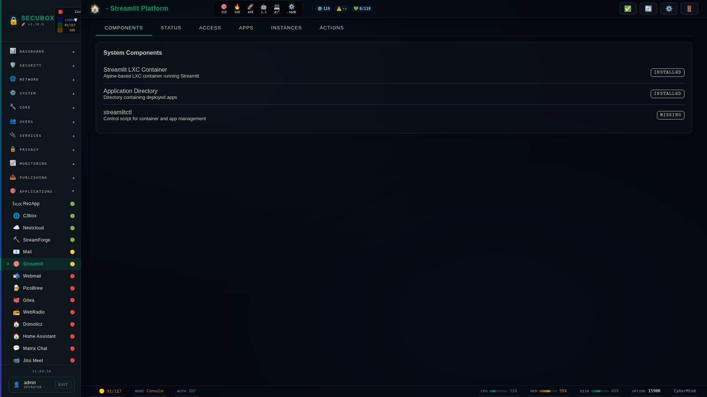

<!--
  SPDX-License-Identifier: LicenseRef-CMSD-1.0
  Copyright (c) 2026 CyberMind — Gérald Kerma <devel@cybermind.fr>
  Source-Disclosed License — All rights reserved except as expressly granted.
  See LICENCE-CMSD-1.0.md for terms.
-->

# 🎨 Streamlit

Streamlit app platform

**Category:** Apps

## Screenshot



## Features

- App hosting
- Deployment
- Management
- Logs

## Installation

```bash
# Add SecuBox repository
curl -fsSL https://apt.secubox.in/install.sh | sudo bash

# Install package
sudo apt install secubox-streamlit
```

## Configuration

Configuration file: `/etc/secubox/streamlit.toml` (example: `config/streamlit.toml.example`).

| Section / key | Default | Effect |
|---|---|---|
| `[ports] min`, `max` | `8501`, `8600` | Range of the automatic port (first free port, see below) |
| `[publication] auto` | `false` | `false`: publication **on demand** (“Publier” button, “Nom public” at deposit). `true`: an app deployed or started without a public name is published as `<folder>.<box domain>` |
| `[publication] autostart` | `true` | A published app stays up (`[apps.<name>] autostart = true`, exempt from idle sleep) and the container is started at boot by `secubox-streamlit-demarrage.service`; `false`: idle sleep applies (nothing wakes an app from its vhost yet, #746) |
| `[publication] ip_conteneur` | — | Container address for nginx `proxy_pass`; empty: live address (`lxc-info -i`), else the one of existing publications |

Declarations written by `streamlitctl` (root): `[apps.<folder>]` (port, enabled, autostart) and, for a
published app, `[instances.<public name>]` (`app`, `port`, `domain`, `enabled`, `emancipated`, `waf_enabled`,
`publication_geree`). Only a publication marked `publication_geree` follows the app's port by itself when the
app is started or redeployed; an `[instances.*]` written by hand is left untouched until an explicit
“Publier” / “Renommer” (same name) takes it over into the managed chain.

## Publication (#3247)

The chain is the one hand-built for `couture.gk2.secubox.in` on 2026-10-28, now generated and removed by
`streamlitctl app publish|unpublish` (code: `api/publication.py`, run as root in isolated mode `python3 -I`):

```
HAProxy  vhost declared: haproxyctl vhost add <domain> nginx_vhosts true  (→ use_backend sbxwaf_inspector)
 → sbxwaf   route <domain> → <address>:9080, written by secubox-waf-route
 → nginx :9080   /etc/nginx/sites-available/streamlit-<public name>.conf (+ link in sites-enabled):
                 server_name <domain>; proxy_pass http://<container>:<port>; WebSocket; proxy_read_timeout 86400s
 → container <ip>:<port>
+ streamlit.toml: [instances.<public name>] and [apps.<folder>]
```

Never a WAF bypass (no `waf_bypass`, the sbxwaf route targets nginx, never the container). Renaming lays
down the new name then removes the old one by the same path. A removal only touches what is still ours (a
route re-pointed elsewhere, an nginx file serving another name are left with a warning); an unreadable route
table aborts without writing. `nginx -t` failing restores the previous state. HAProxy is never forced
(`--allow-shrink` is not used): a refused regeneration is reported, traffic still reaches sbxwaf through the
default backend. Every change is appended to `/var/log/secubox/audit.log`; an inaccessible audit log aborts
before any change.

Public name: one strict DNS label (`[a-z0-9]`, hyphens inside, 1–63), never a box service name
(`admin`, `hall`, `www`, `api`, `mail`, `git`, `waf`, …), never a name already routed, served by nginx,
declared in `haproxy.toml` or published for another app.

## App environment and data

- `streamlitctl app env <name> set --apply` reads `KEY=value` lines on **stdin** (never argv); file
  `/etc/streamlit/env/<name>.env` **inside the container**, root `0600`, outside the apps, never served;
  read by `streamlit-app@<name>` (`EnvironmentFile=-`) at the next start. `list` returns names only.
  Refused: `PATH`, `HOME`, `LD_*`, `PYTHON*`, values with newline, NUL or `'`.
- Persistent data outside the app folder (a new deposit erases the folder, never this):
  `StateDirectory=streamlit-apps/%i` → `STREAMLIT_DATA_DIR=/var/lib/streamlit-apps/<name>`.
- The unit and launcher are re-laid in an already-installed container when the package's copy changes.

## API Endpoints

- `GET /api/v1/streamlit/status` - Module status
- `GET /api/v1/streamlit/health` - Health check
- `GET /api/v1/streamlit/apps/audit` - Fleet-wide inventory (disk/declared/running), feeds the Mosaïque tab, cached every 5 min (lecture gardée : jeton, cookie de session ou tableau de bord LAN)
- `POST /api/v1/streamlit/apps/{name}/wake` - Wake an idle-stopped app without blocking: answers `running` or `waking` within 25 s, the wall re-polls until `running`; the failure of a background wake is returned once (404/503/504) on the next poll — the container itself is woken if it sleeps; also fires a lazy thumbnail capture if stale
- `GET /api/v1/streamlit/apps/{name}/screenshot` - Serve the conserved thumbnail (lecture gardée depuis #1776 — the wall's `` carries the session cookie; no longer public)
- `POST /api/v1/streamlit/apps/{name}/recapture` - Manually trigger a thumbnail recapture (detached, returns immediately)
- `POST /api/v1/streamlit/deploy` (`require_jwt`, multipart) - Fields `file` (ZIP), `name` (folder), `port` (empty = automatic), `public_name` (optional: publishes the app). Wakes the container, deploys, assigns and persists the port, declares the app, publishes if asked (or `[publication] auto`), then (re)starts a published app. ZIP refused if an entry leaves the app folder or is a link. Response: `port`, `port_source`, `publication`, `conteneur_reveille`
- `POST /api/v1/streamlit/app/{name}/start?port=N` (`require_jwt`) - No port: own port, else first free one (never `default_port`). Wakes the container; a published app's chain follows its port
- `POST /api/v1/streamlit/app/{name}/publish` (`require_jwt`, body `{"public_name": "..."}` optional) - Publish (name derived from the folder if absent), then start
- `POST /api/v1/streamlit/app/{name}/rename` (`require_jwt`, body `{"public_name": "..."}`) - Change the public name: new one laid, old one removed, audited
- `POST /api/v1/streamlit/app/{name}/unpublish` (`require_jwt`) - Remove the published chain; the app sleeps again
- `DELETE /api/v1/streamlit/app/{name}` (`require_jwt`) - Unpublish first, then remove (cancelled if unpublishing fails)
- `GET /api/v1/streamlit/publications` (lecture gardée) - Public names and domains per app, publication settings
- `GET|PUT /api/v1/streamlit/app/{name}/env` (`require_jwt`) - Variable names / set (`vars`) and remove (`unset`) variables; values never returned
- `POST /api/v1/streamlit/power/wake` (`require_jwt`) - Wake the container (same path as the implicit wakes) and start the `autostart` instances; 503 with the cause if it stays down

Errors carry the real cause (`detail`), never an empty message: 400 invalid argument, 404 unknown app,
409 state or conflict (archived, port or name taken, reserved name, not published), 503 container
unavailable, 504 `streamlitctl` timeout.

App names reaching `streamlitctl` must match `[A-Za-z0-9_][A-Za-z0-9_.-]{0,127}`
(400 otherwise) — checked before any `sudo`, and again by the ctl itself.

## Control script (root)

`streamlitctl app port <name> [port] [--apply]`, `app publish <name> [public-name] [--par who] [--apply]`,
`app unpublish <name> [--par who] [--apply]`, `app publication <name>`,
`app env <name> list|set [--unset KEY]... [--par who] [--apply]`, `boot`. Dry-run without `--apply`.
Exit codes: 2 unknown app, 3 state, 4 conflict, 5 no free port, 64 refused argument, 75 container unavailable.

Thumbnails are captured on event only (first registration, source update,
or a manual recapture) — never on a timer, and never for an app that isn't
already running. See `api/shots.py` for the capture orchestration and
`sbin/streamlit-shotter` for the detached capture process.

## License

LicenseRef-CMSD-1.0 (Source-Disclosed License) — CyberMind © 2024-2026.
See [LICENCE-CMSD-1.0.md](../../LICENCE-CMSD-1.0.md).
