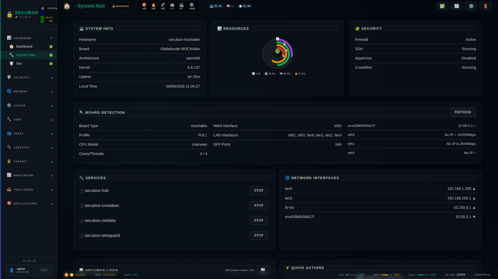

<!--
  SPDX-License-Identifier: LicenseRef-CMSD-1.0
  Copyright (c) 2026 CyberMind — Gérald Kerma <devel@cybermind.fr>
  Source-Disclosed License — All rights reserved except as expressly granted.
  See LICENCE-CMSD-1.0.md for terms.
-->

# ⚙️ System Hub

System configuration and management

**Category:** System

## Screenshot



## Features

- Settings
- Logs
- Services
- Updates

## Installation

```bash
# Add SecuBox repository
curl -fsSL https://apt.secubox.in/install.sh | sudo bash

# Install package
sudo apt install secubox-system
```

## Configuration

Configuration file: `/etc/secubox/system.toml`

## API Endpoints

- `GET /api/v1/system/status` - Module status
- `GET /api/v1/system/health` - Health check
- `POST /api/v1/system/settings` `{"hostname"?, "timezone"?}` (`require_jwt`) — nom de la box par l'unité root
  `secubox-systeme-renommer@<nom>.service` (root, bac à sable : système en lecture seule sauf `/etc`, `/run`,
  `/var/log/secubox`) → `/usr/sbin/secubox-renommer` (secubox-core >= 1.8.10 : hosts, secubox.conf,
  hostnamectl, Avahi, audit, retour arrière) ; le code de sortie est relu (`ExecMainStatus`) et rendu : 400 nom invalide
  ou réservé, 409 nom déjà pris au maillage, 500 écriture ou audit impossible, 502 hostnamectl en échec, 504 délai,
  503 systemctl absent ; chaque démarrage audité (`service_control`). Fuseau : `timedatectl set-timezone`, permis par
  la règle polkit au seul sujet `secubox-system.service` ; échec rendu en 502 (#3242). Jamais de `{"success": true}`
  muet.
  Le nom actuel (comparé à `gethostname()`, sans casse) n'est pas un renommage : un fuseau seul passe même sur une box
  nommée `secubox` (réservé). La page n'envoie `hostname` que s'il a changé. Règle polkit : l'unité
  `secubox-systeme-renommer@<nom>` n'est que démarrée (`start`), pour une instance au motif DNS seulement.
  Limites connues du renommage :
  - acteur dans l'audit : par l'unité `secubox-systeme-renommer@`, `box_renommee` est audité avec l'acteur `root` ;
    l'administrateur réel n'apparaît que dans la ligne `service_control` de l'API ;
  - alias de `/etc/hosts` : une ligne 127.0.1.1 qui ne porte ni l'ancien ni le nouveau nom est retirée avec ses alias,
    et la nouvelle ligne est ajoutée en fin de fichier ;
  - instances en échec : une instance `secubox-systeme-renommer@<nom>` en échec reste listée par `systemctl --failed`
    jusqu'à un `reset-failed` ;
  - durcissement : les deux unités de renommage (celle-ci et l'unité transitoire du ctl de pilotage) gardent leur bac à
    sable actuel ; une borne plus stricte (`CapabilityBoundingSet`, `RestrictAddressFamilies=AF_UNIX`) reste à mesurer
    au banc.

## License

LicenseRef-CMSD-1.0 (Source-Disclosed License) — CyberMind © 2024-2026.
See [LICENCE-CMSD-1.0.md](../../LICENCE-CMSD-1.0.md).

## Pilotage distant (#3126, L5)

`pilotage/routes-ouvertes.d/system.toml`, installé dans `/usr/share/secubox/pilotage/routes-ouvertes.d/` (root, 0644),
déclare les seules écritures que le porteur délégué du pilotage (portée `admin`) peut faire sur ce module : celles
qu'appellent ses pages. Toute autre écriture déléguée est refusée par `secubox_core.auth` (403) ; les lectures
restent soumises à la liste de refus (secrets). Voir le README de secubox-core.

`download_diagnostic` et `delete_diagnostic` n'acceptent qu'un nom `<nom>.json` du dossier des diagnostics (1.11.6).

`/reboot`, `/shutdown`, `/apply_updates`, `/settings`, `/service_control`, `/service_action` et `/restart_services` ne sont
PAS ouvertes au jeton délégué (R-L5-15) : elles passent par les actions du pilotage (L2).
