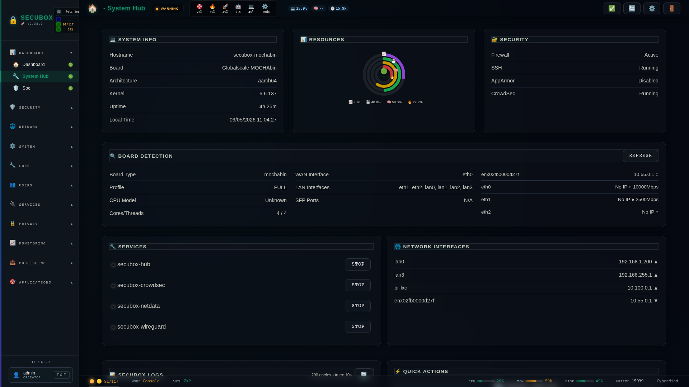

<!--
  SPDX-License-Identifier: LicenseRef-CMSD-1.0
  Copyright (c) 2026 CyberMind — Gérald Kerma <devel@cybermind.fr>
  Source-Disclosed License — All rights reserved except as expressly granted.
  See LICENCE-CMSD-1.0.md for terms.
-->

# ⚙️ System Hub

System configuration and management

**Category:** System

## Screenshot



## Features

- Settings
- Logs
- Services
- Updates

## Installation

```bash
# Add SecuBox repository
curl -fsSL https://apt.secubox.in/install.sh | sudo bash

# Install package
sudo apt install secubox-system
```

## Configuration

Configuration file: `/etc/secubox/system.toml`

## API Endpoints

- `GET /api/v1/system/status` - Module status
- `GET /api/v1/system/health` - Health check
- `GET /api/v1/system/io` - Entrées/sorties (#3907) : débits, IOPS et % occupé par disque physique, pression `/proc/pressure` (avg10), swap (pages/s), 5 services qui écrivent le plus (`io.stat` des cgroups) ; débits entre deux appels (`intervalle_s` null au premier)
- `POST /api/v1/system/settings` `{"hostname"?, "timezone"?}` (`require_jwt`) — nom de la box par l'unité root
  `secubox-systeme-renommer@<nom>.service` (root, bac à sable : système en lecture seule sauf `/etc`, `/run`,
  `/var/log/secubox`) → `/usr/sbin/secubox-renommer` (secubox-core >= 1.8.10 : hosts, secubox.conf,
  hostnamectl, Avahi, audit, retour arrière) ; le code de sortie est relu (`ExecMainStatus`) et rendu : 400 nom invalide
  ou réservé, 409 nom déjà pris au maillage, 500 écriture ou audit impossible, 502 hostnamectl en échec, 504 délai,
  503 systemctl absent ; chaque démarrage audité (`service_control`). Fuseau : `timedatectl set-timezone`, permis par
  la règle polkit au seul sujet `secubox-system.service` ; échec rendu en 502 (#3242). Jamais de `{"success": true}`
  muet.
  Le nom actuel (comparé à `gethostname()`, sans casse) n'est pas un renommage : un fuseau seul passe même sur une box
  nommée `secubox` (réservé). La page n'envoie `hostname` que s'il a changé. Règle polkit : l'unité
  `secubox-systeme-renommer@<nom>` n'est que démarrée (`start`), pour une instance au motif DNS seulement.
  Limites connues du renommage :
  - acteur dans l'audit : par l'unité `secubox-systeme-renommer@`, `box_renommee` est audité avec l'acteur `root` ;
    l'administrateur réel n'apparaît que dans la ligne `service_control` de l'API ;
  - alias de `/etc/hosts` : une ligne 127.0.1.1 qui ne porte ni l'ancien ni le nouveau nom est retirée avec ses alias,
    et la nouvelle ligne est ajoutée en fin de fichier ;
  - instances en échec : une instance `secubox-systeme-renommer@<nom>` en échec reste listée par `systemctl --failed`
    jusqu'à un `reset-failed` ;
  - durcissement : les deux unités de renommage (celle-ci et l'unité transitoire du ctl de pilotage) gardent leur bac à
    sable actuel ; une borne plus stricte (`CapabilityBoundingSet`, `RestrictAddressFamilies=AF_UNIX`) reste à mesurer
    au banc.

## License

LicenseRef-CMSD-1.0 (Source-Disclosed License) — CyberMind © 2024-2026.
See [LICENCE-CMSD-1.0.md](../../LICENCE-CMSD-1.0.md).

## Pilotage distant (#3126, L5)

`pilotage/routes-ouvertes.d/system.toml`, installé dans `/usr/share/secubox/pilotage/routes-ouvertes.d/` (root, 0644),
déclare les seules écritures que le porteur délégué du pilotage (portée `admin`) peut faire sur ce module : celles
qu'appellent ses pages. Toute autre écriture déléguée est refusée par `secubox_core.auth` (403) ; les lectures
restent soumises à la liste de refus (secrets). Voir le README de secubox-core.

`download_diagnostic` et `delete_diagnostic` n'acceptent qu'un nom `<nom>.json` du dossier des diagnostics (1.11.6).

`/reboot`, `/shutdown`, `/apply_updates`, `/check_updates`, `/settings`, `/service_control`, `/service_action`,
`/restart_services`, `/reload_firewall`, `/kiosk/*`, `/backup` et `/set_backup_schedule` ne sont PAS ouvertes au jeton
délégué (R-L5-15, R-L5-16) : les premières passent par les actions du pilotage (L2). `POST /check_updates` et
`POST /run_diagnostic_test` (GET avant 1.11.6).

## Nom du nœud (#3824, #3883)

Panneau « Nom du nœud » de la page Système : l'interrupteur du **relais des autres chemins** du nom public
(`<nœud>.<zone>`) vers l'ancienne cible de sa route, **fermé par défaut** (le nom ne sert que le dé SecuBox et
`/api/v1/health`). Il montre le nom, ce qui est toujours servi, l'état (404 — FERMÉ / RELAYÉS), l'ancienne cible et,
ouvert, la liste des chemins relayés publiquement. Bascule confirmée dans le panneau ; ouvrir est impossible tant que le
mot de passe par défaut est actif ou sans ancienne cible. La carte ne dépend plus du Hall (#3883 : la route était
`/api/v1/webos/noeud/relais` de secubox-webos) :

| Méthode | Route | Garde | Effet |
|---|---|---|---|
| GET | `/api/v1/system/noeud/relais` | `require_jwt` | état : `domaine`, `relais_api`, `relais_actif`, `vhost`, `cible`, `chemins_cible`, `source_chemins`, `servis`, `mot_de_passe_defaut` |
| POST | `/api/v1/system/noeud/relais` | `require_jwt` | `{"actif": bool}` → l'état et `success` ; **409** pour ouvrir tant que le mot de passe admin par défaut est actif (#3401) ; 500 si `nginx -t` refuse (réglage et vhost remis) |

Même contrat JSON qu'avant. L'API (secubox, `NoNewPrivileges`) ne lance rien en root : elle dépose `<id>.demande` dans
`/run/secubox/noeud`, traitée par `secubox-noeud.path` → `secubox-noeud traite` de **secubox-core ≥ 1.8.40** (voir son
README : réglages `/etc/secubox/noeud/noeud.toml`, audit) ; résultat relu dans `/run/secubox/noeud-resultats/<id>.json`.
`secubox-noeud` absent (cœur trop ancien) : **404**, et la carte affiche « secubox-core trop ancien ». 503 si le dépôt
est impossible, 504 sans réponse sous 30 s.

## Accès SSH (#3401)

| Méthode | Route | Garde | Effet |
|---|---|---|---|
| GET | `/api/v1/system/ssh` | `require_jwt` | état : service, mot de passe permis, garde du mot de passe par défaut |
| POST | `/api/v1/system/ssh/acces` | `require_jwt` | `{"actif": bool}` active / désactive `ssh.service` |
| POST | `/api/v1/system/ssh/mot-de-passe` | `require_jwt` | `{"actif": bool}` ; **409** tant que le mot de passe par défaut est actif |

Écritures par `secubox-sshctl` (root), **sans sudo** : l'API dépose une demande dans `/run/secubox/system/ssh`, `secubox-ssh.path` la fait traiter par `secubox-ssh.service` (unité durcie), résultat relu dans `/run/secubox/system/ssh-resultats/`. Drop-ins `/etc/ssh/sshd_config.d/05-secubox-mot-de-passe-defaut.conf` (garde, posée/levée par `secubox-ssh-garde.path` au changement de `users.json` ou de `/etc/shadow`) et `10-secubox-ssh-mot-de-passe.conf` (choix de l'administrateur), validés par `sshd -t` puis `sshd -T -C` (root et admin depuis une adresse publique), défaits et audités sinon. « Défaut actif » = mot de passe Linux (root ou tout compte, `secubox-ssh-defaut`, crypt) OU web admin égal au défaut ; inconnu = actif. Au retrait du paquet, la garde n'est enlevée que si le défaut est prouvé changé.
