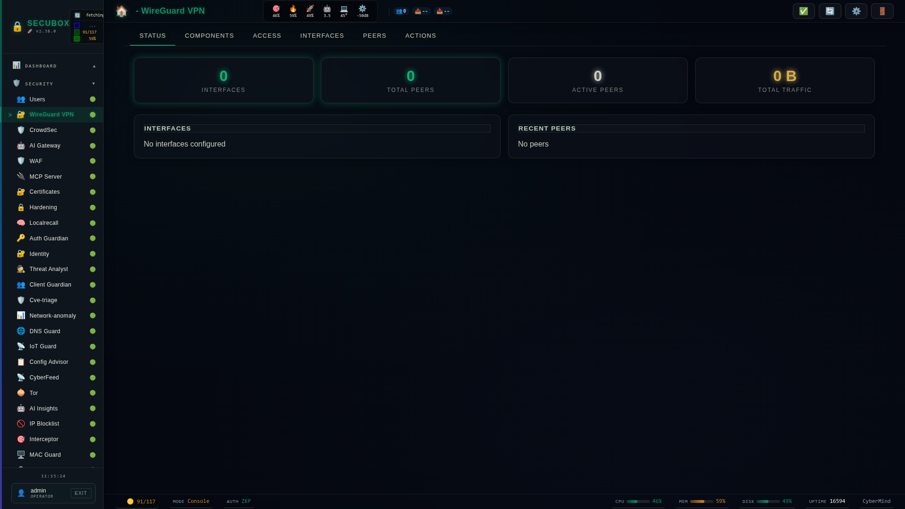

<!--
  SPDX-License-Identifier: LicenseRef-CMSD-1.0
  Copyright (c) 2026 CyberMind — Gérald Kerma <devel@cybermind.fr>
  Source-Disclosed License — All rights reserved except as expressly granted.
  See LICENCE-CMSD-1.0.md for terms.
-->

# 🔗 WireGuard VPN

Modern VPN with kernel integration

**Category:** VPN

## Screenshot



## Features

- Peer management
- QR codes
- Traffic stats
- Multi-tunnel

## Installation

```bash
# Add SecuBox repository
curl -fsSL https://apt.secubox.in/install.sh | sudo bash

# Install package
sudo apt install secubox-wireguard
```

## Configuration

Configuration file: `/etc/secubox/wireguard.toml`

### Serveur « sortie Internet » (#2845)

```
wgctl serveur init --endpoint lgm-ebin.secubox.in:51840   # root seulement
wgctl peer add telephone wg-clients
```

Crée `wg-clients` (10.66.0.1/24, udp/51820), une table nft `secubox_wg_clients` (forward + masquerade) et active `wg-quick@wg-clients`.
`--endpoint` est écrit dans `/etc/secubox/wireguard-endpoint` : c'est le point d'accès des configurations clientes, utile derrière un NAT (relais UDP sur l'infrastructure).

## API Endpoints

- `GET /api/v1/wireguard/status` - Module status
- `GET /api/v1/wireguard/health` - Health check

## License

LicenseRef-CMSD-1.0 (Source-Disclosed License) — CyberMind © 2024-2026.
See [LICENCE-CMSD-1.0.md](../../LICENCE-CMSD-1.0.md).
