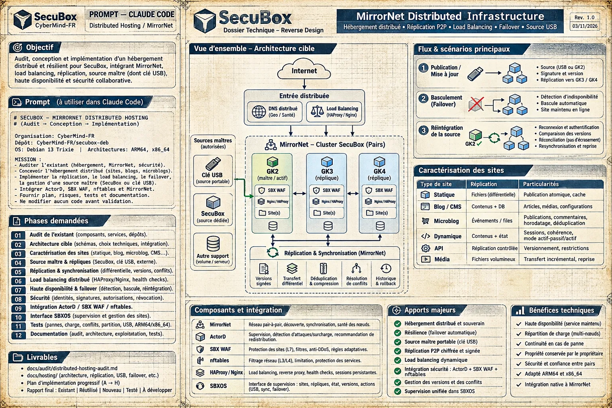
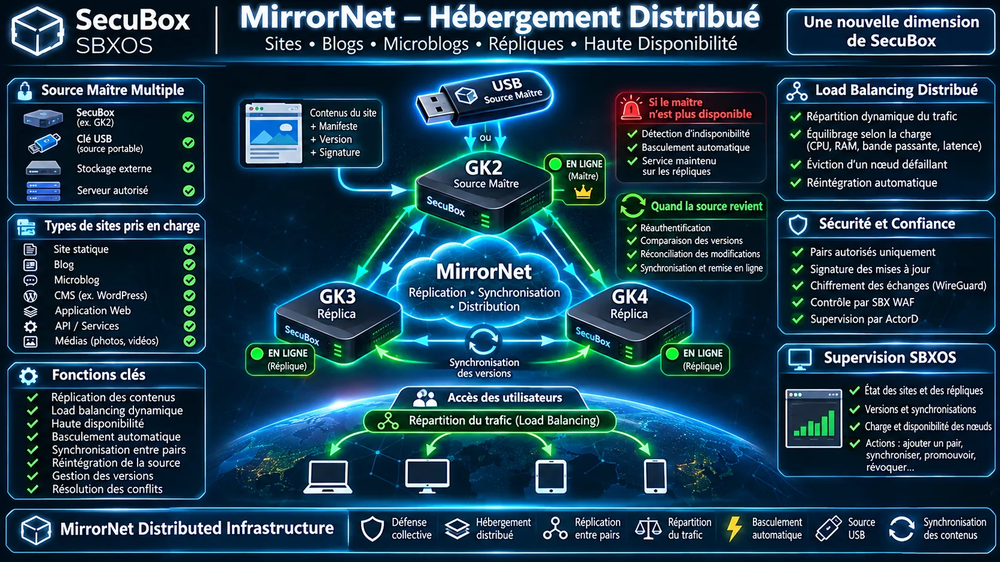
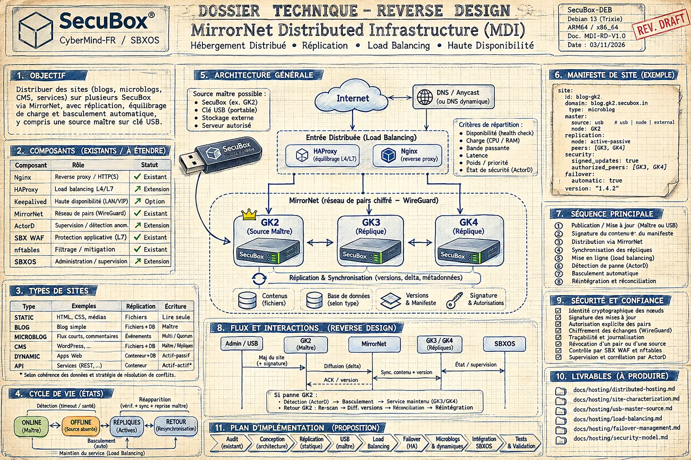
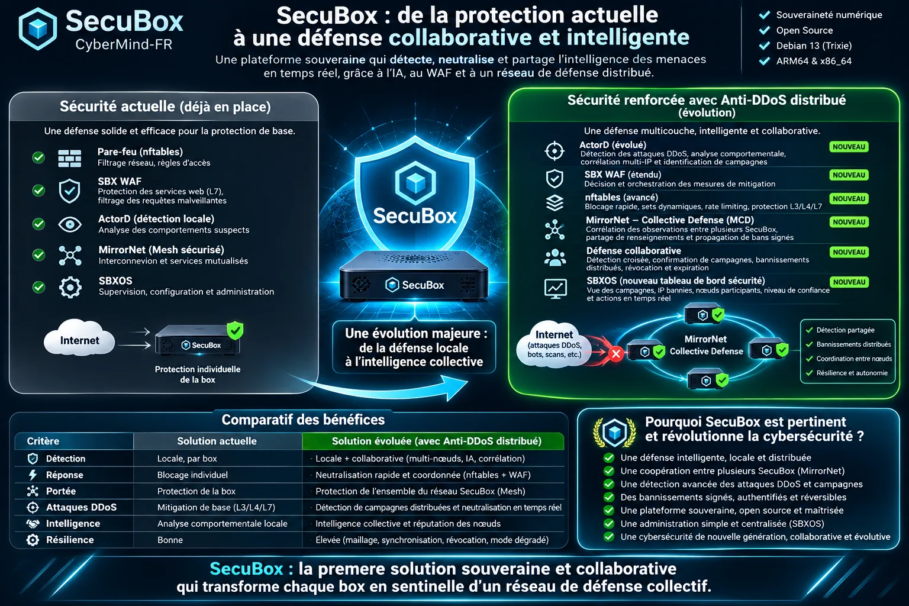
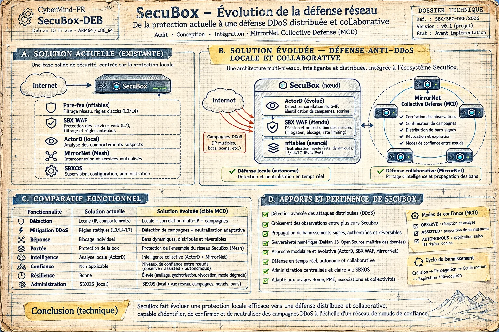

<!--
  SPDX-License-Identifier: LicenseRef-CMSD-1.0
  Copyright (c) 2026 CyberMind — Gérald Kerma <devel@cybermind.fr>
  Source-Disclosed License — All rights reserved except as expressly granted.
  See LICENCE-CMSD-1.0.md for terms.
-->

# MirrorNet — infrastructure distribuée

> **Un site appartient à son propriétaire, pas à son serveur.** Une SecuBox ne se défend plus seule : le réseau de
> SecuBox se défend collectivement et héberge ensemble les sites de ses propriétaires.

Cible de conception des versions **Alpha 21 et Alpha 22**, avant la bêta. Ces planches décrivent ce qui est visé, pas
ce qui existe déjà : l'état réel est établi par les audits cités plus bas.

## Un programme commun

MirrorNet est le socle commun de cette évolution : une SecuBox devient un nœud d'infrastructure autonome, capable de
coopérer avec les autres, de partager ses ressources et de garder les services disponibles. La défense collective et
l'hébergement distribué ne sont pas deux projets séparés mais deux usages du même réseau de pairs.

| Brique | Responsabilité |
|---|---|
| MirrorNet | réseau pair-à-pair chiffré entre SecuBox |
| Distributed Hosting | hébergement distribué des sites |
| Peer Replication | réplication des contenus entre pairs |
| Load Balancing | répartition du trafic, sans point central |
| Failover | continuité de service et réintégration |
| USB Master | source portable et souveraine d'un site |
| ActorD | intelligence et orchestration de la défense |
| SBX WAF | défense applicative |
| Federated Trust | confiance entre pairs : TRUSTED, PARTNER, LIMITED, OBSERVER, REVOKED |
| Node Reputation | fiabilité des participants, explicable et réversible |
| SBXOS | interface de pilotage : MIRRORNET > DISTRIBUTED INFRASTRUCTURE |

Méthode : audit de l'existant, puis conception technique, puis implémentation après validation du propriétaire.
Aucune proposition n'est présentée comme déjà réalisée.

## Hébergement distribué (MDI)

Un site, un blog ou un microblog est servi par plusieurs SecuBox à la fois. Sa **source maître** peut être une
SecuBox, une **clé USB signée**, un stockage externe ou un serveur autorisé ; les **répliques** sont tenues par les
pairs MirrorNet. Si le maître disparaît, les répliques continuent de servir le site ; à son retour, les versions sont
comparées et réconciliées, sans jamais écraser une modification plus récente.

Choix arrêtés :

- manifeste par site en TOML : `/etc/secubox/sites/<nom>.toml` ;
- écriture selon le type de site : statique en lecture seule, blog écrit par le maître, microblog multi-écriture avec
  quorum, CMS écrit par le maître, application dynamique en actif-passif, API en actif-actif si la cohérence est
  garantie ;
- basculement automatique pour la lecture ; promotion d'un CMS en maître écrivain toujours manuelle ;
- keepalived seulement pour l'adresse virtuelle d'un site sur un même LAN, jamais pour la passerelle ;
- mises à jour signées (OpenPGP), pairs autorisés explicitement, révocation d'une clé USB perdue.

## Défense collective (MCD)

ActorD détecte et comprend les attaques, SBX WAF décide, nftables neutralise, MirrorNet partage le renseignement et
propage des bannissements **signés, datés et révocables**. Chaque box garde sa propre politique : OBSERVE, ASSISTED ou
AUTONOMOUS. Un site servi par plusieurs nœuds permet de corréler par site les attaques vues par chacun.

## Calendrier

| Version | Contenu |
|---|---|
| Alpha 21 | correctifs de validation ; images par matériel de référence sur le profil lite (Pi 4/400 HDMI, Pi 4 + écran 7\" tactile, MOCHAbin, ESPRESSObin, PC/VM) avec montée de profil depuis premier pas ; durcissement local anti-DDoS ; fondations de l'hébergement distribué (manifeste, source maître dont USB signée, réplication des sites statiques, identifiant de site transmis au WAF) ; SecuBox mobile |
| Alpha 22 | détection des campagnes DDoS et défense collective signée ; réplication des blogs, microblogs et CMS ; répartition de charge et basculement |
| Bêta | validation sur matériel réel et banc multi-box |

## Pour aller plus loin

- Audit de l'existant, hébergement : `docs/audit/distributed-hosting-audit.md`
- Caractérisation des sites : `docs/hosting/site-characterization.md`
- Audit de l'existant, défense : `docs/audit/ddos-defense-audit.md`
- Suivi : programme #3429, issues #3420 (hébergement) et #3417 (défense)
